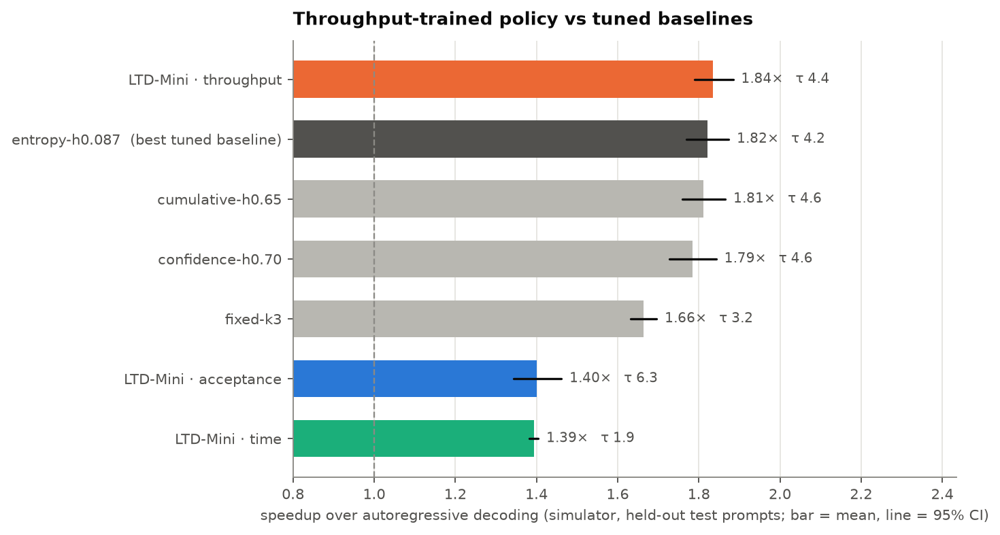
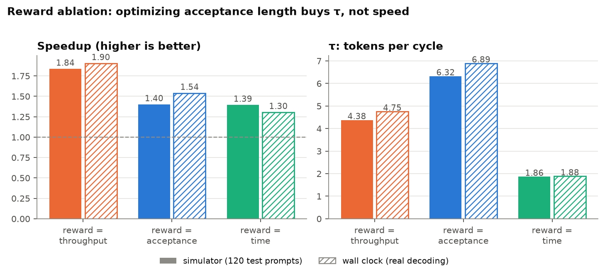
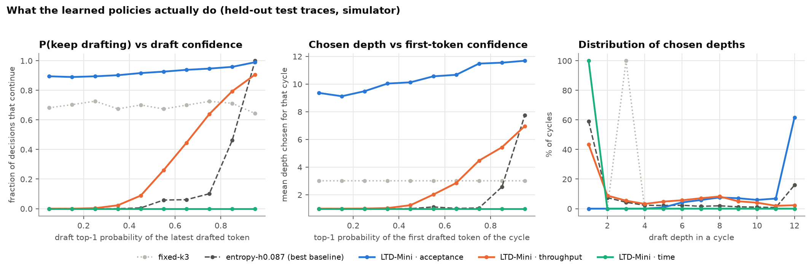
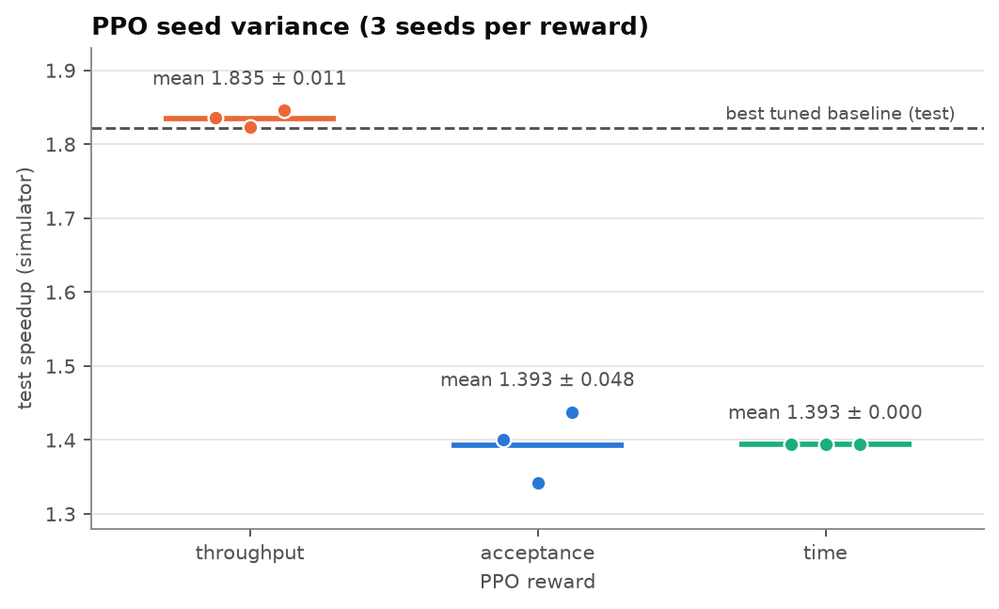
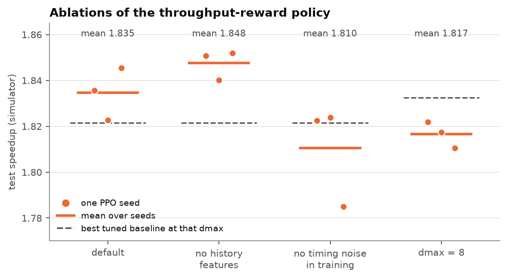
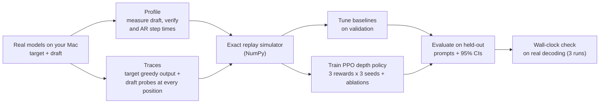
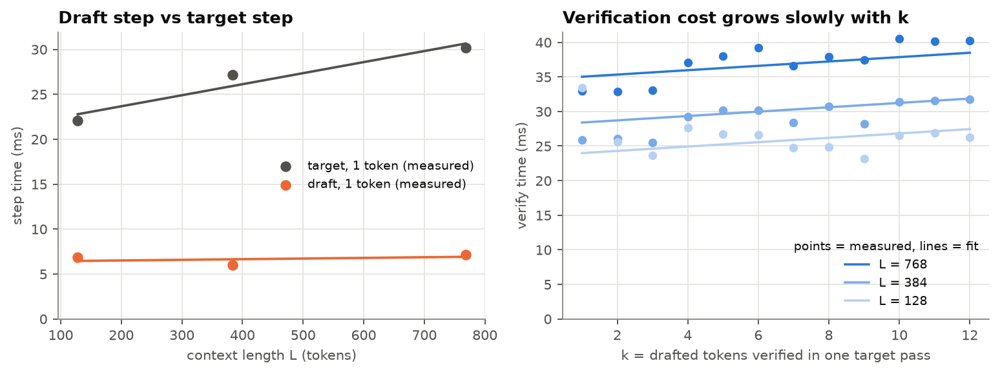

<div align="center">

# LTD-Mini

### *Learning to Draft*, on a laptop.

A zero-cost, small-scale replication of **[Learning to Draft: Adaptive Speculative Decoding with Reinforcement Learning](https://arxiv.org/abs/2603.01639)** (Zhang et al., **ICLR 2026**) — trained, simulated and benchmarked entirely on an 8 GB Apple Silicon MacBook.

[](https://github.com/DMgaming00/learning-to-draft-mini/actions/workflows/ci.yml)


-black)



</div>

---

> **Does optimizing *measured throughput* with reinforcement learning beat optimizing *acceptance length* when choosing how far to draft?**
> The paper says yes, on 8B–32B models and data-center GPUs. LTD-Mini tests the same claim on a laptop, with an exact simulator, tuned baselines, confidence intervals, seeds, ablations and wall-clock validation.

## TL;DR — what we found

Every number comes from [`results/gpt2m-distilgpt2/`](results/gpt2m-distilgpt2/REPORT.md) (GPT-2 medium target, DistilGPT-2 draft, MPS fp16, held-out test prompts).

| | Finding |
|---|---|
| **Reward ablation reproduces** (RQ2) | The throughput reward wins. The acceptance reward gets the **longest τ (6.3 tokens/cycle) but a much lower speedup (1.40×)**, exactly the paper's "optimize the wrong thing" pattern. Same ordering on the wall clock. |
| **It beats naive, but only ties tuned baselines** (RQ1) | The throughput policy beats the best fixed depth by **+0.19×** (paired CI [+0.16, +0.22]) — but vs the best *tuned* training-free baseline the difference is **+0.010 [−0.019, +0.038]**, not significant. Over 3 PPO seeds: **1.835 ± 0.011×** vs 1.821× for the best baseline. |
| **Honest negative result** | A first PPO setup (whole-sequence episodes) collapsed to a constant depth for every reward; we diagnosed and fixed it (one draft-verify cycle per episode) — see [Methodology](#what-went-wrong-first). |
| **The simulator is a good predictor** (RQ4) | Throughput policy: 1.84× simulated vs 1.90× measured. Across 3 independent wall-clock runs each policy's mean speedup varies by 0.03–0.06×. |
| **Lossless in practice** | In **fp32** the speculative decoder reproduces the target's greedy output in **112 / 112** decodes on MPS and **28 / 28** on CPU. In fp16 on MPS, **90 of 672 decodes (13%)** diverge — deterministically and on specific prompts (near-tied logits), not because of the decoder; see [Correctness](#correctness). |

## Results

Simulated: 120 held-out prompts (30 each from MT-Bench, GSM8K, Alpaca, Natural Questions), 95% bootstrap CIs. Wall clock: 32 held-out prompts × 3 independent runs on the real models. τ = mean tokens produced per draft-verify cycle.

| Policy | Simulated speedup [95% CI] | τ (sim) | Wall-clock speedup [95% CI] |
|---|---|---|---|
| **LTD-Mini, throughput reward** | **1.84×** [1.79, 1.88] | 4.38 | **1.90×** [1.81, 1.99] |
| Best entropy-stop (SVIP-style), tuned | 1.82× [1.77, 1.87] | 4.16 | 1.86× [1.76, 1.96] |
| Best cumulative-confidence stop (SpecDec++-style), tuned | 1.81× [1.76, 1.87] | 4.56 | 1.89× [1.79, 2.00] |
| Best confidence-stop, tuned | 1.79× [1.73, 1.84] | 4.65 | 1.87× [1.75, 1.98] |
| Best fixed depth (k=3), tuned | 1.66× [1.63, 1.70] | 3.25 | 1.70× [1.64, 1.75] |
| LTD-Mini, acceptance reward | 1.40× [1.34, 1.46] | **6.32** | 1.54× [1.40, 1.68] |
| LTD-Mini, time reward | 1.39× [1.38, 1.40] | 1.86 | 1.30× [1.28, 1.33] |

<p align="center">

</p>

**What the learned policy does.** It is a smooth, learned version of a confidence rule: it keeps drafting only when the draft is confident, and it starts doing so at a lower confidence (around 0.5–0.6) than the tuned entropy rule, which only switches on above about 0.8 (left panel: orange = throughput policy, dark dashed = tuned entropy baseline).

<p align="center">

</p>

### Robustness (3 PPO seeds each, plus ablations)

| Variant | Per-seed test speedup | Mean ± std | vs best tuned baseline (paired) |
|---|---|---|---|
| throughput reward (default) | 1.836, 1.823, 1.845 | 1.835 ± 0.011 | +0.009 (0 of 3 seeds significant) |
| acceptance reward | 1.400, 1.342, 1.438 | 1.393 ± 0.048 | −0.390 (3 of 3 significantly worse) |
| time reward | 1.393, 1.393, 1.393 | 1.393 ± 0.000 | −0.466 (3 of 3 significantly worse) |
| no history features | 1.851, 1.840, 1.852 | 1.848 ± 0.006 | +0.010 |
| no timing noise in training | 1.822, 1.824, 1.785 | 1.810 ± 0.022 | −0.015 (1 of 3 seeds significantly worse) |
| dmax = 8 | 1.822, 1.817, 1.811 | 1.817 ± 0.006 | −0.015 vs the dmax-8 baselines |

<p align="center">
 
</p>

The full write-up, with every table and figure, is in **[`report/report.md`](report/report.md)**; the machine-generated source of every number is **[`results/gpt2m-distilgpt2/REPORT.md`](results/gpt2m-distilgpt2/REPORT.md)**; per-question interpretation is in **[`docs/RESULTS.md`](docs/RESULTS.md)**.

## What is speculative decoding, and what does the paper add?

LLMs generate one token per forward pass, and each pass must read every weight from memory — so decoding is
**memory-bound**. **Speculative decoding** lets a small *draft* model propose several tokens, then the large
*target* model checks them all in **one** pass. Accepted tokens are free speed; a mathematically exact
acceptance rule guarantees the output is identical to the target's own.

The catch is **how far to draft**. Drafting too little wastes the expensive target pass; drafting too much
wastes draft time on tokens that get rejected. Existing adaptive methods stop drafting based on proxies like
draft confidence or *expected acceptance length*. **Learning to Draft** argues the right objective is the one
you actually care about — **accepted tokens per second** — and learns it with PPO.

## What LTD-Mini replicates

| | Paper | LTD-Mini |
|---|---|---|
| Throughput reward, PPO (Stable-Baselines3), rollout 2048 / batch 256 | ✓ | ✓ |
| Depth policy (binary continue/stop after each draft pass) | ✓ | ✓ |
| Reward ablation: throughput vs acceptance length vs time cost (Table 2) | ✓ | ✓ |
| Train on HumanEval; test on MT-Bench, GSM8K, Alpaca, Natural Questions | ✓ | ✓ (small samples) |
| Tuned training-free baselines (fixed depth via grid search, confidence/entropy stopping) | ✓ | ✓ |
| Episode = one draft-verify cycle | not specified in what we read | ✓ (documented deviation, [why](#what-went-wrong-first)) |
| Eagle3 **tree** drafting, **size policy**, iterative co-training | ✓ | ✗ chain drafting, depth policy only (v2) |
| 8B–32B targets on data-center GPUs | ✓ | ✗ **GPT-2 medium (355M) / DistilGPT-2 (82M)** on a Mac |
| Temperature 1 | ✓ | ✗ greedy only (stochastic acceptance implemented and tested for v2) |

The paper's own ablation finds the **depth policy contributes most** of the gain, so it is the right component to replicate first. Full details: [`docs/METHOD.md`](docs/METHOD.md).

**Why these models?** The first plan (Qwen2.5-1.5B/0.5B) exhausted RAM and swap on an 8 GB laptop, and SmolLM2-360M/135M had a draft only ~0.56× as expensive as its target on MPS (both launch-bound, 32 vs 30 layers), leaving almost no room for speculation. We measured four pairs and picked GPT-2 medium / DistilGPT-2 (draft step ≈ 0.2× a target step) — the table is in the [report](results/gpt2m-distilgpt2/REPORT.md#model-pair-selection) and reproducible with `python scripts/compare_pairs.py`.

## How it works



**The trick that makes laptop-scale RL possible.** The paper trains for a million steps against real GPU
decoding. LTD-Mini instead uses a fact about greedy speculative decoding: *the output is the target's greedy
output no matter which draft depths you choose.* So for every position of that output, we record once what the
draft would propose and how many proposals the target would accept. Any depth policy can then be **replayed
exactly** — same features, same accepted counts as real decoding — in microseconds. Only step times come from a
cost model fitted to measurements on your machine. A test proves the replay matches the real decoder
cycle-for-cycle, and the final evaluation runs on real models with wall-clock time.

<p align="center">

</p>

## Quickstart

```bash
git clone https://github.com/DMgaming00/learning-to-draft-mini && cd learning-to-draft-mini
python -m venv .venv && source .venv/bin/activate
pip install -e ".[all]"

make test        # 31 unit tests (NumPy) + real-decoder tests with tiny random models (no download)
make demo        # synthetic end-to-end pipeline in about a minute (not results)
make smoke       # full pipeline with random tiny models: profile -> traces -> tune -> train -> eval -> report
make small       # the real run: GPT-2 medium / DistilGPT-2  (~1.5 h, dominated by trace building)
make robust      # 3 PPO seeds x 3 rewards + ablations + policy behaviour (~20 min, CPU)
```

Each run writes everything to `results/<run>/`, including `REPORT.md` with tables and figures. The main run's small
artifacts (traces, policies, results, figures) are committed, so you can re-run the simulator stages without
downloading any model:

```bash
ltdmini tune      --config configs/small.yaml
ltdmini train     --config configs/small.yaml --reward all
ltdmini eval-sim  --config configs/small.yaml
ltdmini robust    --config configs/small.yaml --seeds 3
ltdmini behaviour --config configs/small.yaml
ltdmini report    --config configs/small.yaml
```

Stages that need the real models (they download them from Hugging Face, free):

```bash
ltdmini profile   --config configs/small.yaml
ltdmini traces    --config configs/small.yaml
ltdmini eval-real --config configs/small.yaml --n-prompts 8            # wall clock; repeat with --tag _run2, _run3
python scripts/compare_pairs.py                                       # model-pair selection table
```

`configs/tiny.yaml` (SmolLM2) and `configs/mac.yaml` (Qwen2.5) are kept for machines where they work, but **no result in this repository comes from them**.

## Research questions and answers

1. **RQ1.** *Does a PPO depth policy trained on throughput beat tuned training-free policies on held-out prompts?*
   — **It beats fixed depth (+0.19×, significant) but ties the best tuned adaptive baseline** (+0.010, CI [−0.019, +0.038]); same conclusion over 3 seeds and on the wall clock (+0.012 [−0.049, +0.070]).
2. **RQ2.** *Does the throughput reward beat acceptance-length and time-cost rewards — and does the acceptance reward produce longer τ but lower speedup?*
   — **Yes to both.** Acceptance: τ 6.32, speedup 1.40×. Time: τ 1.86, speedup 1.39×. Throughput: τ 4.38, speedup 1.84×. (Simulated acceptance and time are indistinguishable from each other; on the wall clock acceptance > time as in the paper.)
3. **RQ3.** *Does a policy trained on code transfer to chat, math and QA?*
   — **Yes, with no sign of breakdown:** it is trained only on HumanEval and its simulated speedup on the four unseen sets ranges from 1.77× (NQ) to 1.89× (GSM8K), with confidence intervals that overlap those of the tuned baselines on each set (no per-set paired test was run; [per-set figure](results/gpt2m-distilgpt2/figures/by_dataset.png)).
4. **RQ4.** *Do simulated speedups predict wall-clock speedups?*
   — **Closely for the competitive policies** (all within ≈0.1×), **less so for the extremes:** time-reward 1.39× simulated vs 1.30× measured; acceptance-reward 1.40× vs 1.54× ([figure](results/gpt2m-distilgpt2/figures/sim_vs_real.png)).

A "no" to RQ1 is a real finding, not a failure: with a cheap draft and a nearly flat verification cost on this hardware, a good confidence rule already captures nearly all of the gain.

## Correctness

| What | How it's checked |
|---|---|
| Acceptance rule is lossless | Chi-square test that the first emitted token follows the target distribution for random draft/target pairs (`tests/unit/test_sampling.py`) |
| Speculative decoding = target greedy | Token-exact equality across 5 policies × 4 prompts with tiny models in fp32 (`tests/torch/test_specdec.py`); and on the real models: fp32 on MPS **112/112** decodes exact (7 policies × 16 prompts), fp32 on CPU **28/28** exact (reduced setting: 4 prompts × 7 policies, 64 new tokens); fp16 on MPS: 90 of 672 decodes diverge (explained in the report) |
| KV-cache rollback | Covered by the equality tests and an EOS test; works across `transformers` versions via a version-safe `crop_to` |
| Simulator is exact | Per-cycle (depth, accepted) sequence from replay equals the real decoder's (`test_simulator_replays_real_decoder_exactly`) |
| Simulator bookkeeping | Hand-computed cycles, token conservation, depth caps (`tests/unit/test_sim.py`) |
| Training environment | Episode = one cycle with that cycle's reward; feature masks for ablations (`tests/unit/test_gym_env.py`) |
| PPO export | The NumPy MLP reproduces Stable-Baselines3's deterministic actions exactly |
| fp16 on MPS | Every wall-clock row records the output-match rate and the first divergence index; see the [exactness table](results/gpt2m-distilgpt2/REPORT.md#output-exactness) |

## What went wrong first

The first PPO setup used one episode per whole generation. On the real traces it collapsed, for **every** reward and
every setting we tried, to a constant policy ("always stop" or "always draft to depth 12"): changing the discount,
reward normalization, entropy bonus, learning rate, or using Monte-Carlo advantages did not change that. (These were
scratch experiments and are described, not stored, in [`docs/METHOD.md`](docs/METHOD.md).) We did not isolate one
cause; the likely contributors are that a sum of per-cycle rates is not total throughput, that the summed acceptance
reward is constant, and that the return is dominated by how many tokens remain (not observable). Making **one
draft-verify cycle one episode** removes all three and gives each reward its paper definition; PPO then learned
immediately. The cost is that the policy is myopic (it maximizes each cycle's rate, not the sequence's), and its
history features during training come from random-depth warm-ups. Both are listed under limitations.

## Methodology choices worth knowing

- **Fair baselines.** Every baseline family is grid-searched on a validation split; the test split is never used for a choice. The "best tuned baseline" shown is the best of the four families on the test set, which slightly *favours* the baselines.
- **Uncertainty.** Speedups come with 95% bootstrap CIs over prompts; learned vs baseline uses paired bootstrap tests; learned policies are repeated over 3 PPO seeds; wall clock is repeated 3 times.
- **Honest timing.** Device-synchronized timers, warm-up runs, interleaved policy order per prompt, end-to-end time (prefill + decode) for both methods.
- **Reproducibility.** Every run records config, library versions, device and dtype; all numbers in the docs are generated from files in `results/`. (The git commit recorded in `environment.json` is the one at profiling time; the commit that produced the final results is the repository HEAD.)
- **Policy portability.** The PPO policy is exported to plain NumPy weights, so evaluation never depends on the RL library.

## Repository layout

```
src/ltdmini/
  sampling.py      greedy and stochastic (lossless) acceptance rules
  specdec.py       autoregressive + chain speculative decoding with KV-cache rollback
  features.py      depth-policy observation (shared by simulator and real decoder)
  traces.py        trace format + synthetic traces for tests
  build_traces.py  real traces: target greedy output + draft probes
  timing.py        measured linear cost model;  profile.py  measures it
  sim.py           exact replay simulator + reward variants
  gym_env.py       Gymnasium wrapper (one cycle per episode);  train.py  PPO training + NumPy export
  policies.py      fixed / confidence / entropy / cumulative baselines + learned MLP
  tune.py          validation grid search;  evaluate.py  test evaluation with CIs and paired tests
  robustness.py    PPO seeds, ablations, policy behaviour
  real_eval.py     wall-clock evaluation;  report.py + figures.py  REPORT.md and all figures
  cli.py           `ltdmini` command
scripts/compare_pairs.py   model-pair selection (cost ratio + agreement)
configs/           small (used) · small_cpu_fp32 / small_mps_fp32 (exactness) · smoke · tiny · mac
tests/unit         NumPy + gym tests (run anywhere)    tests/torch   real-decoder tests with tiny random models
results/           gpt2m-distilgpt2 (main run, committed) · model_selection · smollm2-360m-135m (negative profile)
docs/              paper summary · method & faithfulness · experiment protocol · results · report template
report/            the assignment write-up
```

## Limitations

- Chain drafting with a separate small model, not Eagle3 tree drafting; no size policy yet.
- Greedy decoding only; **base** GPT-2 models, so prompts are raw text and outputs are low quality (speculative decoding is lossless whatever the quality, but draft–target agreement may be unrepresentative of modern instruct models, and repetition in small base models can inflate it).
- Small models and small prompt samples (120 simulated, 32 wall-clock); results describe this hardware and these models, not 8B–32B serving.
- The learned policy is myopic (one-cycle episodes) and trained with history features from a random-depth warm-up.
- Simulator step times come from a linear cost model with a few ms of measurement noise; the wall-clock evaluation is the check on it, and it agrees to within ≈0.1× for the competitive policies.
- The throughput policy **ties** the best tuned baseline here; this repository does not show that RL beats tuned heuristics at this scale.

## Cite the original paper

```bibtex
@inproceedings{zhang2026learning,
  title     = {Learning to Draft: Adaptive Speculative Decoding with Reinforcement Learning},
  author    = {Zhang, Jiebin and Yu, Zhenghan and Wang, Liang and Yang, Nan and Yu, Eugene J. and Li, Zheng and
               Song, Yifan and Zhu, Dawei and Zhang, Xingxing and Wei, Furu and Li, Sujian},
  booktitle = {International Conference on Learning Representations (ICLR)},
  year      = {2026}
}
```

Official implementation: [zhzihao/Learning-to-Draft](https://github.com/zhzihao/Learning-to-Draft). This repository is an independent, from-scratch replication and is not affiliated with the authors.

## Author

**Dev Mulchandani** — M.S. Software Engineering, San José State University.
Also built [AgentOS](https://github.com/DMgaming00/AgentOS). MIT License.
