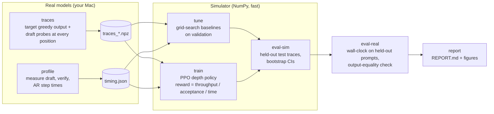

# Method: how LTD-Mini replicates *Learning to Draft* on a laptop

## Pipeline

## Why a simulator, and why it is exact

The paper trains for 1M PPO steps against real decoding on GPUs. On a laptop that would take weeks. LTD-Mini
instead trains in a **trace-replay simulator** and then **validates on real decoding**.

The key fact: **with greedy decoding, speculative decoding's output equals the target's greedy output no
matter which draft depths are chosen.** So we can:

1. Run the target greedily once per prompt to get the output `y`.
2. At every position `p` of `y`, let the draft propose `dmax` tokens from `prompt + y[:p]`, recording its top-1
   probability and entropy at each depth and how many proposals match `y[p:]`.

Any depth policy can then be replayed **exactly**: in each cycle it sees the same features it would see in
real decoding and gets exactly the accepted count the real target would give (this is verified by
`tests/torch/test_specdec.py::test_simulator_replays_real_decoder_exactly`). Only the step *times* come from a
model — a linear fit to times measured on your machine — with small multiplicative noise during training so the
policy does not overfit the cost model.

The real-decoding evaluation then checks whether simulated gains survive contact with wall-clock reality
(figure `sim_vs_real.png`).

## Faithfulness: what matches the paper and what does not

| Aspect | Paper | LTD-Mini | Why |
|---|---|---|---|
| Objective | Throughput reward per draft-verify cycle | **Same** (scaled by AR step time for PPO stability) | Core claim under test |
| Algorithm | PPO, Stable-Baselines3, rollout 2048, minibatch 256 | **Same** | Faithful |
| Episode definition | Not specified in the parts of the paper we read | **One draft-verify cycle per episode**, started at a random position of a random trace (after a random-depth warm-up so history features are populated) | Full-sequence episodes did not train (see below). Documented deviation; `DraftDepthEnv(episode="sequence")` keeps the original for comparison |
| Policy network | Lightweight MLP | MLP 64-64, tanh | Paper's exact sizes are in an appendix we did not have |
| Depth action | Binary continue/stop after each draft pass | **Same** | Faithful |
| Depth policy observation | Last-layer draft probabilities, D, L | top-1 prob, entropy, cumulative top-1, D, L, + 2 history features | Chain drafting has one token per layer; history features are cheap and documented |
| Drafting | Eagle3 **tree** drafting | **Chain** drafting with a separate small model | Eagle3 heads need training and large GPUs; chain drafting runs on a Mac |
| Size policy | Learns verification size 20–240 | **Not in v1** (degenerate for chains) | Paper's ablation: depth policy contributes most. v2 extension |
| Co-training | Alternating depth/size rounds | Not applicable in v1 | No size policy |
| Training data | HumanEval | **Same** (100 train prompts, 24 val prompts, disjoint) | Faithful |
| Test data | MT-Bench, GSM8K, Alpaca, NQ | **Same** sets, 30 prompts each (120 total) for the simulator; 8 each (32) for wall clock | Faithful; small samples |
| Models | 8B–32B targets with Eagle3 drafts | **GPT-2 medium (355M) target / DistilGPT-2 (82M) draft** (base models, prompts fed as raw text). `configs/tiny.yaml` (SmolLM2) and `configs/mac.yaml` (Qwen2.5) are kept but were **not used for results** | Chosen by measurement: SmolLM2 360M/135M had a draft step only ~0.58× a target step on MPS (both launch-overhead-bound), and Qwen2.5-1.5B/0.5B exhausted RAM+swap on an 8 GB Mac. See the model-selection table in the run report |
| Baselines | Eagle3 default + grid search, DDD, SVIP, Gammatune, Disco, SpecDec++, C2T | Fixed depth (grid search), confidence-stop, entropy-stop (SVIP-style), cumulative-confidence stop (SpecDec++-style), each tuned on validation | Same *families*, re-implemented for chains |
| Reward ablation | Throughput vs acceptance vs time | **Same three rewards** | Replicates Table 2 |
| Temperature | Greedy (main) + T=1 | Greedy only in v1 | Simulator exactness needs greedy; T=1 is a v2 extension |
| Metric | Speedup vs AR, τ | **Same**, plus 95% bootstrap CIs and paired tests | Small samples need uncertainty |

## Why one cycle per episode (a negative result we hit first)

With whole-sequence episodes (reward at the end of each cycle, return = sum over ~50-100 cycles) PPO collapsed to a
constant policy for every reward and every setting we tried on the gpt2-medium / distilgpt2 traces: always stop at
depth 1 (throughput, acceptance) or always draft to depth 12 (time). Changing gamma, reward normalization, entropy
bonus, learning rate or Monte-Carlo advantages did not help (these were scratch experiments, not stored in `results/`).
We did not isolate a single cause. Contributing factors we can reason about: the summed per-cycle rate is not total
throughput (it favours many short cycles); with gamma = 1 the summed acceptance reward equals the token count whatever
the policy does (no signal); and the return is dominated by the number of tokens remaining, which the observation does
not contain. Treating each cycle as its own episode removes all three: the reward is exactly the paper's per-cycle
reward and credit assignment is immediate. **Limitation:** the policy is myopic (it maximizes each cycle's rate, not
the sequence's total tokens over total time), and during training the history features come from a random-depth
warm-up policy rather than the learned policy's own history.

## Research questions

1. **RQ1 (main claim):** Does a PPO depth policy trained on throughput beat tuned training-free depth policies
   on held-out prompts?
2. **RQ2 (reward ablation, paper Table 2):** Does the throughput reward beat acceptance-length and time-cost
   rewards — and does the acceptance reward yield longer τ but *lower* speedup, as the paper found?
3. **RQ3 (transfer):** Does a policy trained on code (HumanEval) transfer to chat, math and QA prompts?
4. **RQ4 (sim-to-real):** Do simulated speedups predict wall-clock speedups on Apple Silicon?

A negative answer to RQ1 is a legitimate, reportable result. Explain it (e.g. hardware where verification of
extra tokens is almost free makes "always draft deep" near-optimal).

## Extensions (v2)

- **Tree drafting + size policy** with a custom 4D attention mask, then alternating co-training (paper Sec. 4.3).
- **Temperature 1:** stochastic acceptance is already implemented and tested in `sampling.py`; the simulator
  would then use sampled outcomes instead of exact replay.
- **Online fine-tuning** of the policy against real decoding for a few thousand steps.
- **More hardware:** compare M-series generations, or a free Kaggle T4.
