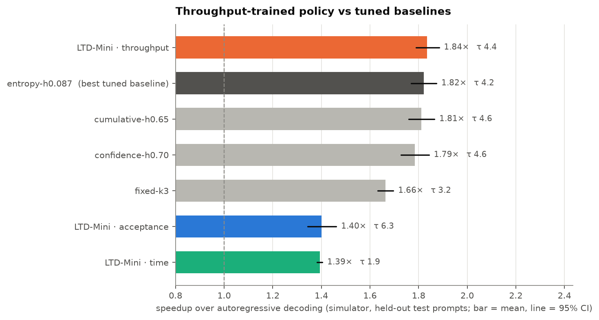
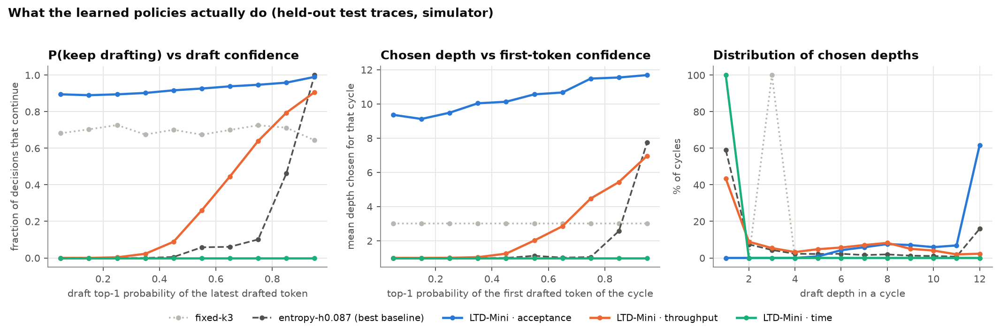
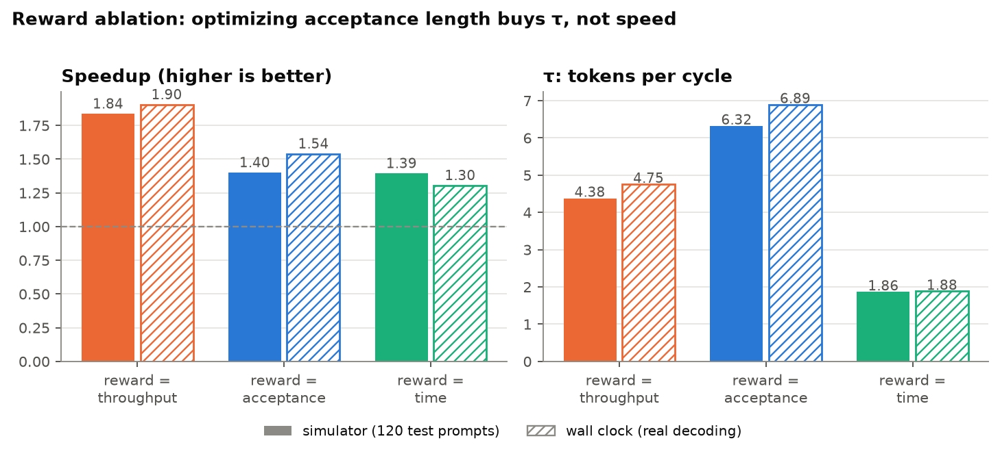
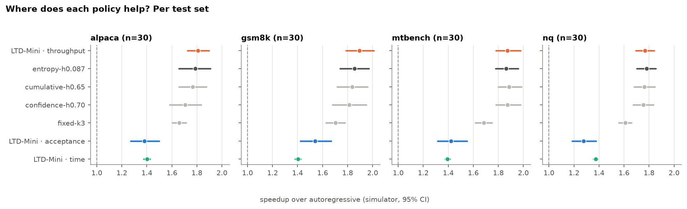
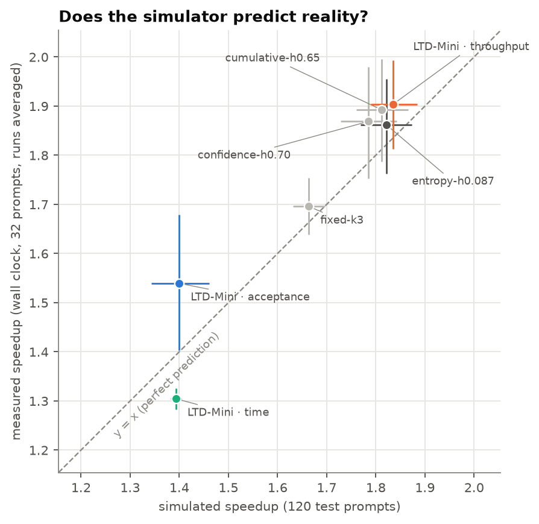
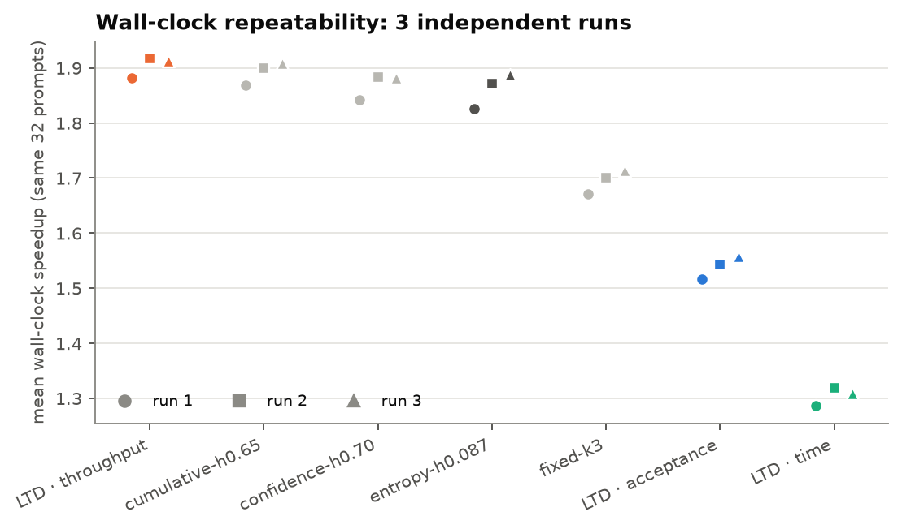
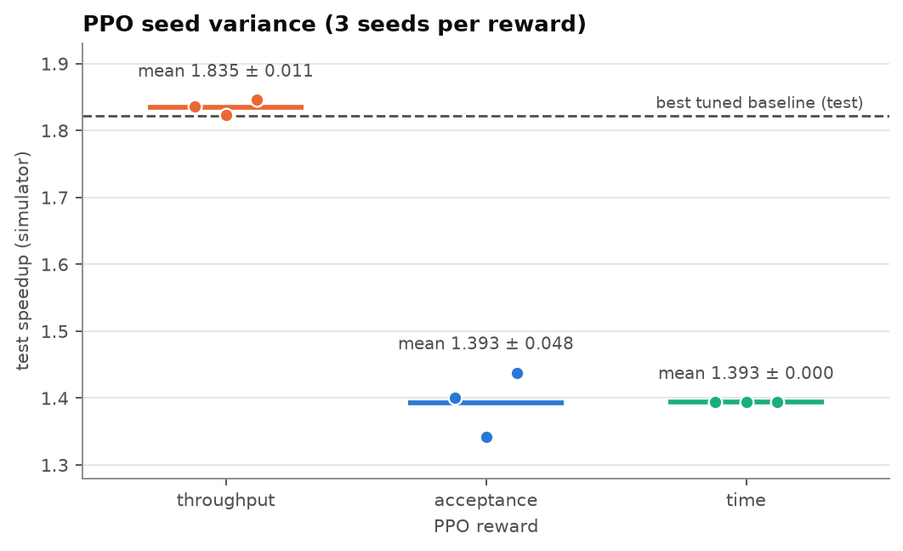
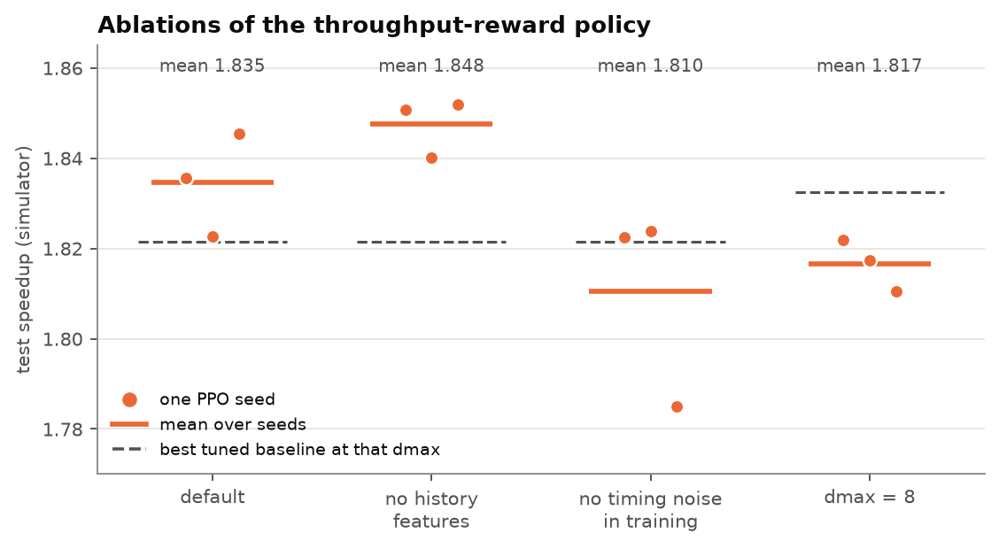

# Results

All numbers below are copied from [`results/gpt2m-distilgpt2/REPORT.md`](../results/gpt2m-distilgpt2/REPORT.md)
(generated by `ltdmini report` from the files in that folder). Setup: **GPT-2 medium (355M) target, DistilGPT-2 (82M)
draft**, Apple Silicon, MPS fp16, greedy decoding, chain drafting, depth policy only. Train = 100 HumanEval prompts,
validation = 24 disjoint HumanEval prompts, test = 30 prompts each from MT-Bench, GSM8K, Alpaca and Natural Questions
(120 total) for the simulator and 8 each (32 total) for wall clock. τ = mean tokens produced per draft-verify cycle.
Intervals are 95% bootstrap CIs over prompts.

## RQ1 — Learned depth policy vs tuned baselines

| Policy | Simulated speedup [95% CI] | τ | Wall-clock speedup [95% CI], 32 prompts × 3 runs |
|---|---|---|---|
| LTD-Mini, throughput reward | 1.84× [1.79, 1.88] | 4.38 | 1.90× [1.81, 1.99] |
| entropy-stop (tuned) | 1.82× [1.77, 1.87] | 4.16 | 1.86× [1.76, 1.96] |
| cumulative-confidence stop (tuned) | 1.81× [1.76, 1.87] | 4.56 | 1.89× [1.79, 2.00] |
| confidence-stop (tuned) | 1.79× [1.73, 1.84] | 4.65 | 1.87× [1.75, 1.98] |
| fixed depth k=3 (tuned) | 1.66× [1.63, 1.70] | 3.25 | 1.70× [1.64, 1.75] |

Paired differences (per-prompt speedup of the throughput policy minus the comparison policy):

| Comparison | Simulator | Wall clock |
|---|---|---|
| vs fixed-k3 | +0.190 [+0.160, +0.220], wins 87% | — (not computed) |
| vs best tuned baseline (entropy in the simulator, cumulative on the wall clock) | **+0.010 [−0.019, +0.038]**, wins 54%, not significant | **+0.012 [−0.049, +0.070]**, wins 62%, not significant |

Across 3 PPO seeds the throughput policy reaches 1.836, 1.823 and 1.845× (mean 1.835 ± 0.011); none of the three
seeds is significantly better or worse than the best baseline (1.821×).

**Interpretation.** The learned policy clearly beats the static, grid-searched fixed depth, but it **does not beat
the best tuned adaptive heuristic**: all four adaptive policies lie within about 0.05× of each other and their
intervals overlap. The honest reading is a tie. This is plausible on this hardware and model pair: the draft is cheap
(≈0.2× a target step) and verification cost is nearly flat in k (+0.3 ms per extra token on a ≈21 ms base), so once
a policy stops drafting when the draft is unconfident, little remains for a learned policy to gain. The paper's
margins over *grid-searched* baselines were also small on several models (~2–3%); we cannot distinguish a gain of
that size with 120 prompts. The "best baseline" shown is the best of four on the test set, which, if anything, favours
the baselines.

What the policy learned (test traces, simulator): the probability of continuing rises smoothly with the draft's
confidence — 0.26 / 0.45 / 0.64 / 0.79 / 0.91 in the confidence bins 0.5–0.6 … 0.9–1.0 — whereas the tuned entropy
rule is a sharp switch (0.06–0.10 below 0.8 confidence, then 0.46 and 1.00). Its mean chosen depth is 3.98, against 3.68
for the entropy rule and 3 for the fixed baseline.

## RQ2 — Reward ablation (throughput vs acceptance vs time)

| Reward | Simulated speedup | τ (sim) | Wall-clock speedup | Mean depth chosen |
|---|---|---|---|---|
| throughput | 1.84× [1.79, 1.88] | 4.38 | 1.90× [1.81, 1.99] | 3.98 |
| acceptance | 1.40× [1.34, 1.46] | **6.32** | 1.54× [1.40, 1.68] | 10.69 |
| time | 1.39× [1.38, 1.40] | 1.86 | 1.30× [1.28, 1.33] | 1.00 |

3-seed means: throughput 1.835 ± 0.011, acceptance 1.393 ± 0.048, time 1.393 ± 0.000 (every seed learned the same
constant depth-1 policy).

**Interpretation.** The paper's ordering, throughput > acceptance > time, is reproduced on the wall clock
(1.90 > 1.54 > 1.30) and throughput is far ahead in the simulator. The paper's specific finding that the
acceptance-length reward gives the *highest τ but a lower speedup* is reproduced cleanly: τ 6.32 (and 6.89 measured)
against 4.38 for throughput, at a 0.44× lower simulated speedup, because the policy drafts to depth ≈10.7 and pays
for tokens that are rejected. In the simulator the acceptance and time rewards are statistically indistinguishable
(1.40 vs 1.39), so the full ordering is only visible in the real measurements. The time reward is degenerate in our
setting: with one-cycle episodes, "minimize this cycle's time" is minimized by never drafting beyond one token.

## RQ3 — Transfer from code to chat, math and QA

| Policy (simulator) | alpaca | gsm8k | mtbench | nq |
|---|---|---|---|---|
| LTD-Mini, throughput | 1.81× [1.72, 1.90] | 1.89× [1.79, 2.01] | 1.87× [1.78, 1.98] | 1.77× [1.70, 1.84] |
| entropy-stop (tuned) | 1.79× [1.66, 1.91] | 1.86× [1.74, 1.97] | 1.86× [1.78, 1.96] | 1.78× [1.70, 1.85] |
| fixed-k3 | 1.66× [1.60, 1.71] | 1.70× [1.63, 1.78] | 1.68× [1.62, 1.75] | 1.61× [1.56, 1.66] |

**Interpretation.** The policy was trained only on HumanEval and shows no sign of breakdown on the four unseen sets:
its speedup ranges 1.77–1.89× and beats fixed depth on each. It is highest on GSM8K (τ 4.91) and lowest on Natural
Questions (τ 3.72), where the draft agrees with the target less. Compared with the tuned baselines, the per-set
intervals overlap everywhere; with 30 prompts per set we did not run (and could not power) a per-set paired test, so
we claim "transfers without degradation", not "improves on each set".

## RQ4 — Simulated vs wall-clock speedup

| Policy | Simulated | Wall clock (3 runs, 32 prompts) |
|---|---|---|
| throughput | 1.84× | 1.90× |
| entropy-stop | 1.82× | 1.86× |
| cumulative | 1.81× | 1.89× |
| confidence | 1.79× | 1.87× |
| fixed-k3 | 1.66× | 1.70× |
| acceptance | 1.40× | 1.54× |
| time | 1.39× | 1.30× |

**Interpretation.** For the five competitive policies the simulator is within about 0.1× of the measurement and
reproduces their ordering up to ties. It under-predicts the acceptance policy (1.40 vs 1.54) and over-predicts the
time policy (1.39 vs 1.30). Plausible causes (not isolated): the linear timing model has a few ms of measurement
noise, verification cost is not exactly linear in k (e.g. at L=768 the measured verify times for k≥4 sit above the fitted line),
and the wall-clock set is a different, smaller sample of prompts (32 vs 120). Wall-clock runs repeat to within 0.03–0.06×
across three runs made at different times, so the sim–real gaps for the acceptance and time policies (0.1×) exceed run-to-run noise.

## Robustness

| Variant (throughput reward) | Per-seed speedup | Mean ± std | Best tuned baseline at that dmax | Mean Δ (paired) |
|---|---|---|---|---|
| default | 1.836, 1.823, 1.845 | 1.835 ± 0.011 | entropy-h0.087 (1.821) | +0.009 |
| no history features | 1.851, 1.840, 1.852 | 1.848 ± 0.006 | entropy-h0.087 (1.821) | +0.010 |
| no timing noise in training | 1.822, 1.824, 1.785 | 1.810 ± 0.022 | entropy-h0.087 (1.821) | −0.015 |
| dmax = 8 | 1.822, 1.817, 1.811 | 1.817 ± 0.006 | cumulative-h0.65 (1.833) | −0.015 |

 

**Interpretation.** (a) *History features do not matter here*: removing them leaves the policy as good (1.848 vs 1.835,
within seed spread), so the two extra features are not needed for this setup. (b) *Timing noise*: training without it
gives a slightly lower mean (1.810) and one of three seeds is significantly worse than the best baseline, consistent
with the noise acting as a mild regularizer against over-fitting the fitted cost model — with only 3 seeds this is
suggestive, not established. (c) *dmax 8 vs 12*: 1.817 vs 1.835 (−0.018, a bit more than the seed std of 0.006–0.011); the tuned baselines also move
(the best becomes cumulative-h0.65 at 1.833), so the learned policy does not beat them at either depth cap.

## Output exactness

Speculative decoding must reproduce the target's own greedy output. Measured on the real models
(`real_results*.jsonl`, `mps_fp32/`, `cpu_fp32/`):

| Setting | Decodes | Exact output match |
|---|---|---|
| fp32 on MPS, 160 new tokens (7 policies × 16 prompts) | 112 | **112 / 112 (100%)** |
| fp32 on CPU, 64 new tokens (7 policies × 4 prompts) — reduced setting | 28 | **28 / 28 (100%)** |
| fp16 on MPS, 160 new tokens (7 policies × 32 prompts × 3 runs) | 672 | 582 / 672 (87%) |

The fp32 checks cover a subset of the 32 wall-clock prompts (the first 4 per test set on MPS, the first 1 per set on
CPU, the latter with fewer tokens because fp32 decoding was too slow on an 8 GB laptop under memory pressure), so they
are strong evidence of a correct decoder, not an exhaustive proof.

**Why fp16 differs (the data, then the hypothesis).** The 90 diverging fp16 decodes are *deterministic* (the same
decodes diverge in all three runs) and *prompt-specific*: four Natural-Questions prompts (nq-1, nq-2, nq-3, nq-6)
diverge for 6–7 of the 7 policies, and the acceptance policy (mean depth 10.7, i.e. the largest verification batches)
additionally diverges on five prompts (mtbench-4, mtbench-7, gsm8k-4, alpaca-3, nq-4) where the other six match.
Among the 448 decodes that recorded divergence information, 60 diverged, with the first differing token at generated
position median 28 (min 3, max 64). The most consistent explanation is **rounding differences in fp16 between one-token
decoding and multi-token verification flipping near-tied argmaxes**: it predicts exactly what we see (prompt-specific,
deterministic, worse for larger verification batches, absent in fp32 — including on the diverging prompts alpaca-3,
nq-1, nq-2 and nq-3, which are in the fp32 sample). I did not isolate the kernel-level mechanism. After the first flip
the two continuations differ, so the token-match rate (84.9–92.7%) mostly reflects *where* a decode diverges, not
how many tokens are wrong in isolation. Reported speedups are for the real fp16 process as run.

## Limitations of these results

One model pair, one machine, chain drafting, base (non-instruct) models, greedy decoding only; 120 / 32 test prompts;
one trace-building run (traces are deterministic for a given model and prompt set, so there is no trace-sampling
variance, but a different prompt sample could shift the numbers); timing model fitted from a single profiling session;
PPO seeds 0–2 only. Details and threats to validity: [`report/report.md`](../report/report.md).
