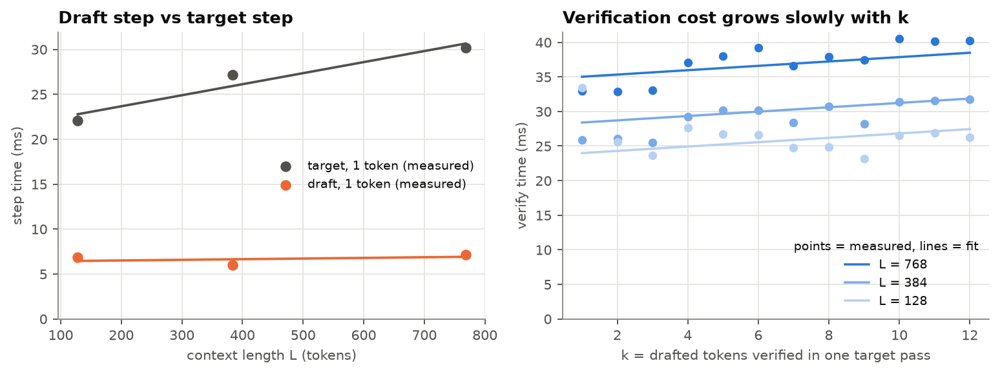
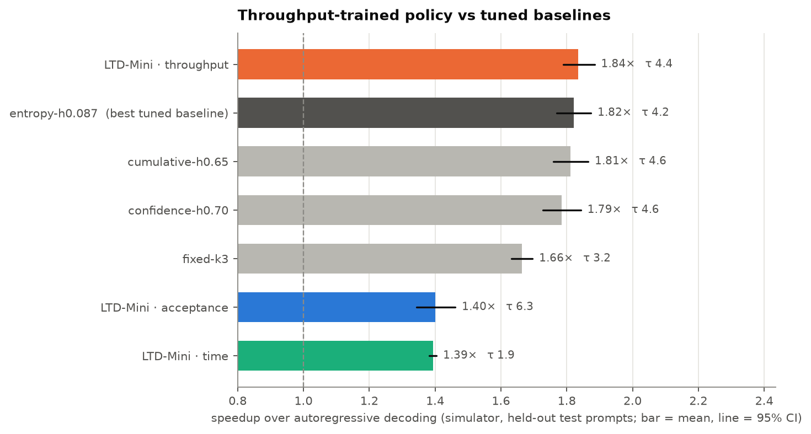
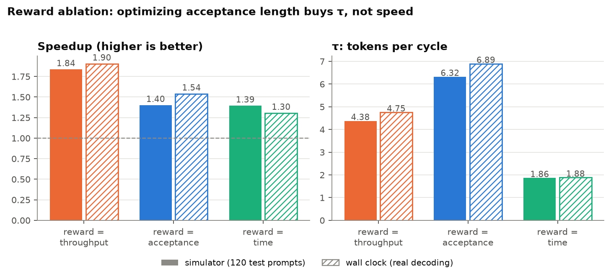
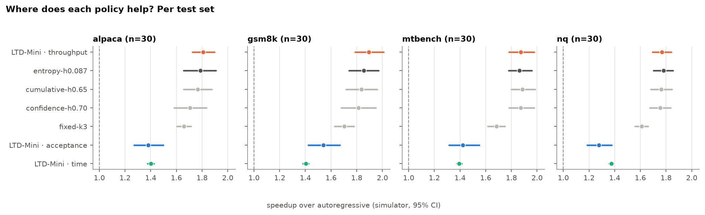
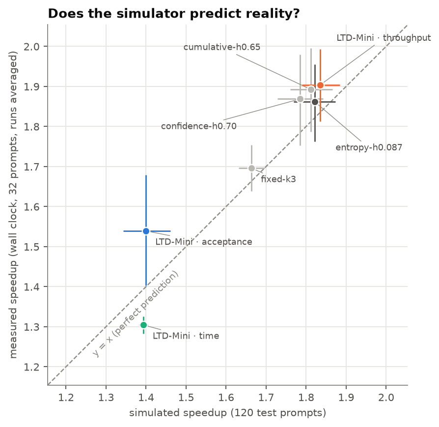
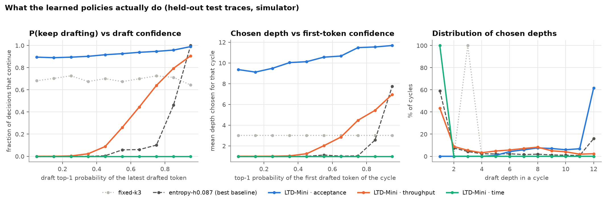
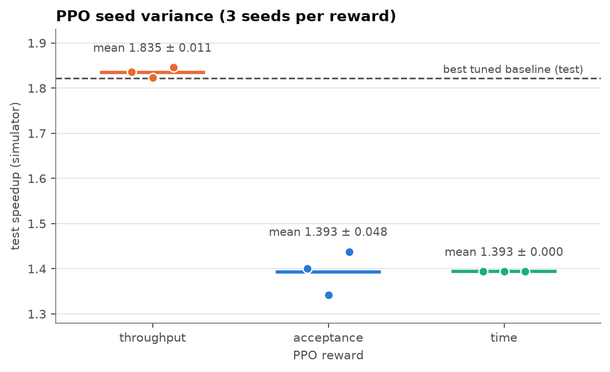
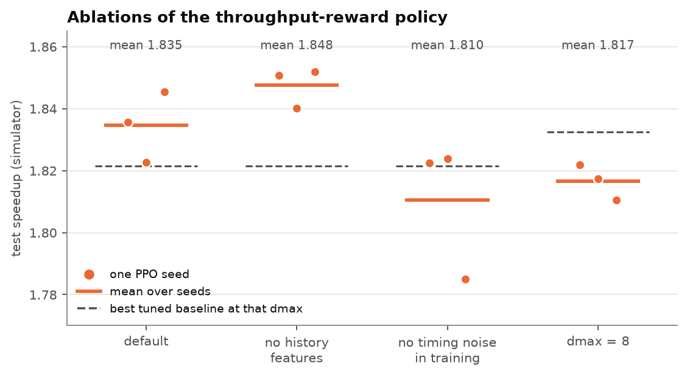

# Learning to Draft, on a Laptop: a Zero-Cost Replication of RL-Trained Draft Lengths for Speculative Decoding

**Dev Mulchandani** · M.S. Software Engineering, San José State University
Code, data and every result file: <https://github.com/DMgaming00/learning-to-draft-mini>

> Every number in this report is read from a file in `results/` (mainly `results/gpt2m-distilgpt2/REPORT.md`).
> Anything uncertain is marked **[uncertain]**; anything not measured is marked **NOT YET MEASURED**.

---

## 1. Introduction

Autoregressive LLM decoding is slow because it is memory-bound: each new token needs one full pass over the model's
weights. **Speculative decoding** lets a small *draft* model propose several tokens that the large *target* model
verifies in a single pass; with an exact acceptance rule the output is identical to the target's own. How far to draft
is the key knob: too short wastes the expensive target pass, too long wastes draft time on rejected tokens.

Zhang et al. (*Learning to Draft*, ICLR 2026) argue that adaptive methods should optimize what actually matters,
**measured throughput** (accepted tokens per second), instead of proxies such as acceptance length, and they learn the
drafting policy with PPO. Their central, falsifiable claim is that a policy trained on throughput beats one trained on
acceptance length — even though the latter achieves a longer average accepted length.

**What I did.** I replicated the depth-policy component and the reward ablation at laptop scale, for $0: an 8 GB
Apple M1, GPT-2 medium (355M) as target and DistilGPT-2 (82M) as draft, free Hugging Face data, and no paid compute. The
work consists of (i) a real speculative decoder with KV-cache rollback, (ii) an *exact trace-replay simulator* in which
PPO can train in minutes, (iii) grid-searched training-free baselines, and (iv) evaluation with confidence intervals,
PPO seeds, ablations and repeated wall-clock measurements on the real models.

**Headline.** The reward ablation of the paper reproduces (throughput 1.84× > acceptance 1.40× > time 1.39× in the
simulator; 1.90× > 1.54× > 1.30× measured), including the "longest τ but lower speedup" effect of the acceptance
reward. The learned throughput policy beats a tuned fixed depth by +0.19× but only **ties** the best tuned adaptive
heuristic (+0.010×, paired 95% CI [−0.019, +0.038]).

## 2. Background

**Speculative decoding.** A draft model proposes γ tokens; the target scores them in one forward pass and accepts the
longest prefix that matches (greedy) or by rejection sampling (Leviathan et al. 2023; Chen et al. 2023); the target's own
next token comes for free. The implementation is in `src/ltdmini/specdec.py`; the lossless stochastic rule is in
`src/ltdmini/sampling.py` and is tested with a chi-square test on the first emitted token. Only greedy decoding is used for
the experiments.

**Why the draft length matters.** If each drafted token is accepted independently with probability α, a cycle that
drafts γ tokens yields on average (1 − α^(γ+1)) / (1 − α) tokens at a cost of γ draft steps plus one verification pass.
The best γ therefore depends on α, which varies token by token, and on the relative cost of draft and verify steps.

**Adaptive drafting.** Training-free methods stop drafting when the draft's confidence drops (max-confidence rules),
when its entropy rises (SVIP), or when an estimate of the acceptance probability falls (SpecDec++). They optimize proxies.
These families are my baselines, each tuned on a validation split.

## 3. The paper

The paper frames draft-and-verify as a reinforcement-learning problem with two small MLP policies trained by PPO
(Stable-Baselines3): a *depth policy* (binary keep-drafting / stop after each draft pass, observing the last draft
layer's probabilities, the depth D and context length L) and a *size policy* (how many tree candidates to verify). The
reward per cycle is accepted tokens ÷ (draft time + verify time). Policies are trained on HumanEval, first separately
and then alternately. Results reported in the paper: 2.24×–4.32× over autoregressive decoding on five models (8B–32B)
and four benchmarks, up to 36.4% faster than Eagle3, and a reward ablation (Vicuna-13B) in which throughput gives 4.13×
(τ 6.84), acceptance length 3.59× despite the *highest* τ (6.89), and time cost 3.45×. The depth policy contributes
most of the gain (`docs/PAPER_SUMMARY.md`).

## 4. Replication design

**Hardware and cost.** Apple M1, 8 GB unified memory, macOS 26.5.2, MPS backend; $0. Software: Python 3.12.15,
PyTorch 2.15.0, transformers 5.22.1, Stable-Baselines3 2.9.2, Gymnasium 1.4.0 (`environment.json`).

**Models and why.** My first plan, Qwen2.5-1.5B / 0.5B, did not run on this laptop (profiling exhausted RAM and swap:
**cost ratio NOT MEASURED**). SmolLM2-360M / 135M ran but the draft step cost 0.56× a target step on MPS (both models are
kernel-launch-bound, 32 vs 30 layers), leaving little room for speculation. I measured four candidate pairs
(`scripts/compare_pairs.py`, `results/model_selection/pairs.json`; cost ratio = draft step ÷ target step at context 128 / 512;
agreement = draft top-1 equals target greedy token on 24 HumanEval prompts disjoint from all splits):

| Pair (target / draft) | Layers | Cost ratio, MPS fp16 | Agreement |
|---|---|---|---|
| SmolLM2-360M / 135M | 32 / 30 | 0.56 / 0.59 | 0.932 |
| pythia-410m / pythia-70m | 24 / 6 | 0.18 / 0.18 | 0.783 |
| pythia-410m / pythia-160m | 24 / 12 | 0.42 / 0.48 | 0.858 |
| **gpt2-medium / distilgpt2** | 24 / 6 | **0.24 / 0.20** | 0.809 |

GPT-2 medium / DistilGPT-2 was chosen as the pair with a cheap draft (≈0.2×) and good agreement. Both are *base* models,
so prompts are fed as raw text; speculative decoding is lossless whatever the output quality, but the agreement may not
represent modern instruct models **[uncertain]**.

**The exact replay simulator.** With greedy decoding, speculative decoding's output equals the target's greedy output
whatever the draft depths are. I therefore run the target once per prompt to get its output y, and at every position
of y record what the draft would propose (top-1 probability and entropy at each depth up to dmax) and how many proposals
match y. Any depth policy can then be replayed *exactly*: it sees the same features and gets the same accepted count as in
real decoding. A test (`test_simulator_replays_real_decoder_exactly`) checks that the per-cycle (depth, accepted)
sequence of the simulator equals the real decoder's. Only step *times* are modelled, by a linear cost model fitted to
measurements on this machine, with multiplicative noise during training (5%):

- draft step ≈ 6.36 ms + 0.717 µs·L
- verify(k) ≈ 21.45 ms + 0.315 ms·k + 17.25 µs·L
- autoregressive step ≈ 21.20 ms + 12.29 µs·L



The fit is noisy (a few ms): draft time at L=384 is below L=128, and some verify measurements deviate from the line
(e.g. at L=768 for k ≥ 4). This is a threat to validity (§6); the wall-clock evaluation is the check.

**Data and splits.** Train: 100 HumanEval prompts; validation: 24 disjoint HumanEval prompts (baseline grid search
and PPO checkpoint selection); test: 30 each from MT-Bench, GSM8K, Alpaca and Natural Questions for the simulator, and
8 each (32 total) for wall clock. Each target output is 160 tokens, dmax = 12.

**Faithfulness to the paper** (`docs/METHOD.md`):

| Aspect | Paper | This replication |
|---|---|---|
| Objective | throughput reward per draft-verify cycle | same (scaled by the AR step time) |
| Algorithm | PPO, SB3, rollout 2048, minibatch 256 | same; MLP 64-64 tanh |
| Depth action | binary continue / stop | same |
| Observation | last-layer draft probabilities, D, L | top-1 prob, entropy, cumulative top-1, D, L, 2 history features |
| Episode | not specified in what I read | **one draft-verify cycle** (deviation; §5.5) |
| Drafting | Eagle3 tree | **chain**, separate small model |
| Size policy / co-training | yes | **not in v1** |
| Models | 8B–32B, data-center GPUs | **355M / 82M on an M1 laptop** |
| Baselines | Eagle3 + grid search, SVIP, SpecDec++, … | fixed depth, confidence, entropy, cumulative stop; each tuned on validation |
| Reward ablation | throughput / acceptance / time | same |
| Temperature | greedy + T=1 | greedy only |

## 5. Results

Simulator: 120 held-out prompts, 95% bootstrap CIs over prompts. Wall clock: 32 held-out prompts × 3 independent runs
on the real models. All figures and tables are generated in `results/gpt2m-distilgpt2/REPORT.md`.

### 5.1 RQ1 — learned policy vs tuned baselines

| Policy | Simulated speedup [95% CI] | τ | Wall-clock speedup [95% CI] |
|---|---|---|---|
| **LTD-Mini, throughput reward** | **1.84×** [1.79, 1.88] | 4.38 | **1.90×** [1.81, 1.99] |
| entropy-stop (tuned) | 1.82× [1.77, 1.87] | 4.16 | 1.86× [1.76, 1.96] |
| cumulative-confidence stop (tuned) | 1.81× [1.76, 1.87] | 4.56 | 1.89× [1.79, 2.00] |
| confidence-stop (tuned) | 1.79× [1.73, 1.84] | 4.65 | 1.87× [1.75, 1.98] |
| fixed depth k=3 (tuned) | 1.66× [1.63, 1.70] | 3.25 | 1.70× [1.64, 1.75] |
| LTD-Mini, acceptance reward | 1.40× [1.34, 1.46] | 6.32 | 1.54× [1.40, 1.68] |
| LTD-Mini, time reward | 1.39× [1.38, 1.40] | 1.86 | 1.30× [1.28, 1.33] |

Paired over prompts, the throughput policy beats fixed depth by +0.190 [+0.160, +0.220] (87% wins) but versus the best
tuned baseline the difference is **+0.010 [−0.019, +0.038]** (54% wins) in the simulator and **+0.012 [−0.049, +0.070]**
(62% wins) on the wall clock — neither significant. Over three PPO seeds the policy reaches 1.836, 1.823, 1.845 (mean
1.835 ± 0.011); none of the seeds is significantly better or worse than the best baseline (1.821×).



**Verdict on RQ1:** a *tie* with the best tuned adaptive rule, and a significant win over a tuned static depth.

### 5.2 RQ2 — reward ablation

| Reward | Sim. speedup | τ | Wall-clock speedup | Mean depth |
|---|---|---|---|---|
| throughput | 1.84× | 4.38 | 1.90× | 3.98 |
| acceptance | 1.40× | **6.32** | 1.54× | 10.69 |
| time | 1.39× | 1.86 | 1.30× | 1.00 |

Three-seed means: 1.835 ± 0.011, 1.393 ± 0.048, 1.393 ± 0.000. The acceptance reward drives the policy to draft almost to
the cap, which gives the longest τ (6.32 simulated, 6.89 measured) and a much lower speedup; this is exactly the paper's
point that optimizing acceptance length is the wrong objective. The full ordering throughput > acceptance > time is
visible on the wall clock; in the simulator acceptance and time are indistinguishable (CIs overlap). The time reward is
degenerate here (all three seeds learn "never draft beyond one token"), see §5.5.



### 5.3 RQ3 — transfer from HumanEval

The policy is trained on code only. On the four unseen test sets its simulated speedup is 1.81× (Alpaca), 1.89× (GSM8K),
1.87× (MT-Bench) and 1.77× (NQ) — above fixed depth on every set, with CIs overlapping the tuned baselines. It is highest
on GSM8K (τ 4.91) and lowest on NQ (τ 3.72). No per-set paired test was run (30 prompts per set would be underpowered), so
I claim "transfers without degradation", not "improves on each set".



### 5.4 RQ4 — simulation vs reality, and what the policy does

For the five competitive policies the simulator is within about 0.1× of the measurement (throughput 1.84 vs 1.90; entropy
1.82 vs 1.86; cumulative 1.81 vs 1.89; confidence 1.79 vs 1.87; fixed-k3 1.66 vs 1.70). It under-predicts the acceptance
policy (1.40 vs 1.54) and over-predicts the time policy (1.39 vs 1.30). Three wall-clock runs made at different times
vary by 0.03–0.06× in mean speedup, so these two gaps (0.1–0.14×) exceed run-to-run noise. Possible causes, **not isolated**:
timing-model error, non-linear verify cost, and different prompt samples (120 vs 32).



The learned policy is a smooth, learned confidence rule: the probability of drafting another token rises with the draft's
top-1 probability (0.26 / 0.45 / 0.64 / 0.79 / 0.91 in the bins 0.5–0.6 … 0.9–1.0), whereas the tuned entropy rule is a sharp
switch above ≈0.8; its mean chosen depth is 3.98 vs 3.68 for the entropy rule.



### 5.5 What went wrong first, and the deviation it forced

My first PPO setup used one episode per whole generation (return = sum of per-cycle rewards). On the real traces it
**collapsed for every reward** to a constant policy — "always stop at depth 1" (throughput, acceptance) or "always draft
to depth 12" (time) — with validation speedups of 1.365× and 1.206× (equal to the fixed-k1 and fixed-k12 baselines), far
below the tuned 1.78×. Changing the discount factor, normalizing rewards, adding an entropy bonus, lowering the learning
rate and using Monte-Carlo advantages did not change this. (These were scratch experiments; they are described in
`docs/METHOD.md`, not stored in `results/`.) I did **not** isolate a single cause. Plausible contributors: a sum of
per-cycle *rates* is not total throughput (it favours many short cycles); with γ = 1 the summed acceptance reward equals
the number of tokens regardless of the policy (no signal); and the return is dominated by the number of tokens still to
generate, which the observation lacks, so the critic cannot fit it.

Making **one draft-verify cycle one episode** (started at a random position of a random trace, after a random-depth warm-up
so that the history features are populated) removes all three and gives each reward exactly its per-cycle definition; PPO
then learned a state-dependent policy straight away. The price: the policy is *myopic* (it maximizes each cycle's rate, not
the sequence's), and the history features seen in training come from a random-depth warm-up rather than the policy's own
past. For the time reward this makes "minimize this cycle's time" trivially minimized at depth 1.

### 5.6 Robustness: seeds and ablations

| Variant (throughput reward) | Per-seed test speedup | Mean ± std | Best tuned baseline at that dmax | Mean Δ (paired) |
|---|---|---|---|---|
| default | 1.836, 1.823, 1.845 | 1.835 ± 0.011 | entropy-h0.087 (1.821) | +0.009 |
| no history features | 1.851, 1.840, 1.852 | 1.848 ± 0.006 | entropy-h0.087 (1.821) | +0.010 |
| no timing noise in training | 1.822, 1.824, 1.785 | 1.810 ± 0.022 | entropy-h0.087 (1.821) | −0.015 |
| dmax = 8 | 1.822, 1.817, 1.811 | 1.817 ± 0.006 | cumulative-h0.65 (1.833) | −0.015 |

 

History features are unnecessary here (removing them does not hurt). Training without timing noise gives a lower mean and
one seed is significantly worse than the best baseline — consistent with noise acting as a regularizer, but with three
seeds only suggestive **[uncertain]**. A dmax of 8 vs 12 lowers the mean speedup by 0.018×, a bit more than the seed std (0.006–0.011). With *n* = 3 seeds
the "± std" values are rough.

### 5.7 Correctness: output exactness

Speculative decoding must reproduce the target's own greedy output. Measured on the real models
(`real_results*.jsonl`, `mps_fp32/`, `cpu_fp32/`):

| Setting | Decodes | Exact output match |
|---|---|---|
| fp32 on MPS, 160 new tokens (7 policies × 16 prompts) | 112 | **112 / 112 (100%)** |
| fp32 on CPU, 64 new tokens (7 policies × 4 prompts) — reduced setting | 28 | **28 / 28 (100%)** |
| fp16 on MPS, 160 new tokens (7 policies × 32 prompts × 3 runs) | 672 | 582 / 672 (87%) |

The fp32 checks cover a subset of the 32 wall-clock prompts (the first 4 per test set on MPS, the first 1 per set on
CPU, the latter with fewer tokens because fp32 decoding was too slow on an 8 GB laptop under memory pressure), so they
are strong evidence of a correct decoder, not an exhaustive proof.

**Why fp16 differs (the data, then the hypothesis).** The 90 diverging fp16 decodes are *deterministic* (the same
decodes diverge in all three runs) and *prompt-specific*: four Natural-Questions prompts (nq-1, nq-2, nq-3, nq-6)
diverge for 6–7 of the 7 policies, and the acceptance policy (mean depth 10.7, i.e. the largest verification batches)
additionally diverges on five prompts (mtbench-4, mtbench-7, gsm8k-4, alpaca-3, nq-4) where the other six match.
Among the 448 decodes that recorded divergence information, 60 diverged, with the first differing token at generated
position median 28 (min 3, max 64). The most consistent explanation is **rounding differences in fp16 between one-token
decoding and multi-token verification flipping near-tied argmaxes**: it predicts exactly what we see (prompt-specific,
deterministic, worse for larger verification batches, absent in fp32 — including on the diverging prompts alpaca-3,
nq-1, nq-2 and nq-3, which are in the fp32 sample). I did not isolate the kernel-level mechanism. After the first flip
the two continuations differ, so the token-match rate (84.9–92.7%) mostly reflects *where* a decode diverges, not
how many tokens are wrong in isolation. Reported speedups are for the real fp16 process as run.

## 6. Discussion

**Does the evidence support the paper's central claim at small scale?** Partly. The *objective* claim — measured
throughput is a better training signal than acceptance length — is supported: the acceptance reward yields the longest τ
and a speedup 0.44× lower (simulator) and 0.36× lower (wall clock) than the throughput reward, and the time reward does
worse still. The *method* claim — that a learned policy beats strong tuned heuristics — is **not** supported here: the
throughput policy ties the best tuned adaptive baseline (+0.010×, CI [−0.019, +0.038]).

**Why the results may differ from the paper.**
(1) *Hardware cost profile.* The draft step costs ≈0.2× a target step and verifying one more token adds only ≈0.3 ms to a
≈21 ms pass, so a simple "stop when unconfident" rule already captures most of the available gain; the paper's GPUs and
tree drafting have different trade-offs. (2) *Chain, not tree.* With one token per layer there is no size policy and
less to optimize. (3) *Small models with high draft agreement.* (4) *Sample size*: with 120 prompts a 2–3% margin (the size
of the paper's gains over grid-searched baselines on several models) is below the resolution of the paired CI. (5) *Myopic
training* (§5.5).

**What the policy does.** It behaves like a smoothed confidence threshold that continues at lower confidence than the
tuned entropy rule (§5.4); the tie with tuned rules is therefore unsurprising.

**Threats to validity.**
- *Simulator timing model:* a linear fit from one profiling session with a few ms of noise; the wall-clock check
  agrees to ≈0.1× for competitive policies but not for the extremes.
- *Selection of the "best baseline"* is made on test speedup among four families, which favours the baselines; the
  baselines themselves were tuned on validation only.
- *Seeds:* three PPO seeds; wall clock: three runs on one machine, one thermal state **[uncertain]**.
- *Samples:* 120 simulated and 32 wall-clock prompts; HumanEval train/val are code, test sets are not, and base GPT-2 outputs
  are low quality and may be repetitive, which can inflate draft agreement.
- *Myopic one-cycle training and history-feature warm-up* differ from the paper's setup.
- *Single model pair, single machine, chain drafting, greedy decoding.*
- *Provenance:* the git commit stored in `environment.json` is from profiling time; the final results come from the
  repository HEAD.
- *fp16 on MPS* does not always reproduce the target's greedy output exactly (§5.7).

## 7. Conclusion and future work

A laptop-scale replication, trained and tested for $0, reproduces the *ablation* at the heart of *Learning to Draft*:
optimizing accepted tokens per second beats optimizing acceptance length (1.84× vs 1.40× simulated, 1.90× vs 1.54×
measured), and the acceptance reward buys τ but not speed. It does **not** show that an RL policy beats well-tuned
confidence rules at this scale (+0.010×, not significant). Along the way the replication surfaced a practical lesson: with
whole-sequence episodes PPO collapsed to a constant policy, and treating each cycle as an episode fixed it.

**Future work:** tree drafting with a 4D attention mask, a size policy and alternating co-training (paper §4.3);
temperature 1 using the stochastic acceptance rule already in `sampling.py`; training on the policy's own history; online
fine-tuning against real decoding; and instruct-model pairs on a machine with more memory.

## Appendix: commands, configs, environment

```bash
pip install -e ".[all]"
pytest                                                    # 61 tests (31 unit + torch)
ltdmini all --config configs/smoke.yaml                   # pipeline check with random tiny models (not results)
ltdmini profile   --config configs/small.yaml
ltdmini traces    --config configs/small.yaml
ltdmini tune      --config configs/small.yaml
ltdmini train     --config configs/small.yaml --reward all
ltdmini eval-sim  --config configs/small.yaml
ltdmini eval-real --config configs/small.yaml --n-prompts 8            # + --tag _run2, _run3
ltdmini robust    --config configs/small.yaml --seeds 3
ltdmini behaviour --config configs/small.yaml
ltdmini report    --config configs/small.yaml
python scripts/compare_pairs.py
ltdmini eval-real --config configs/small_mps_fp32.yaml --policies-from results/gpt2m-distilgpt2 --n-prompts 4
ltdmini eval-real --config configs/small_cpu_fp32.yaml --policies-from results/gpt2m-distilgpt2 --n-prompts 1
```

Configs: `configs/small.yaml` (used for all results), `small_mps_fp32.yaml`, `small_cpu_fp32.yaml`, `smoke.yaml`; `tiny.yaml`
(SmolLM2) and `mac.yaml` (Qwen2.5) were not used for results. Environment: `results/gpt2m-distilgpt2/environment.json`.
Machine: Apple M1, 8 GB, macOS 26.5.2.

**References.** Zhang et al., *Learning to Draft: Adaptive Speculative Decoding with Reinforcement Learning*, ICLR 2026,
arXiv:2603.01639. Leviathan, Kalman, Matias, *Fast Inference from Transformers via Speculative Decoding*, ICML 2023.
Chen et al., *Accelerating Large Language Model Decoding with Speculative Sampling*, 2023. Schulman et al., *Proximal Policy
Optimization Algorithms*, 2017. Raffin et al., *Stable-Baselines3*, JMLR 2021.
