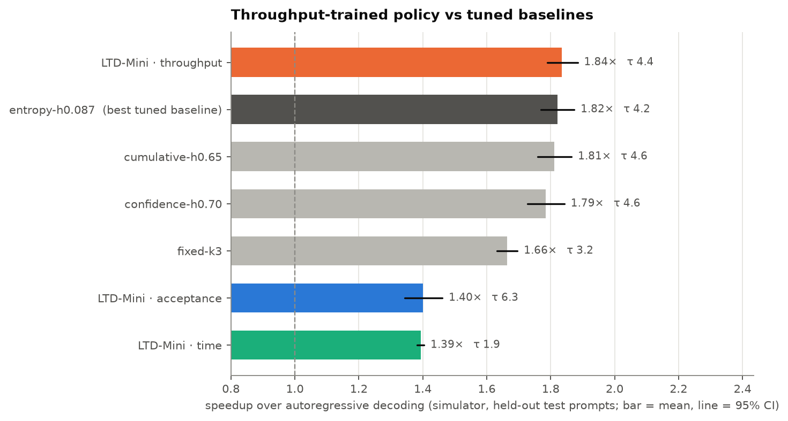
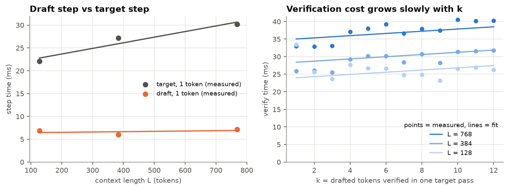
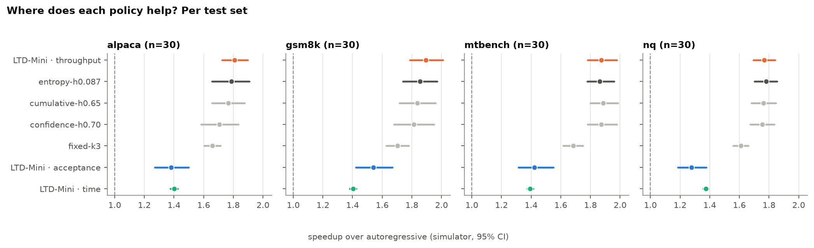
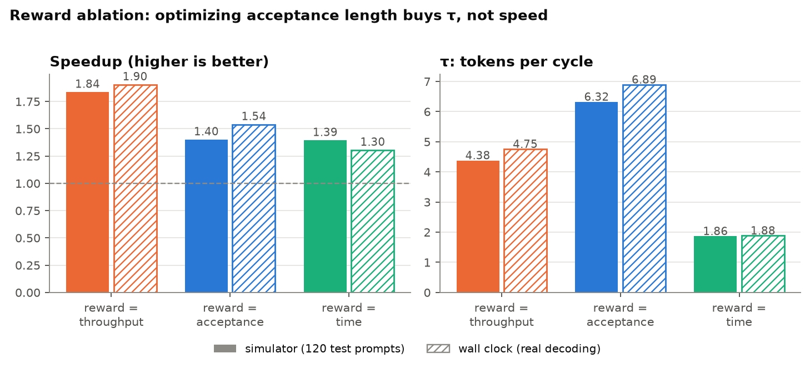
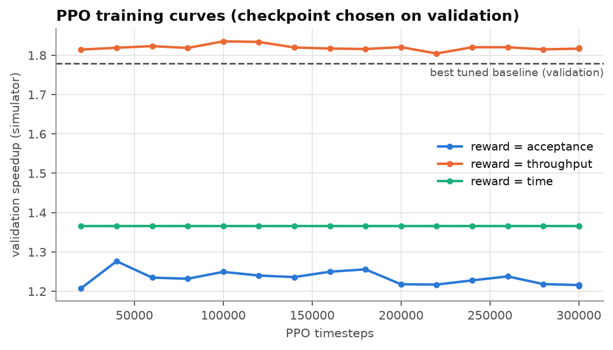
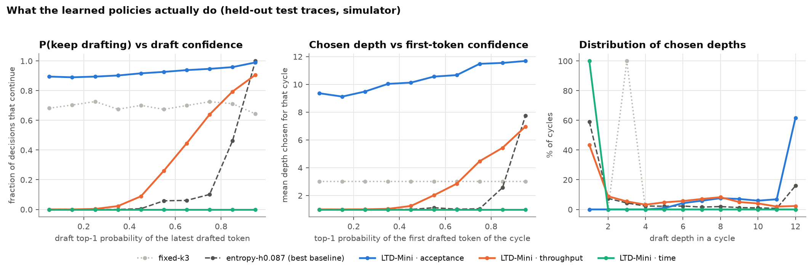
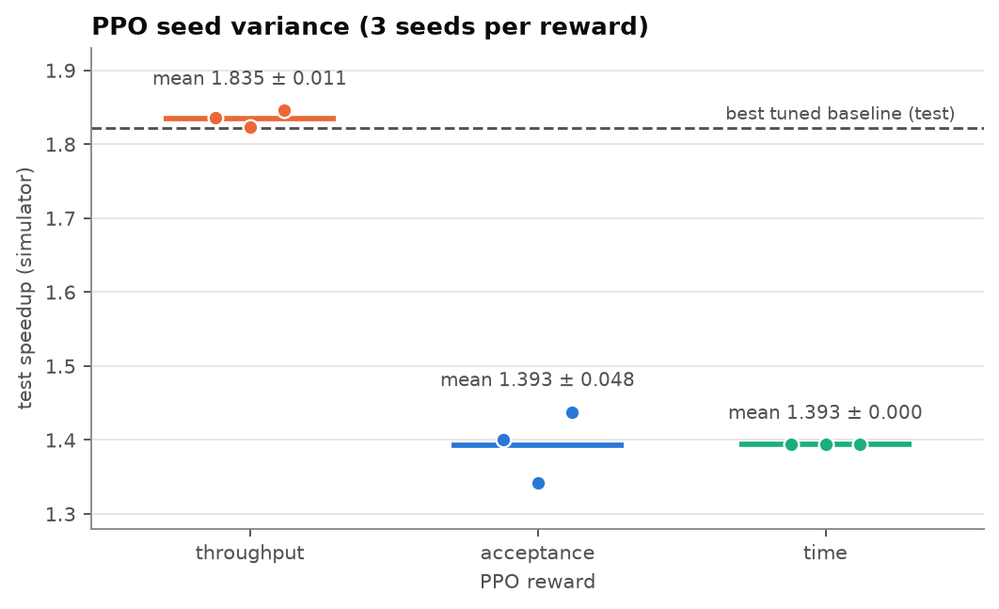
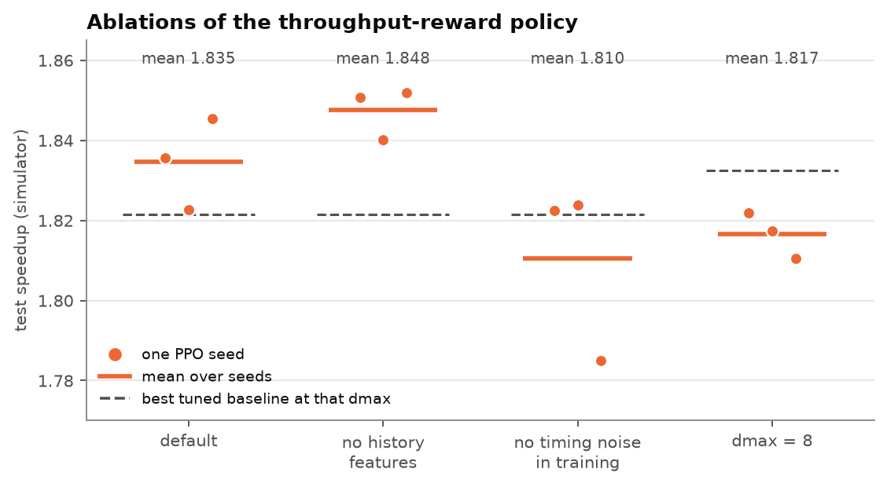
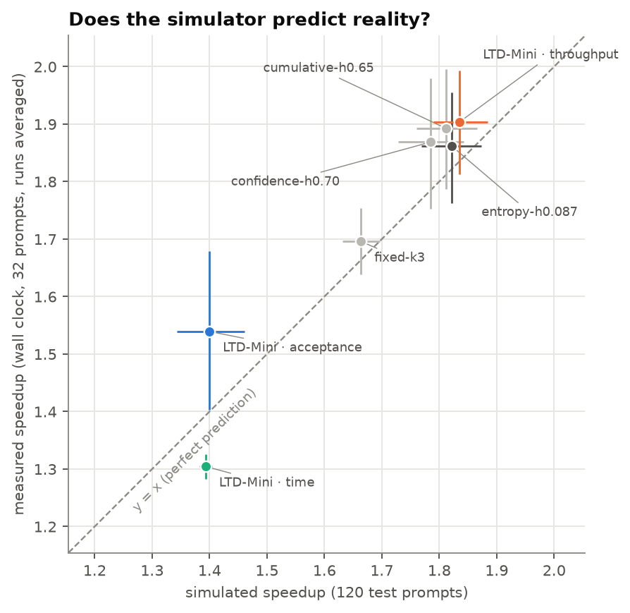
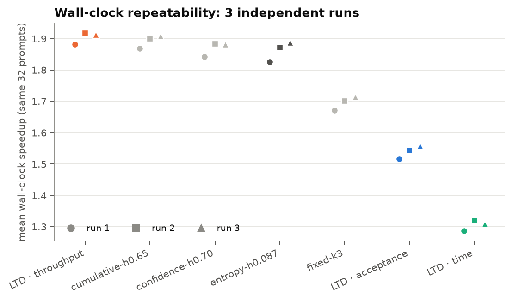

# Results — `gpt2m-distilgpt2`

_Generated by `ltdmini report` from the files in this folder. Do not edit by hand. Every number below is read from a file written by an earlier stage._

## At a glance

- Simulated test speedup of the throughput-reward policy: **1.84×** [1.79, 1.88]; best tuned baseline `entropy-h0.087`: 1.82×. Paired difference +0.010 [-0.019, +0.038] (not significant).
- Wall-clock speedup of the same policy: **1.90×** (32 prompts × 3 run(s)).

## Environment

- **timestamp_utc:** 2026-11-02T00:43:34.891033+00:00
- **python:** 3.12.15
- **platform:** macOS-26.5.2-arm64-arm-64bit
- **machine:** arm64
- **processor:** arm
- **git_commit:** 825c97f4a43d61e6592d671a327709dd61996828
- **git_dirty:** True
- **numpy:** 2.5.4
- **torch:** 2.15.0
- **transformers:** 5.22.1
- **stable_baselines3:** 2.9.2
- **gymnasium:** 1.4.0
- **mps_available:** True
- **cuda_available:** False
- **target:** openai-community/gpt2-medium
- **draft:** distilbert/distilgpt2
- **device:** mps
- **dtype:** torch.float16

## Timing model

Device `mps` — fitted from measured samples.

- draft step ≈ 6.36 ms + 0.717 µs·L
- verify(k) ≈ 21.45 ms + 0.315 ms·k + 17.251 µs·L
- autoregressive step ≈ 21.20 ms + 12.293 µs·L

## Tuned baselines (validation grid search)

- **fixed:** `fixed-k3` (val speedup 1.695)
- **confidence:** `confidence-h0.70` (val speedup 1.780)
- **entropy:** `entropy-h0.087` (val speedup 1.697)
- **cumulative:** `cumulative-h0.65` (val speedup 1.775)

## Simulated evaluation on held-out traces

Speedup vs autoregressive [95% bootstrap CI] · τ = mean tokens per cycle.

| Policy | alpaca | gsm8k | mtbench | nq | overall |
|---|---|---|---|---|---|
| ltd-mini-throughput | 1.81× [1.72, 1.90] · τ 4.42 | 1.89× [1.79, 2.01] · τ 4.91 | 1.87× [1.78, 1.98] · τ 4.45 | 1.77× [1.70, 1.84] · τ 3.72 | 1.84× [1.79, 1.88] · τ 4.38 |
| entropy-h0.087 | 1.79× [1.66, 1.91] · τ 4.25 | 1.86× [1.74, 1.97] · τ 4.60 | 1.86× [1.78, 1.96] · τ 4.20 | 1.78× [1.70, 1.85] · τ 3.60 | 1.82× [1.77, 1.87] · τ 4.16 |
| cumulative-h0.65 | 1.77× [1.66, 1.88] · τ 4.78 | 1.84× [1.72, 1.96] · τ 5.02 | 1.89× [1.80, 1.99] · τ 4.56 | 1.76× [1.68, 1.85] · τ 3.86 | 1.81× [1.76, 1.87] · τ 4.56 |
| confidence-h0.70 | 1.71× [1.58, 1.83] · τ 4.87 | 1.81× [1.68, 1.95] · τ 5.16 | 1.87× [1.78, 1.98] · τ 4.63 | 1.75× [1.67, 1.84] · τ 3.93 | 1.79× [1.73, 1.84] · τ 4.65 |
| fixed-k3 | 1.66× [1.60, 1.71] · τ 3.23 | 1.70× [1.63, 1.78] · τ 3.33 | 1.68× [1.62, 1.75] · τ 3.28 | 1.61× [1.56, 1.66] · τ 3.13 | 1.66× [1.63, 1.70] · τ 3.25 |
| ltd-mini-acceptance | 1.38× [1.27, 1.50] · τ 6.29 | 1.54× [1.42, 1.67] · τ 6.99 | 1.42× [1.31, 1.55] · τ 6.37 | 1.28× [1.19, 1.38] · τ 5.62 | 1.40× [1.34, 1.46] · τ 6.32 |
| ltd-mini-time | 1.40× [1.38, 1.43] · τ 1.87 | 1.40× [1.38, 1.43] · τ 1.88 | 1.39× [1.37, 1.41] · τ 1.87 | 1.37× [1.36, 1.39] · τ 1.83 | 1.39× [1.38, 1.40] · τ 1.86 |

Reference: **fixed-k3** (per-sequence speedup differences, 95% paired bootstrap CI)

| Policy | Mean Δ speedup | 95% CI | Wins | Significant |
|---|---|---|---|---|
| ltd-mini-throughput | +0.190 | [+0.160, +0.220] | 87% | yes |
| entropy-h0.087 | +0.180 | [+0.149, +0.210] | 87% | yes |
| cumulative-h0.65 | +0.175 | [+0.138, +0.211] | 82% | yes |
| confidence-h0.70 | +0.155 | [+0.115, +0.193] | 77% | yes |
| ltd-mini-acceptance | -0.205 | [-0.245, -0.163] | 18% | yes |
| ltd-mini-time | -0.286 | [-0.309, -0.262] | 0% | yes |

Learned policies vs the best tuned baseline, **entropy-h0.087** (per-sequence speedup differences, 95% paired bootstrap CI)

| Policy | Mean Δ speedup | 95% CI | Wins | Significant |
|---|---|---|---|---|
| ltd-mini-throughput | +0.010 | [-0.019, +0.038] | 54% | no |
| ltd-mini-acceptance | -0.385 | [-0.419, -0.353] | 2% | yes |
| ltd-mini-time | -0.466 | [-0.506, -0.426] | 3% | yes |

## Reward ablation (paper Table 2)

## Training curves

## What the learned policy does

## Robustness: seeds and ablations

### PPO seeds (3 seeds per reward, held-out test, simulator)

| Reward | Per-seed speedup | Mean ± std | Mean τ | Seeds significantly better / worse than best tuned baseline |
|---|---|---|---|---|
| throughput | 1.836, 1.823, 1.845 | 1.835 ± 0.011 | 4.37 | 0 / 0 of 3 |
| acceptance | 1.400, 1.342, 1.438 | 1.393 ± 0.048 | 6.33 | 0 / 3 of 3 |
| time | 1.393, 1.393, 1.393 | 1.393 ± 0.000 | 1.86 | 0 / 3 of 3 |

Best tuned baseline on the same test set: `entropy-h0.087` at 1.821×.

### Ablations (throughput reward, same seeds)

| Variant | Per-seed speedup | Mean ± std | Best tuned baseline at that dmax | Mean Δ vs that baseline (paired) |
|---|---|---|---|---|
| default | 1.836, 1.823, 1.845 | 1.835 ± 0.011 | entropy-h0.087 (1.821) | +0.009 |
| no_history | 1.851, 1.840, 1.852 | 1.848 ± 0.006 | entropy-h0.087 (1.821) | +0.010 |
| no_timing_noise | 1.822, 1.824, 1.785 | 1.810 ± 0.022 | entropy-h0.087 (1.821) | -0.015 |
| dmax8 | 1.822, 1.817, 1.811 | 1.817 ± 0.006 | cumulative-h0.65 (1.833) | -0.015 |

## Real end-to-end evaluation (wall clock)

| Policy | Mean speedup [95% CI over prompts] | τ | Mean depth | Exact output match | Mean token-match rate |
|---|---|---|---|---|---|
| ltd-mini-throughput | 1.90× [1.81, 1.99] | 4.75 | 4.43 | 88% | 90.4% |
| cumulative-h0.65 | 1.89× [1.79, 2.00] | 4.94 | 4.70 | 88% | 90.5% |
| confidence-h0.70 | 1.87× [1.75, 1.98] | 5.09 | 4.99 | 91% | 92.7% |
| entropy-h0.087 | 1.86× [1.76, 1.96] | 4.50 | 4.10 | 88% | 90.5% |
| fixed-k3 | 1.70× [1.64, 1.75] | 3.33 | 3.00 | 88% | 90.4% |
| ltd-mini-acceptance | 1.54× [1.40, 1.68] | 6.89 | 10.89 | 78% | 84.9% |
| ltd-mini-time | 1.30× [1.28, 1.33] | 1.88 | 1.00 | 88% | 90.4% |

_32 prompts × 3 independent run(s); speedups are averaged over runs per prompt first._

Wall clock, learned vs the best baseline here (**cumulative-h0.65**), paired over prompts:

| Policy | Mean Δ speedup | 95% CI | Wins | Significant |
|---|---|---|---|---|
| ltd-mini-throughput | +0.012 | [-0.049, +0.070] | 62% | no |
| ltd-mini-acceptance | -0.353 | [-0.421, -0.286] | 3% | yes |
| ltd-mini-time | -0.588 | [-0.680, -0.490] | 6% | yes |

### Repeatability

Mean wall-clock speedup per independent run (same prompts, same policies, run at different times):

| Policy | run 1 | run 2 | run 3 | spread (max − min) |
|---|---|---|---|---|
| ltd-mini-throughput | 1.882× | 1.917× | 1.913× | 0.036 |
| cumulative-h0.65 | 1.869× | 1.899× | 1.909× | 0.040 |
| confidence-h0.70 | 1.842× | 1.883× | 1.881× | 0.042 |
| entropy-h0.087 | 1.827× | 1.871× | 1.888× | 0.062 |
| fixed-k3 | 1.672× | 1.701× | 1.714× | 0.042 |
| ltd-mini-acceptance | 1.517× | 1.543× | 1.558× | 0.042 |
| ltd-mini-time | 1.286× | 1.318× | 1.309× | 0.032 |

### Output exactness

| Setting | Policy | Decodes | Exact output match | Mean token-match rate |
|---|---|---|---|---|
| fp16 on MPS (main runs) | confidence-h0.70 | 96 | 91% | 92.7% |
| fp16 on MPS (main runs) | cumulative-h0.65 | 96 | 88% | 90.5% |
| fp16 on MPS (main runs) | entropy-h0.087 | 96 | 88% | 90.5% |
| fp16 on MPS (main runs) | fixed-k3 | 96 | 88% | 90.4% |
| fp16 on MPS (main runs) | ltd-mini-acceptance | 96 | 78% | 84.9% |
| fp16 on MPS (main runs) | ltd-mini-throughput | 96 | 88% | 90.4% |
| fp16 on MPS (main runs) | ltd-mini-time | 96 | 88% | 90.4% |
| fp32 on MPS | confidence-h0.70 | 16 | 100% | 100.0% |
| fp32 on MPS | cumulative-h0.65 | 16 | 100% | 100.0% |
| fp32 on MPS | entropy-h0.087 | 16 | 100% | 100.0% |
| fp32 on MPS | fixed-k3 | 16 | 100% | 100.0% |
| fp32 on MPS | ltd-mini-acceptance | 16 | 100% | 100.0% |
| fp32 on MPS | ltd-mini-throughput | 16 | 100% | 100.0% |
| fp32 on MPS | ltd-mini-time | 16 | 100% | 100.0% |
| fp32 on CPU (64 new tokens) | confidence-h0.70 | 4 | 100% | 100.0% |
| fp32 on CPU (64 new tokens) | cumulative-h0.65 | 4 | 100% | 100.0% |
| fp32 on CPU (64 new tokens) | entropy-h0.087 | 4 | 100% | 100.0% |
| fp32 on CPU (64 new tokens) | fixed-k3 | 4 | 100% | 100.0% |
| fp32 on CPU (64 new tokens) | ltd-mini-acceptance | 4 | 100% | 100.0% |
| fp32 on CPU (64 new tokens) | ltd-mini-throughput | 4 | 100% | 100.0% |
| fp32 on CPU (64 new tokens) | ltd-mini-time | 4 | 100% | 100.0% |

Of the 448 fp16 decodes that recorded divergence info, 60 diverged from the target's greedy output; the first differing token was at generated position median 28 (min 3, max 64).

## Model-pair selection

Draft-step cost as a fraction of a target-step (lower = more room for speculation) and draft–target agreement (`scripts/compare_pairs.py`, `results/model_selection/pairs.json`).

| Target / draft | Layers | Params (M) | Cost ratio, MPS fp16 (L=128 / 512) | Cost ratio, CPU fp32 (L=128 / 512) | Agreement (CPU fp32, 24 HumanEval prompts × 64 tokens) |
|---|---|---|---|---|---|
| SmolLM2-360M-Instruct / SmolLM2-135M-Instruct | 32 / 30 | 362 / 135 | 0.56 / 0.59 | 0.54 / 0.42 | 0.932 |
| pythia-410m / pythia-70m | 24 / 6 | 405 / 70 | 0.18 / 0.18 | 0.15 / 0.13 | 0.783 |
| pythia-410m / pythia-160m | 24 / 12 | 405 / 162 | 0.42 / 0.48 | 0.38 / 0.32 | 0.858 |
| gpt2-medium / distilgpt2 | 24 / 6 | 355 / 82 | 0.24 / 0.20 | 0.23 / 0.16 | 0.809 |

`Qwen/Qwen2.5-1.5B-Instruct / Qwen2.5-0.5B-Instruct` (the original plan) was attempted on an 8 GB Mac: profiling did not finish because the machine exhausted RAM and swap, so its cost ratio is **NOT MEASURED**.
