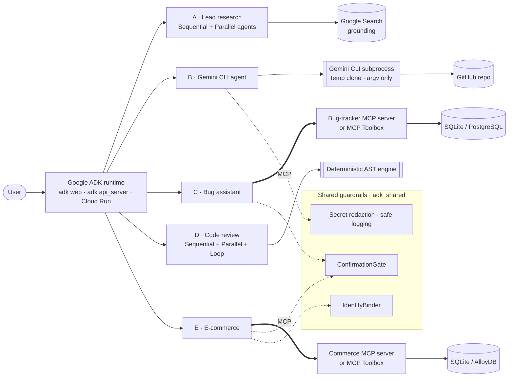
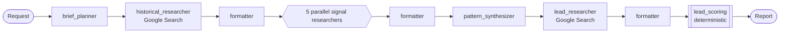
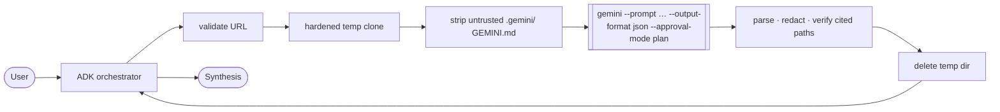
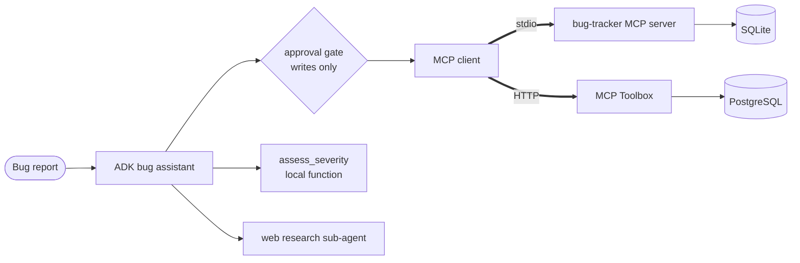
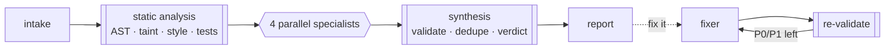
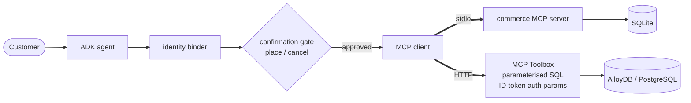

# Five Production-Grade AI Agent Architectures Built with Google ADK

**Google ADK 2.13 · Gemini · Gemini CLI · Model Context Protocol (MCP) · MCP Toolbox for Databases · PostgreSQL / AlloyDB · Cloud Run**

This repository builds five deliberately different agent architectures with the
[Google Agent Development Kit](https://google.github.io/adk-docs/). Each one targets a
production concern:
* evidence-backed research;
* safe orchestration of an external AI CLI;
* real MCP tool use;
* trustworthy automated code review;
* consequential database transactions with human approval.

| # | Agent | Architecture pattern | Key technology |
|---|---|---|---|
| **A** | [Deep Research Lead Agent](agents/lead_research/) | Two-phase multi-agent research pipeline (learn → predict) with parallel fan-out and deterministic scoring | ADK Sequential/Parallel agents · Gemini · Google Search grounding |
| **B** | [Gemini CLI Engineering Agent](agents/gemini_cli_agent/) | External tool orchestration behind a hardened execution boundary | ADK · **Gemini CLI** (headless JSON mode) · git |
| **C** | [Software Bug Assistant](agents/bug_assistant/) | MCP tool orchestration with approval-gated writes | ADK · **MCP** (stdio server + MCP Toolbox) · optional GitHub MCP |
| **D** | [Code Review Assistant](agents/code_review/) | Static analysis + parallel specialists + verified fix loop | ADK Sequential/Parallel/Loop agents · AST analysis · structured output |
| **E** | [E-Commerce Agent](agents/ecommerce/) | Transactional database agent with identity binding and a human confirmation boundary | ADK · **MCP Toolbox** · **AlloyDB / PostgreSQL** · ADK tool confirmation |

> **Status:** 186 automated tests pass locally (1 opt-in integration test skipped by
> default). Ruff is clean. All five agents load in the real `adk api_server`. The model
> is replaced by scripted test doubles in unit tests, so **conversations with Gemini
> need your credentials**. The production Toolbox/AlloyDB path is configured and
> statically validated but **was not deployed or executed** during development. See
> [Local vs production](#local-development-vs-production-architecture) and
> [docs/FINAL_AUDIT.md](docs/FINAL_AUDIT.md).

---

## Architecture overview



Every diagram in this repo reflects the code as written. Deeper diagrams are in
[docs/ARCHITECTURE.md](docs/ARCHITECTURE.md).

---

## A · Deep Research Lead Agent
**Objective:** find companies likely to enter a target market, with evidence explaining
why each was chosen.


* **Capabilities:** learns pre-entry signals (hiring, partnerships, licences, funding,
  localisation…) from real entrants, derives patterns, and finds and **scores** new
  candidates (coverage, evidence quality, recency).
* **Design decisions:**
  * search and structured-output stages are split;
  * every signal is labelled **fact** or **inference**;
  * grounding metadata is captured so the scorer can tell retrieved sources from
    invented ones;
  * the report writer can't change the ranking.
* **Try:** `Find 5 B2B SaaS companies likely to expand into India next. Learn from 3 companies that entered India in the last 4 years.`
* **Expect:** ~10 traced stages, then a report with patterns, a ranked lead table
  (tier/score), FACT/INFERENCE evidence with links, and disqualified candidates with
  reasons.

## B · Gemini CLI Engineering Agent
**Objective:** repository analysis where **ADK orchestrates and the real Gemini CLI does
the work.**


* **Capabilities:** architecture, test plan, security review, bug hunting, code quality,
  or custom tasks on any allow-listed public repo.
* **Design decisions:**
  * argv only, never `shell=True`;
  * strict URL allow-list (blocks ssh, `file://`, `ext::`, credentials, ports, traversal,
    option injection, SSRF);
  * hardened git (no hooks, symlinks or non-HTTPS protocols);
  * an environment allowlist so DB passwords and tokens never reach the CLI;
  * a timeout that kills the whole process group, capped output and guaranteed cleanup;
  * the CLI's JSON output parsed, with **cited file paths verified** against the clone.
* **Try:** `Analyze https://github.com/pallets/flask. Focus on routing and give three concrete test gaps with file paths.`
* **Expect:** one `run_gemini_cli_analysis` call with `execution: real_gemini_cli`, the
  commit SHA, token stats, and verified and unverified paths, then a structured report
  with provenance.

## C · Software Bug Assistant (MCP)
**Objective:** triage bugs (search, duplicates, severity, debugging plan) and update
tickets **only through MCP and only with approval.**


* **Capabilities:** nine MCP tools, annotated read-only or write: search, get, list,
  duplicate candidates, create, status, priority, comment, mark-duplicate. Duplicate
  refusal, a status state machine and an audit trail are enforced server-side.
* **Design decisions:**
  * local mode is still **real MCP over stdio**, so it isn't a disguised Python call;
  * production swaps in MCP Toolbox with the same tool names;
  * a deterministic P0–P3 rubric;
  * an optional read-only GitHub MCP server.
* **Try:** `Checkout returns HTTP 500 after a customer removes a coupon. Search first and don't create a ticket.`
* **Expect:** `search_tickets`, then `find_duplicate_candidates`, then `get_ticket(1)`,
  then `assess_severity`, then a structured triage recommending a comment on #1.

## D · Code Review Assistant
**Objective:** a serious, reproducible review with **P0–P3 findings** (file, line,
severity, category, explanation, fix) and a verified fix loop.


* **Capabilities:** 30+ deterministic rules (SQL and command injection, eval, secrets,
  pickle/yaml, TLS off, weak hashes, path traversal, SSRF, ZeroDivision, mutation
  during iteration, bare except…), correctness, security, testing and maintainability
  specialists, and a rule-based verdict.
* **Design decisions:**
  * LLM findings must quote real code or they're dropped;
  * a model can't dismiss a high-confidence P0/P1, which resists prompt injection in
    comments;
  * submitted code is **never executed**;
  * the fix loop exits only when re-analysis finds no P0/P1.
* **Try:** `Review vulnerable_app.py`, then `Fix it`
* **Expect:** `REQUEST_CHANGES` with 3 P0 and 8 P1 findings on the vulnerable fixture,
  and zero findings on the clean fixture.

## E · E-Commerce Agent
**Objective:** general-merchandise shopping (discovery, details, inventory, stores,
orders, status, cancel) over **MCP Toolbox + AlloyDB/PostgreSQL**, with **no purchase
without human approval**.


* **Capabilities:**
  * natural-language search and product details;
  * per-store stock and store lookup;
  * **quote → place** two-phase ordering (atomic, idempotent, oversell-proof);
  * user-scoped order history, status and cancel.
* **Design decisions:**
  * the session identity overrides any model-supplied `user_id`;
  * ADK tool confirmation is required for `place_order` and `cancel_order`;
  * quotes must come from this conversation;
  * in production, Toolbox fills `user_email` from a verified Google ID token;
  * a least-privilege database role.
* **Try:** `Buy one Insulated Bottle 1L shipped online.`, then `Yes`, then approve.
* **Expect:** a quote first, then an approval dialog with the total, and only then an
  order. Asking for another customer's order returns "not found".

---

## Quick start

```bash
git clone https://github.com/DMgaming00/CMPE-297.git
cd CMPE-297/adk-agent-assignment

python3 -m venv .venv            # Python 3.11+
source .venv/bin/activate
pip install -e ".[dev]"
cp .env.example .env             # then add GOOGLE_API_KEY (or Vertex AI settings)

python scripts/preflight.py      # PASS / WARN / FAIL readiness report
python scripts/seed_demo_data.py # create local demo databases
python scripts/mcp_smoke.py      # talk to both MCP servers over stdio (no credentials)
pytest -q                        # unit + flow tests (no credentials)

adk web agents                   # ADK Dev UI with all five agents → http://localhost:8000
```

`./scripts/setup.sh` or `make setup` does the install steps in one command. Agent B also
needs `npm install -g @google/gemini-cli` and an authenticated CLI. Useful targets:
`make check` (compile + lint + tests), `make mcp-smoke`, `make web`, `make eval`
(needs credentials and `pip install -e ".[eval]"`), and `make toolbox-up` (PostgreSQL +
MCP Toolbox containers).

## Local development vs production architecture

| Agent | Local development (default) | Production architecture |
|---|---|---|
| A | Gemini + Google Search grounding; in-memory sessions | Same agents on Cloud Run; persistent session service |
| B | Real Gemini CLI on your machine (temp clones) | Container with pinned Gemini CLI; Cloud Run (low concurrency) or a sandboxed job |
| C | **Real MCP over stdio** to the repo bug-tracker server; SQLite with fictional tickets | MCP Toolbox (`bug_tracker_tools.yaml`) → PostgreSQL/Cloud SQL; optional GitHub MCP (read-only) |
| D | Static engine offline; specialists on Gemini | CI/PR check; artifacts for reports |
| E | **Real MCP over stdio** to the repo commerce server; SQLite with fictional catalog | MCP Toolbox (`ecommerce_tools.yaml`) → AlloyDB/PostgreSQL; Google ID-token `authServices` |

**Honest boundaries:**
* SQLite isn't AlloyDB. Local mode gives the same tool contract and transaction
  semantics.
* Local Python functions are never described as MCP. The only non-MCP tools are
  labelled ones such as `assess_severity`.
* The unit tests use a **fake** Gemini CLI. The real CLI runs in normal use and in the
  opt-in integration test.
* No Cloud Run deployment or AlloyDB instance was created while building this repo.

## Repository layout

```text
.
├── agents/                     # one ADK app per folder (adk web agents)
│   ├── lead_research/          # A  agent.py · prompts.py · models.py · scoring.py · stages.py · callbacks.py
│   ├── gemini_cli_agent/       # B  agent.py · tools.py · security.py · runner.py · workspace.py
│   ├── bug_assistant/          # C  agent.py · toolsets.py · severity.py · mcp_server/ · eval/
│   ├── code_review/            # D  agent.py · stages.py · tools.py · analyzers/ · eval/
│   └── ecommerce/              # E  agent.py · guardrails.py · toolsets.py · mcp_server/ · eval/
├── adk_shared/                 # config · guardrails (confirmation, identity) · MCP helpers · seed · test doubles
├── configs/toolbox/            # MCP Toolbox manifests (production MCP for C and E)
├── database/postgres/          # PostgreSQL/AlloyDB schemas, least-privilege roles, generated seeds
├── data/demo/                  # fictional catalog, tickets, and code-review fixtures
├── docs/                       # architecture, walkthrough, deployment, security, testing, audit…
├── scripts/                    # setup.sh · preflight.py · seed_demo_data.py · mcp_smoke.py
├── tests/                      # repository-level tests (Toolbox configs, agent loading, hygiene)
├── Dockerfile · docker-compose.yml · Makefile · pyproject.toml · .env.example
└── .github/workflows/ci.yml
```

## Documentation

| Document | Contents |
|---|---|
| [docs/ARCHITECTURE.md](docs/ARCHITECTURE.md) | Detailed diagrams, state flow, guardrail sequence, ADK feature map |
| [docs/EXECUTION_WALKTHROUGH.md](docs/EXECUTION_WALKTHROUGH.md) | Step-by-step runs for A–E: commands, prompts, expected tool flows, troubleshooting |
| [docs/DEPLOYMENT.md](docs/DEPLOYMENT.md) | Cloud Run, MCP Toolbox, AlloyDB, Secret Manager |
| [docs/SECURITY.md](docs/SECURITY.md) | Threat model, red-team results, residual risks |
| [docs/TESTING.md](docs/TESTING.md) | Test strategy, ADK eval, manual production verification |
| [docs/GAP_ANALYSIS.md](docs/GAP_ANALYSIS.md) | Strict audit of the original submission and what was fixed |
| [docs/REFERENCES.md](docs/REFERENCES.md) · [docs/ORIGINALITY.md](docs/ORIGINALITY.md) | Attribution and what is original |
| [docs/FINAL_AUDIT.md](docs/FINAL_AUDIT.md) · [docs/SUBMISSION_CHECKLIST.md](docs/SUBMISSION_CHECKLIST.md) | Self-assessment and pre-submission checks |
| [SECURITY.md](SECURITY.md) · [CONTRIBUTING.md](CONTRIBUTING.md) | Policy and contribution guide |

## Acknowledgements
This work builds on the official and reference material assigned for the course:
* Google Cloud's deep research lead-generation article and
  [MagnIeeT/leadGenerationAgentADK](https://github.com/MagnIeeT/leadGenerationAgentADK);
* [derrickchwong/gemini-cli-on-adk](https://github.com/derrickchwong/gemini-cli-on-adk);
* Google's *software-bug-assistant* ADK sample;
* [ayoisio/adk-code-review-assistant](https://github.com/ayoisio/adk-code-review-assistant);
* [mtoscano84/sports-agent-adk-mcp-alloydb](https://github.com/mtoscano84/sports-agent-adk-mcp-alloydb).

No reference code was copied. See [docs/REFERENCES.md](docs/REFERENCES.md) and
[docs/ORIGINALITY.md](docs/ORIGINALITY.md).

Licensed under the [MIT License](LICENSE).
