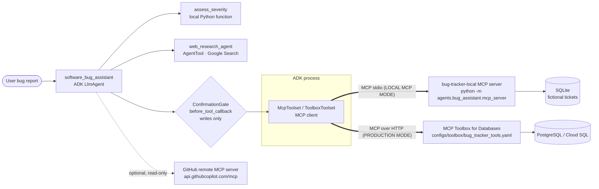

# C. MCP Software Bug Assistant

## 1. Purpose
Triage bug reports the way a senior reliability engineer would. It searches the
tracker, detects duplicates, assigns a policy-based severity, proposes ranked hypotheses
and debugging steps, and performs ticket updates only when the user approves. **All
ticket operations go through MCP.**

## 2. Architecture



| Mode | `BUG_TRACKER_BACKEND` | Transport | Storage | What is real |
|---|---|---|---|---|
| **LOCAL MCP MODE** (default) | `local` | MCP **stdio** to a repo MCP server subprocess | SQLite, seeded from `data/demo/bug_tickets.json` | Real MCP protocol, tool discovery, annotations and structured results. Development storage |
| **PRODUCTION MCP MODE** | `toolbox` | MCP Toolbox (HTTP) | PostgreSQL via parameterised SQL | Production architecture. Needs a running Toolbox and database |
| GitHub (optional) | `GITHUB_PERSONAL_ACCESS_TOKEN` set | Streamable HTTP MCP | GitHub | GitHub's MCP server, filtered to read-only tools |

There's no "fake MCP" path: in every mode the ticket tools are MCP tools. Only
`assess_severity` and `get_current_date` are plain local Python functions, and they're
labelled that way.

## 3. Why this design
* **A real protocol boundary.** The agent discovers tools at runtime over MCP. Switching
  from local to production changes the transport and storage, not the agent. Tool names
  are the same in both backends.
* **Writes need human approval, enforced in code.** ADK tool confirmation is applied by
  a callback to `create_ticket`, `update_ticket_status`, `update_ticket_priority`,
  `add_comment` and `mark_duplicate`, whichever MCP backend serves them.
* **Server-side integrity.** The MCP server validates input, enforces a ticket-status
  state machine, writes an audit comment on every change, strips control characters,
  and refuses likely duplicates unless the caller passes `allow_duplicate=true`.
* **Severity follows a fixed policy.** The LLM extracts impact facts and a
  deterministic rubric maps them to P0–P3 with an SLA.

## 4. Agent flow
1. Extract symptoms, environment, impact and start time from the report.
2. `search_tickets` with the error text, then `find_duplicate_candidates` (TF-IDF cosine;
   threshold calibrated on the demo data), then `get_ticket` for the best hits.
3. `assess_severity(...)` returns priority, factors and SLA.
4. Ranked hypotheses labelled EVIDENCE or HYPOTHESIS. `web_research_agent` handles
   unfamiliar errors.
5. A debugging plan and **one** recommended ticket action.
6. Only if the user asks: the write tool, then an ADK confirmation prompt, then the
   write runs only on approval.

## 5. File structure
| Path | Role |
|---|---|
| `agent.py` | Root agent, web research sub-agent, write confirmation gate |
| `toolsets.py` | MCP connections: local stdio, Toolbox, optional GitHub (read-only filter) |
| `prompts.py` | Triage workflow and output format |
| `severity.py` | Deterministic P0–P3 rubric (local function tool) |
| `mcp_server/server.py` | **MCP server** (MCP SDK 2.x `MCPServer`, 9 annotated tools) |
| `mcp_server/store.py` | SQLite repository, validation, state machine, audit trail |
| `mcp_server/similarity.py` | Dependency-free TF-IDF ranking |
| `eval/` | ADK eval set and criteria |
| Production config | [`configs/toolbox/bug_tracker_tools.yaml`](../../configs/toolbox/bug_tracker_tools.yaml), [`database/postgres/bug_tracker_schema.sql`](../../database/postgres/bug_tracker_schema.sql) |

## 6. Setup
Root [Quick start](../../README.md#quick-start). Local mode needs only Gemini
credentials. Production mode: `docker compose up -d` (PostgreSQL + Toolbox), then set
`BUG_TRACKER_BACKEND=toolbox`.

## 7. Environment variables
`BUG_TRACKER_BACKEND` (`local` or `toolbox`), `BUG_TRACKER_TOOLBOX_URL` (default
`http://127.0.0.1:5001`), `GITHUB_PERSONAL_ACCESS_TOKEN` (optional), `LOCAL_STATE_DIR`,
and Gemini credentials.

## 8. Run
```bash
python scripts/mcp_smoke.py   # talk to the MCP server directly, no LLM needed
adk web agents                # choose "bug_assistant"
npx @modelcontextprotocol/inspector python -m agents.bug_assistant.mcp_server  # optional
```

## 9. Example prompts
* `Checkout returns HTTP 500 after a customer removes a coupon. Started after 4.12.0, many users affected. Search first, don't create a ticket.`
* `Stock went negative during the flash sale when two people bought the last item. Is this already tracked?`
* `Add a comment to ticket 6 saying it reproduced again today.` (the approval prompt appears)

## 10. Expected behaviour
For the first prompt, the trace shows `search_tickets`, then `find_duplicate_candidates`,
then `get_ticket(1)`, then `assess_severity`. Ticket #1 is identified as the existing
issue. The answer has Summary, Related tickets, Severity, Likely causes, Debugging steps
and Recommended ticket action (comment on #1, no new ticket). For the third prompt,
ADK Web shows an approve/reject dialog, and the comment is written only after approval.

## 11. Tests
```bash
pytest agents/bug_assistant -q    # 34 tests
```
The tests cover:
* search, retrieval and filters;
* duplicate detection on paraphrased reports, and no flags on unrelated ones;
* refusing to create duplicates;
* create and update validation, and control-character stripping;
* the status state machine and audit trail;
* the severity policy;
* an **MCP contract test over real stdio** (tool set, read-only and write annotations,
  required fields, structured errors);
* an **ADK Runner flow test** showing reads run freely and writes wait for approval;
* the GitHub read-only filter.

## 12. Production path
Apply `bug_tracker_schema.sql`, which also enforces the state machine with a trigger
and creates a least-privilege `bug_app` role. Serve `bug_tracker_tools.yaml` with MCP
Toolbox on Cloud Run, with the config loaded from Secret Manager, and point
`BUG_TRACKER_TOOLBOX_URL` at it. See [DEPLOYMENT.md](../../docs/DEPLOYMENT.md).

## 13. Limitations
* The duplicate threshold (0.28) was calibrated on 16 demo tickets. Re-calibrate on real
  data, or switch to embeddings (pgvector) in production.
* In Toolbox mode, ranking uses PostgreSQL full-text search and there's no automatic
  duplicate refusal. The agent's workflow still checks for duplicates first.
* The local server trusts its caller (stdio has no auth channel). The ADK process is
  the only client.
* The GitHub MCP integration is optional. It wasn't exercised here because it needs a
  personal access token, and its tool names come from GitHub's server and can change.

## 14. Improvements beyond the reference
The official sample (`google/adk-samples` *software-bug-assistant*) uses MCP Toolbox +
Cloud SQL tickets, a search agent and a GitHub MCP server. This implementation keeps
those ideas and adds:
* a **zero-cost local mode that is still real MCP**;
* MCP tool annotations (`readOnlyHint` / `destructiveHint`);
* deterministic duplicate scoring and duplicate refusal;
* a ticket state machine, in Python and as a database trigger;
* audit comments;
* a deterministic severity rubric;
* code-enforced write approval;
* a read-only GitHub filter;
* contract, flow and eval tests.

See [ORIGINALITY.md](../../docs/ORIGINALITY.md).
