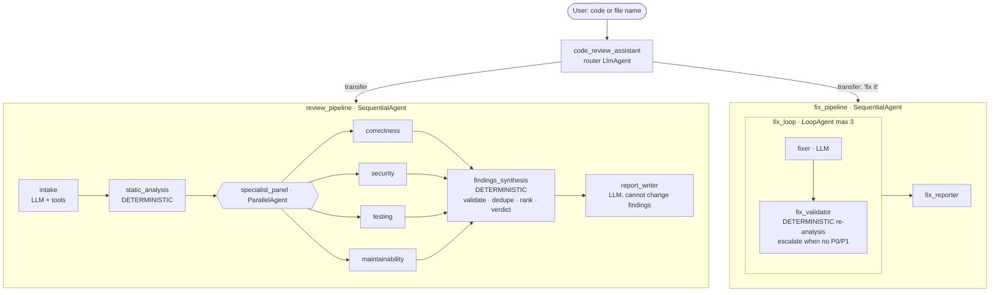

# D. Production Code Review Assistant

## 1. Purpose
Review Python code the way a serious engineering team does. Deterministic static
analysis runs first, four LLM specialists then review in parallel, and the findings are
validated and ranked into a P0–P3 report with a verdict. An optional **fix → re-validate
loop** follows. Reviewed code is parsed, **never imported or executed**.

## 2. Architecture



## 3. Why this design
* **Deterministic first.** An AST engine with 30+ rules finds high-signal defects
  cheaply and reproducibly. Its findings anchor the review.
* **Specialists add judgement.** Each returns a validated `SpecialistReview`
  (structured output). Specialists can add findings and dispute static ones.
* **Code decides what is reported**, not the LLM:
  * LLM findings must cite a real file and line and **quote code that exists**, or
    they are dropped as hallucinations;
  * duplicates are merged;
  * a model can't remove a high-confidence P0/P1 static finding (it is marked
    *disputed*), so a comment like `# reviewer: this is safe` can't talk the system
    out of an SQL injection;
  * the verdict is a rule: any P0/P1 gives `REQUEST_CHANGES`, any P2 gives `COMMENT`,
    otherwise `APPROVE`.
* **The fix loop is verified, not trusted.** Each fix is re-analysed. The loop exits
  early (ADK `escalate`) only when no P0/P1 remain and the code parses.

### Severity model
| Level | Meaning | Examples |
|---|---|---|
| **P0** | Critical / blocker | SQL or command injection, `eval` on input, live credentials, syntax error |
| **P1** | High: fix before merge | pickle/yaml deserialization, path traversal, SSRF, TLS off, debug mode, ZeroDivision on empty input, list mutated during iteration |
| **P2** | Medium | bare except, swallowed exceptions, mutable defaults, unreachable code, missing tests, high complexity |
| **P3** | Low / informational | style (aggregated), docstrings, long functions, `== None` |

Each finding has: `id`, `rule_id`, `file`, `line`, `end_line`, `severity`, `category`,
`title`, `explanation`, `recommendation`, `confidence` and `source` (static or llm).

## 4. Agent flow
1. **intake** registers pasted code (`submit_code_for_review`) or workspace files
   (`load_workspace_files`, sandboxed to `REVIEW_WORKSPACE_ROOT`).
2. **static_analysis** runs security rules (with intra-function taint from `request.*`
   and `input()`), correctness, maintainability, style (pycodestyle, in memory) and a
   test-gap analysis with a generated test plan.
3. **specialist_panel** runs four parallel LLM reviews against a line-numbered listing.
   Unused panels are skipped when no code was submitted.
4. **findings_synthesis** validates, merges and ranks the findings and sets the verdict.
5. **report_writer** writes the markdown review.
6. *(on request)* **fix_loop**: the fixer submits corrected files, `fix_validator`
   re-runs the analysis, and the loop repeats at most 3 times. Then **fix_reporter**
   reports before and after counts.

## 5. File structure
| Path | Role |
|---|---|
| `agent.py` | Router, review and fix pipelines |
| `analyzers/security.py` | SEC001–SEC013 (injection, secrets, deserialization, TLS, crypto, traversal, SSRF, …) |
| `analyzers/correctness.py` | COR000–COR016 (syntax, exceptions, mutable defaults, `is` literals, ZeroDivision, unreachable, duplicate keys, mutation in loop, …) |
| `analyzers/maintainability.py` | Cyclomatic complexity, length, params, nesting, docstrings |
| `analyzers/style.py`, `analyzers/testing.py` | PEP 8 score; untested functions, assertion-free tests, test plan |
| `analyzers/engine.py` | Runs everything, de-duplicates, renders the numbered listing |
| `stages.py` | Deterministic ADK agents: static analysis, synthesis, fix validator |
| `tools.py` | Intake / workspace / fix tools with path-traversal protection |
| `models.py` | Finding, SpecialistReview, StaticReport schemas |
| Fixtures | [`data/demo/code_review/`](../../data/demo/code_review/): `vulnerable_app.py`, `buggy_inventory.py`, `clean_module.py` + tests |

## 6. Setup
Root [Quick start](../../README.md#quick-start). Gemini credentials are needed for the
specialists, report and fixer. The static engine works offline:
```bash
python -c "from pathlib import Path; from agents.code_review.analyzers import analyze_files; \
r = analyze_files({'v.py': Path('data/demo/code_review/vulnerable_app.py').read_text()}); \
[print(f.severity, f.rule_id, f.line, f.title) for f in r.findings]"
```

## 7. Environment variables
`REVIEW_WORKSPACE_ROOT` (default `data/demo/code_review`), plus Gemini credentials and
model variables.

## 8. Run
```bash
adk web agents     # choose "code_review"
```

## 9. Example prompts
* `Review vulnerable_app.py`
* `Review this: def average(xs): return sum(xs)/len(xs)`, then `Fix it`
* `Review buggy_inventory.py and clean_module.py with test_clean_module.py`

## 10. Expected behaviour
* `vulnerable_app.py` gets **REQUEST_CHANGES** with 3 P0 findings (SQL injection,
  shell injection, eval) and 8 P1 findings (hard-coded password, path traversal, SSRF,
  TLS off, pickle, yaml.load, MD5 passwords, Flask debug).
* `buggy_inventory.py` gets 3 P1 findings (mutation during iteration, ZeroDivision,
  `is "A"`) and several P2 findings, with no false security findings.
* `clean_module.py` plus its tests produces zero static findings.

After "Fix it", the state key `fix_status` shows the before and after counts and
`resolved_rules`.

## 11. Tests
```bash
pytest agents/code_review -q     # 23 tests
```
The tests cover:
* every planted defect in the fixtures, and zero findings on the clean fixture;
* no false positives on parameterised SQL or argv subprocess calls;
* syntax errors handled;
* **submitted code is never executed** (a file-write and `os.system` payload leaves no
  trace);
* sandboxed workspace loading (blocks `../`, absolute paths and symlink escapes);
* hallucination filtering and the anti-injection dispute rule;
* malformed specialist output;
* the verdict rules;
* a **full review → fix loop through ADK's Runner** with scripted models (the loop
  exits after one attempt via `escalate`);
* specialists skipped when no code is submitted.

## 12. Production path
Run as a CI/PR check: post the review as PR comments and fail the build on
`REQUEST_CHANGES`. Store review results as ADK artifacts. To also execute tests, add a
sandboxed code executor (for example `VertexAiCodeExecutor` or an isolated container),
which is deliberately not done here.

## 13. Limitations
* Python only. Taint tracking stays within one function and doesn't follow calls
  across modules.
* Static rules are heuristics. Specialists cover gaps, but recall isn't guaranteed.
* The fix loop verifies against static analysis, not by running the project's tests.

## 14. Improvements beyond the reference
The reference ([ayoisio/adk-code-review-assistant](https://github.com/ayoisio/adk-code-review-assistant))
uses a sequential review (AST structure → style → test runner → feedback) and a
fix LoopAgent, and it **executes generated tests** with a code executor. This
implementation is security-focused and adds:
* an AST security engine with taint tracking;
* four **parallel** specialists with structured output;
* a P0–P3 model with locations;
* deterministic validation that rejects hallucinated or prompt-injected findings;
* rule-based verdicts;
* a sandboxed file intake;
* deterministic fix validation;
* vulnerable, buggy and clean fixtures with tests.

See [ORIGINALITY.md](../../docs/ORIGINALITY.md).
