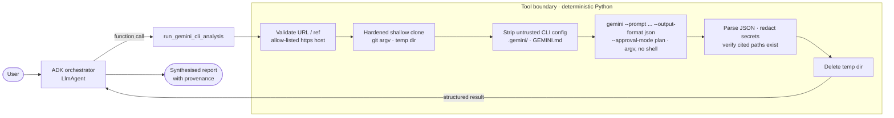

# B. Gemini CLI Engineering Agent

## 1. Purpose
Repository-level engineering analysis (architecture, test plans, security review, bug
hunting, code quality) where **ADK orchestrates and the real Gemini CLI does the work**.
ADK plans the task, invokes the CLI as a tool on a fresh clone, then checks and
synthesises the result.

## 2. Architecture



## 3. Why this design
* **The CLI is a tool, not the application.** The ADK agent converts the request into a
  task type and a focused prompt, and decides what to show the user.
* **The security boundary lives in Python, not in the prompt.** URL validation, git
  hardening, the environment allowlist, timeouts and output caps are all code, and all
  unit-tested.
* **Answers are checked against the repo.** Every file path the CLI mentions is checked
  against the clone before it is deleted. The orchestrator reports any non-existent
  paths.

## 4. Agent flow
1. The orchestrator picks `task_type` (`explain_architecture`, `test_plan`,
   `security_review`, `bug_hunt`, `code_quality` or `custom`) and writes a `focus`.
2. `run_gemini_cli_analysis` validates the input, then clones with
   `git -c protocol.allow=never -c protocol.https.allow=always -c core.symlinks=false -c core.hooksPath=/dev/null ... clone --depth 1 --single-branch --no-tags -- <url> <tmp>`.
3. It deletes `.gemini/` and `GEMINI.md` files, which could reconfigure or instruct the
   CLI, and enforces size and file-count limits.
4. It runs `gemini --prompt <one argv element> --output-format json --approval-mode plan`
   in the clone, with a filtered environment, a process-group timeout, and capped
   stdout and stderr.
5. It parses the CLI's JSON (`response`, `stats`, `error`), redacts secrets, verifies
   cited paths, records the commit SHA, and deletes the temp dir in `finally`.
6. The orchestrator synthesises findings, next steps and provenance.

## 5. File structure
| File | Role |
|---|---|
| `agent.py` | Orchestrator `LlmAgent` |
| `tools.py` | ADK tools, prompt construction, JSON parsing, concurrency limit |
| `security.py` | URL/ref validation, hardened git/gemini argv, env allowlists |
| `runner.py` | Async bounded subprocess (timeout kills the process group, capped output) |
| `workspace.py` | Temp clone lifecycle, untrusted-config stripping, path verification |
| `tests/` | Unit tests, local git and fake-CLI tests, opt-in real-CLI integration test |

## 6. Setup
```bash
npm install -g @google/gemini-cli     # Node.js 20+; developed against gemini-cli 0.66.0
gemini --version
# Authenticate the CLI: export GEMINI_API_KEY=...   (or Vertex AI env vars / `gemini` login)
```

## 7. Environment variables
| Variable | Default | Purpose |
|---|---|---|
| `GEMINI_CLI_PATH` | `gemini` | CLI binary |
| `GEMINI_CLI_MODEL` | (CLI default) | Model passed with `--model` (validated) |
| `GEMINI_CLI_TIMEOUT_SECONDS` | 300 | Wall-clock limit (30–1800) |
| `GEMINI_CLI_MAX_CONCURRENCY` | 2 | Simultaneous CLI runs per process |
| `GEMINI_CLI_SANDBOX` | false | Add `--sandbox` (needs Docker/Podman/Seatbelt) |
| `GEMINI_CLI_ALLOWED_HOSTS` | `github.com,gitlab.com` | Clone host allowlist |
| `GIT_CLONE_TIMEOUT_SECONDS`, `REPO_MAX_FILES`, `REPO_MAX_MB` | 90 / 20000 / 300 | Clone limits |

## 8. Run
```bash
adk web agents      # choose "gemini_cli_agent"
```

## 9. Example prompts
* `Analyze https://github.com/pallets/flask. Focus on routing: give three concrete test gaps with file paths.`
* `Do a security review of https://github.com/psf/requests, focusing on redirects and auth handling.`

## 10. Expected behaviour
The trace shows one function call to `run_gemini_cli_analysis`, which takes about
30–120 s. Its response contains `execution: "real_gemini_cli"`, the repo commit,
`cli.duration_s` and `cli.stats` with token counts, plus `cited_paths.verified` and
`cited_paths.unverified`. The final answer has Repository, Findings, Next steps and
Provenance sections.

## 11. Tests
```bash
pytest agents/gemini_cli_agent -q                                   # 62 tests, no credentials
RUN_GEMINI_CLI_INTEGRATION=1 pytest -m integration agents/gemini_cli_agent   # real CLI
```
The unit tests cover:
* 26 malicious or unsupported URLs (ssh, `file://`, `ext::`, credentials, ports,
  traversal, option injection, SSRF hosts, encodings, newlines);
* ref validation and hardened argv construction;
* shell metacharacters staying a single argv element;
* environment secret filtering;
* a timeout that kills the whole process group, including grandchildren;
* output caps with no deadlock;
* missing binary and non-zero exit;
* temp-dir cleanup on success, failure and exceptions;
* repository size limits and untrusted-config stripping.

**Tests that need the CLI use a fake `gemini` executable**, a clearly labelled test
double that copies the CLI's JSON contract. Its auth-error shape and stream were
captured from a real gemini-cli 0.66.0 run. Clones in those tests use real `git`
against a local fixture repo.

**Verified locally with the real CLI:** the tool was run against the real Gemini CLI
0.66.0 binary and a real public GitHub clone (`pallets/markupsafe`) without credentials.
The clone, the config stripping and the CLI invocation all worked, and the CLI returned
its structured auth error (exit 41), which the tool reported cleanly. A successful
analysis needs your CLI credentials.

## 12. Production path
The Dockerfile installs a pinned Gemini CLI in the image. On Cloud Run:
* give the service a dedicated service account with Vertex AI access only;
* set `GOOGLE_GENAI_USE_VERTEXAI=true` and the project/location for the CLI;
* keep concurrency low (`--concurrency 2` matches `GEMINI_CLI_MAX_CONCURRENCY`);
* for untrusted multi-tenant use, move the clone+CLI step into a Cloud Run **job** or
  gVisor sandbox with egress restricted to the git host and Gemini API.

## 13. Limitations
* `--approval-mode plan` and the untrusted-folder fallback keep the CLI read-only, but
  it still reads repository content, which can contain prompt-injection text.
  `GEMINI.md` and `.gemini/` are removed and the result is treated as untrusted data.
  Residual risk remains: misleading analysis. Code execution and edits are not allowed.
* Only public repositories. Private repos would need short-lived tokens scoped per
  request, which is out of scope here.
* Path verification only checks that a file exists, not that the claim about it is
  correct.

## 14. Improvements beyond the reference
The reference ([derrickchwong/gemini-cli-on-adk](https://github.com/derrickchwong/gemini-cli-on-adk))
builds `git clone "{url}"` and `gemini -p "{task}"` as **shell strings with
`shell=True`**, clones into a shared `/tmp/<repo>` that is reused and never cleaned, and
passes the full environment. This implementation replaces all of that with:
* argv-only execution and strict URL validation;
* per-run private temp dirs with guaranteed cleanup;
* git hardening and an environment allowlist;
* process-group timeouts and output caps;
* JSON output parsing, the read-only approval mode and untrusted-config stripping;
* citation verification;
* a concurrency limit;
* 62 tests.

See [ORIGINALITY.md](../../docs/ORIGINALITY.md).
