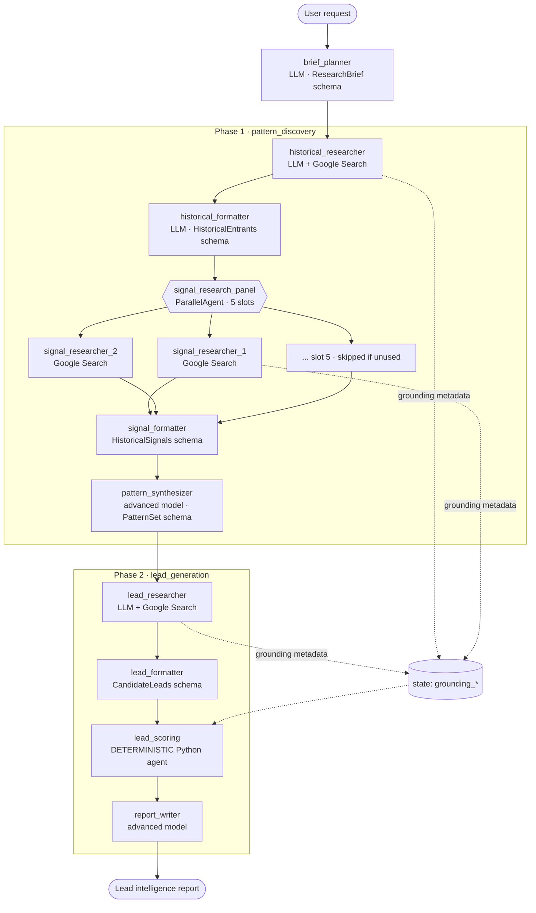

# A. Deep Research Lead Generation Agent

## 1. Purpose
Find companies that are likely to expand into a target market. The agent doesn't ask
Gemini to name some leads. It **learns what preceded real market entries**, then
**searches for companies showing those signals now**, and **scores them with a
deterministic, explainable formula**.

## 2. Architecture



## 3. Why this design
* **Separating learning from prediction** stops the model from listing famous companies.
  Leads must match patterns derived from evidence.
* **Search → format split.** Google Search grounding and structured output are kept in
  separate agents, so every downstream stage receives validated Pydantic data.
* **A dynamic fan-out inside a static ADK graph.** Five parallel signal-research slots
  are each assigned a company at runtime by an instruction provider. A
  `before_agent_callback` skips unused slots without calling the model.
* **Deterministic scoring.** The model gathers evidence and code decides the ranking.
  The same evidence always produces the same score.
* **Hallucinated citations are detected.** `after_model_callback` records the source
  domains Google Search actually returned (grounding metadata). The scorer rewards
  citations from those domains and reports `grounded_signals` per lead.

## 4. Agent flow
1. `brief_planner` turns the request into a `ResearchBrief` (market, industry, counts,
   exclusions).
2. `historical_researcher` finds companies that recently entered the market. Its notes
   are formatted into `HistoricalEntrants`.
3. Parallel signal researchers look for pre-entry signals per company (hiring,
   partnerships, local entity, licences, funding, localisation, and so on), labelled
   **fact** or **inference**.
4. `pattern_synthesizer` derives 3–6 recurring patterns. A pattern rated high or medium
   needs at least two supporting companies.
5. `lead_researcher` finds current companies showing those patterns, excluding the
   historical entrants.
6. `lead_scoring` disqualifies and scores candidates, de-duplicates them, and ranks them
   into tiers A, B and C.
7. `report_writer` writes the report. It can't change the ranking.

**Scoring formula** (see [`scoring.py`](scoring.py)):
`score = 55·pattern_coverage + 25·evidence_quality + 20·recency`. Coverage is weighted
by pattern strength. A fact with a source counts more than an inference. A candidate is
disqualified if it is already in the market, is a historical entrant, was excluded by
the user, or has no sourced fact.

## 5. File structure
| File | Role |
|---|---|
| `agent.py` | Pipeline assembly (Sequential / Parallel agents) |
| `prompts.py` | Static prompts + instruction providers that inject state as JSON |
| `models.py` | Pydantic schemas for every structured stage |
| `scoring.py` | Deterministic qualification and scoring |
| `stages.py` | `LeadScoringAgent` (custom `BaseAgent`, no LLM) |
| `callbacks.py` | Grounding capture, slot guard |
| `tests/` | Scoring and pipeline tests |

## 6. Setup
Follow the root [Quick start](../../README.md#quick-start). This agent needs Gemini
credentials. Google Search grounding is a built-in Gemini tool.

## 7. Environment variables
`GOOGLE_API_KEY` or Vertex AI (`GOOGLE_GENAI_USE_VERTEXAI=true`, `GOOGLE_CLOUD_PROJECT`,
`GOOGLE_CLOUD_LOCATION`), plus optional `GEMINI_FAST_MODEL` and `GEMINI_ADVANCED_MODEL`.

## 8. Run
```bash
adk web agents          # choose "lead_research"
# or
adk run agents/lead_research
```

## 9. Example prompts
* `Find 5 B2B SaaS companies likely to expand into India next. Learn from 3 companies that entered India in the last 4 years.`
* `Which European fintechs might enter Brazil? Study 3 recent entrants, exclude Nubank.`

## 10. Expected behaviour
The ADK Web trace shows about 10 stages. The parallel panel runs one researcher per
historical company, and unused slots finish instantly with `NO_COMPANY`. The final
report includes:
* the patterns learned, with supporting companies and lead times;
* a ranked lead table with tier, score and matched patterns;
* evidence per lead labelled FACT or INFERENCE, with source links;
* the disqualified candidates and the reason for each;
* the search queries used.

Session state holds every intermediate artefact: `research_brief`,
`historical_entrants`, `historical_signals`, `expansion_patterns`, `candidate_leads`
and `scored_leads`.

## 11. Tests
```bash
pytest agents/lead_research -q
```
The tests cover the scoring maths, tiers, every disqualification rule,
de-duplication, the grounding bonus, determinism, and the date and URL helpers. A
**full scripted run of the whole pipeline** goes through ADK's Runner. In that run the
models are test doubles and search is disabled, so it checks the orchestration and data
hand-offs, not research quality.

## 12. Production path
Deploy with the repository Dockerfile to Cloud Run ([DEPLOYMENT.md](../../docs/DEPLOYMENT.md)).
For long research runs, use a persistent session service (`--session_service_uri`) so
reports survive restarts. Add a paid search or data provider (Crunchbase, LinkedIn
Sales Navigator) as an additional tool for firmographics.

## 13. Limitations
* Research quality depends on what Google Search can find. Small or private companies
  may have little evidence.
* Grounding verification matches by domain. It shows a source was retrieved, not that
  it supports the specific claim.
* The pattern sample is small (at most 5 companies), so patterns are hypotheses, and
  the report says so.
* A full run makes roughly 10–14 model calls. Cost and latency scale with
  `seed_company_count`.

## 14. Improvements beyond the reference
The reference ([MagnIeeT/leadGenerationAgentADK](https://github.com/MagnIeeT/leadGenerationAgentADK))
pioneered the pattern-discovery → lead-generation split, with interactive confirmation
and a custom fan-out orchestrator. This implementation adds:
* deterministic, documented scoring and qualification, so ranking isn't left to the LLM;
* grounding-metadata capture to separate retrieved sources from invented ones;
* fact/inference labelling on every signal;
* explicit disqualification reasons;
* fan-out with skip guards inside a static, inspectable ADK graph;
* tests for the full pipeline and the scoring.

See [ORIGINALITY.md](../../docs/ORIGINALITY.md).
