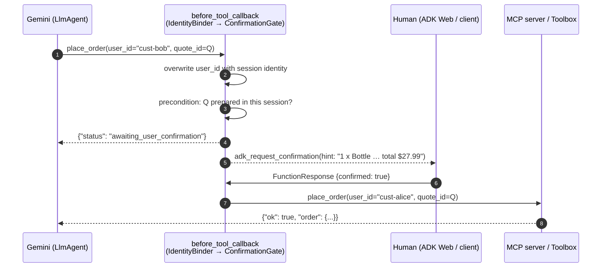
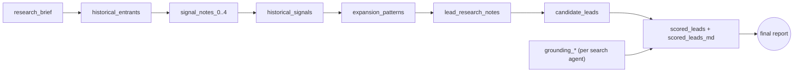
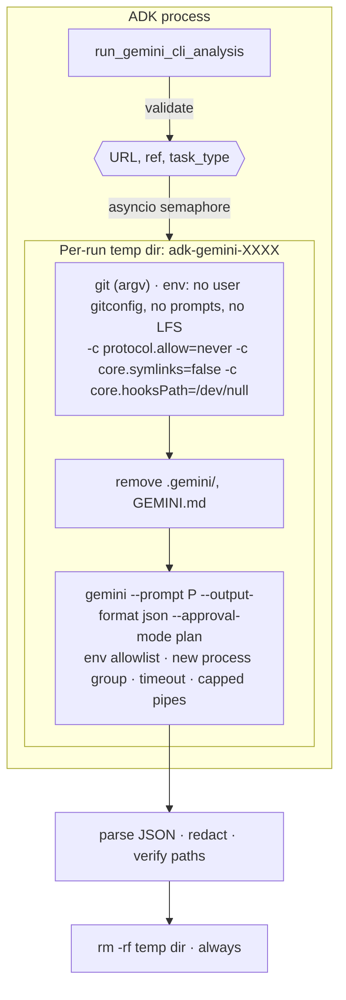
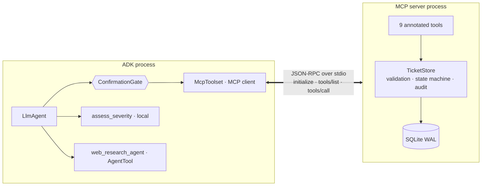
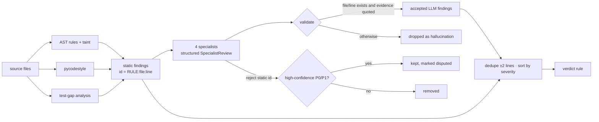
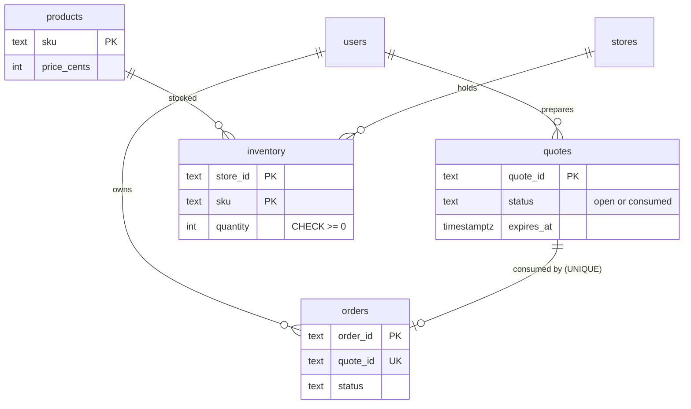

# Architecture

## Design principles
1. **Each agent shows a different ADK pattern.** Agents A–E aren't five copies of one
   chatbot.
2. **Models reason, code decides.** Anything that must be correct is deterministic
   Python, implemented as tools, custom agents or callbacks:
   * rankings (A);
   * process isolation (B);
   * ticket integrity (C);
   * verdicts (D);
   * purchases (E).
3. **Guardrails live outside the prompt.** Confirmation and identity are ADK callbacks
   that a prompt-injected model can't skip.
4. **Every protocol claim is literal.** "MCP" always means the MCP protocol. Local
   functions are labelled as local.

## ADK feature map

| ADK capability | Where it is used |
|---|---|
| `LlmAgent` with tools | B, C, E (root agents); D intake/fixer |
| `SequentialAgent` | A (root, both phases), D (review and fix pipelines) |
| `ParallelAgent` | A (signal research panel), D (specialist panel) |
| `LoopAgent` + `escalate` | D fix loop (exits when the deterministic validator passes) |
| Custom `BaseAgent` (no LLM) | A `LeadScoringAgent`; D `StaticAnalysisAgent`, `FindingsSynthesisAgent`, `FixValidationAgent` |
| `output_schema` (Pydantic structured output) + `output_key` | A (6 stages), D (4 specialists) |
| Instruction providers (callables) | A (inject research state as JSON) |
| `include_contents="none"` | A/D downstream stages: state-driven, no chat-history leakage |
| `before_agent_callback` | A slot guards, D skip-if-no-code and review reset |
| `after_model_callback` | A Google Search grounding capture |
| `before_tool_callback` / `after_tool_callback` | C/E confirmation gate, E identity binder, E quote tracking |
| Tool confirmation (`request_confirmation`, `adk_request_confirmation`) | C writes, E `place_order` / `cancel_order` |
| `AgentTool` | C web research sub-agent |
| Built-in `google_search` | A researchers, C web research |
| `McpToolset` + `StdioConnectionParams` | C, E local MCP mode |
| `McpToolset` + `StreamableHTTPConnectionParams` + `tool_filter` | C optional GitHub MCP (read-only) |
| `ToolboxToolset` (`auth_token_getters`) | C, E production mode |
| Agent transfer (`sub_agents`) | D router to the review or fix pipeline |
| Session state | All agents; D/A pipelines are fully state-driven |
| `adk eval` eval sets | C, D, E (`agents/*/eval/`) |

> ADK 2.x marks `SequentialAgent`, `ParallelAgent` and `LoopAgent` as deprecated in
> favour of the graph-based `Workflow` API. They remain fully supported in 2.13.
> `Workflow` can't yet be used as an `LlmAgent` sub-agent, which agent D's router
> requires. These agents were therefore kept for consistency. Migrating A to `Workflow`
> is a self-contained follow-up.

## Shared guardrail sequence (agents C and E)

The same sequence is executed by `agents/ecommerce/tests/test_agent_flow.py` through
ADK's real Runner and the real MCP stdio server.

## A. Lead research: state flow

## B. Gemini CLI: process isolation

## C. Bug assistant: MCP boundary

## D. Code review: finding lifecycle

## E. E-commerce: data model

## Concurrency and scale ("what breaks with 100 users?")

| Concern | Mitigation in this repo | Remaining limit |
|---|---|---|
| Oversell under concurrent purchase (E) | `BEGIN IMMEDIATE` + conditional decrement (SQLite); single-statement CTE + `CHECK (quantity >= 0)` (PostgreSQL); tested with 4 threads | SQLite serialises writers. Production uses PostgreSQL. |
| Duplicate submission / retries (E) | Idempotent `place_order` per quote (`UNIQUE(quote_id)`) | — |
| Cross-user access (E) | Identity forced by callback; every query scoped by user; Toolbox auth params | Local identity mapping is a demo convenience |
| Many Gemini CLI runs (B) | Per-loop semaphore (`GEMINI_CLI_MAX_CONCURRENCY`), per-run temp dirs, process-group kill, capped output, repo size limits | Clones use disk and network. Use a Cloud Run job for scale. |
| Model returning malformed JSON (A, D) | Pydantic `output_schema`; deterministic stages validate state and degrade with warnings | A malformed specialist output is ignored, so coverage drops |
| Tool / MCP failures | Structured `{ok:false,error:{code,message}}` results; MCP `isError` mapped; stdio timeout configurable | No automatic retries with backoff |
| Session state growth | Listings capped (60 KB), findings capped (25), grounding sources capped | In-memory sessions by default. Use a DB session service. |
| Rate limits / quotas | Model names configurable; fewer calls via skip guards and deterministic stages | No client-side rate limiter |
