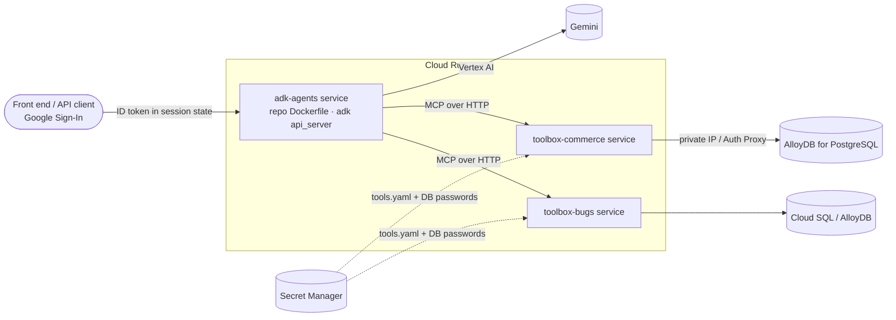

# Deployment

> Nothing was deployed while building this repository. The commands follow the current
> Google Cloud, ADK and MCP Toolbox documentation (checked 2026-10-29). Run them in
> your own project and record the results.

## Topology



## 1. Project setup
```bash
export PROJECT_ID=<your-project> REGION=us-central1
gcloud config set project $PROJECT_ID
gcloud services enable run.googleapis.com aiplatform.googleapis.com \
  artifactregistry.googleapis.com cloudbuild.googleapis.com secretmanager.googleapis.com \
  alloydb.googleapis.com servicenetworking.googleapis.com compute.googleapis.com
gcloud artifacts repositories create agents --repository-format=docker --location=$REGION
```

## 2. Database (AlloyDB for PostgreSQL)
Create a cluster and primary instance on a private network, following
[AlloyDB quickstart](https://cloud.google.com/alloydb/docs/quickstart/create-and-connect).
Then apply the schema and seed from a host that can reach it (for example through the
AlloyDB Auth Proxy):
```bash
psql "host=127.0.0.1 port=5432 user=postgres dbname=store" -f database/postgres/ecommerce_schema.sql
psql "host=127.0.0.1 port=5432 user=postgres dbname=store" -f database/postgres/ecommerce_seed.sql
psql "host=127.0.0.1 port=5432 user=postgres" -c "CREATE DATABASE bugs"
psql "host=127.0.0.1 port=5432 user=postgres dbname=bugs" -f database/postgres/bug_tracker_schema.sql
psql "host=127.0.0.1 port=5432 user=postgres dbname=bugs" -f database/postgres/bug_tracker_seed.sql
# least-privilege roles were created by the schema files; set their passwords:
psql ... -c "ALTER ROLE commerce_app PASSWORD '<from Secret Manager>'"
```
The Toolbox configs use the generic `postgres` source type, which works with AlloyDB
over private IP or the Auth Proxy. To use IAM database auth instead, change the source
to Toolbox's native `type: alloydb-postgres` (project, region, cluster, instance).

## 3. MCP Toolbox on Cloud Run
(Pattern from the official Toolbox Cloud Run guide.)
```bash
gcloud iam service-accounts create toolbox-identity
gcloud projects add-iam-policy-binding $PROJECT_ID \
  --member serviceAccount:toolbox-identity@$PROJECT_ID.iam.gserviceaccount.com \
  --role roles/secretmanager.secretAccessor
gcloud projects add-iam-policy-binding $PROJECT_ID \
  --member serviceAccount:toolbox-identity@$PROJECT_ID.iam.gserviceaccount.com \
  --role roles/alloydb.client

gcloud secrets create commerce-tools --data-file=configs/toolbox/ecommerce_tools.yaml
gcloud secrets create commerce-db-password --data-file=- <<< '<commerce_app password>'

gcloud run deploy toolbox-commerce \
  --image us-central1-docker.pkg.dev/database-toolbox/toolbox/toolbox:1.15.0 \
  --service-account toolbox-identity --region $REGION --no-allow-unauthenticated \
  --set-secrets "/app/tools.yaml=commerce-tools:latest,DB_PASSWORD=commerce-db-password:latest" \
  --set-env-vars "DB_HOST=<alloydb-private-ip>,DB_PORT=5432,DB_NAME=store,DB_USER=commerce_app,GOOGLE_OAUTH_CLIENT_ID=<client-id>" \
  --network default --subnet default \
  --args="--config=/app/tools.yaml","--address=0.0.0.0","--port=8080"
```
Repeat with `configs/toolbox/bug_tracker_tools.yaml` for `toolbox-bugs`, setting
`BUG_DB_NAME=bugs` and `DB_USER=bug_app`.

## 4. Agents on Cloud Run
`adk deploy cloud_run` packages a **single agent folder**. These agents import the
shared `adk_shared/` package, so deploy the repository container instead:
```bash
gcloud iam service-accounts create adk-agents
gcloud projects add-iam-policy-binding $PROJECT_ID \
  --member serviceAccount:adk-agents@$PROJECT_ID.iam.gserviceaccount.com --role roles/aiplatform.user
gcloud run services add-iam-policy-binding toolbox-commerce --region $REGION \
  --member serviceAccount:adk-agents@$PROJECT_ID.iam.gserviceaccount.com --role roles/run.invoker

IMAGE=$REGION-docker.pkg.dev/$PROJECT_ID/agents/adk-agents:v1
gcloud builds submit --tag $IMAGE .
gcloud run deploy adk-agents --image $IMAGE --region $REGION \
  --service-account adk-agents@$PROJECT_ID.iam.gserviceaccount.com \
  --no-allow-unauthenticated --concurrency 4 --timeout 900 --memory 2Gi \
  --set-env-vars "GOOGLE_GENAI_USE_VERTEXAI=true,GOOGLE_CLOUD_PROJECT=$PROJECT_ID,GOOGLE_CLOUD_LOCATION=$REGION,ECOMMERCE_BACKEND=toolbox,BUG_TRACKER_BACKEND=toolbox,TOOLBOX_URL=https://toolbox-commerce-<hash>.run.app,BUG_TRACKER_TOOLBOX_URL=https://toolbox-bugs-<hash>.run.app,GEMINI_CLI_MAX_CONCURRENCY=2"
```
* The default command is `adk api_server`. Set `ADK_COMMAND=web` only for a private
  demo, because the dev UI is unauthenticated by design.
* **Calling a private Toolbox service** from the agents needs a Google-signed ID token
  for the Toolbox URL. Add an `additional_headers` entry on `ToolboxToolset` with
  `toolbox_adk.CredentialStrategy.workload_identity(...)` if you keep Toolbox private.
  This wiring is left as a documented step because it depends on your IAM layout.
* **Sessions:** pass `--session_service_uri` (for example a Cloud SQL or Agent Engine
  session service) so long research runs survive instance restarts.
* **Agent B on Cloud Run:** the image contains a pinned Gemini CLI. With Vertex env vars
  the CLI authenticates via the service account. For untrusted repositories, run the
  clone+CLI step as a Cloud Run **job** with restricted egress.

## 5. Front end identity (E in production)
Your front end signs the user in with Google and creates or updates the ADK session
with `state["temp:google_id_token"] = <ID token>` before each turn. `ToolboxToolset`
forwards it via `auth_token_getters={"google-signin": …}`. Toolbox verifies it against
`GOOGLE_OAUTH_CLIENT_ID` and fills `user_email`. The LLM never sees or controls it.

## 6. Production checklist
- [ ] Services deployed with `--no-allow-unauthenticated`
- [ ] Toolbox config and DB passwords stored only in Secret Manager
- [ ] DB users are `commerce_app` / `bug_app` (least privilege), not `postgres`
- [ ] Vertex AI quotas sized; model names set explicitly
- [ ] Persistent session service configured
- [ ] Cloud Logging reviewed: tool logs are redacted JSON lines (`adk_shared.logging_utils`)
- [ ] `docs/TESTING.md` production verification steps executed and recorded
