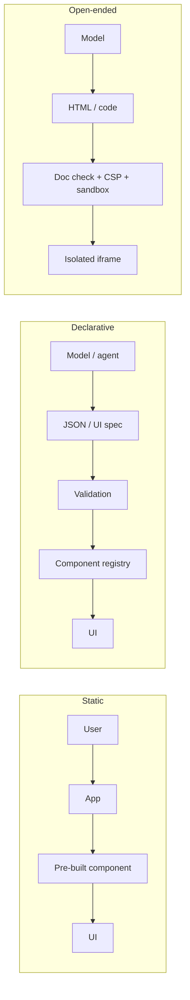
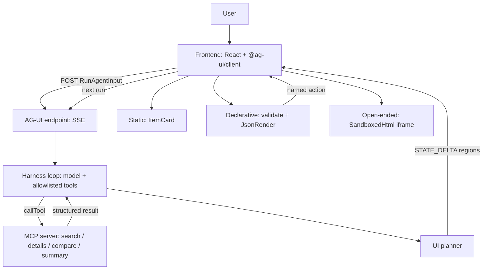

<div align="center">

# GenUX Codelabs

### Generative UI, built up one layer at a time

**A2UI · AG-UI · MCP Apps · JSON Render · OpenUI · Harness Integration**, and a mixed-mode capstone that uses all of them.


</div>

> **Author:** Dev Mulchandani · CMPE 297 · San José State University

Seven runnable labs show how an agent's output becomes an interface, and how much freedom the model should get while doing it. Each lab is small enough to read in one sitting, and each adds one idea to the previous one.

## Why this repo exists

Two decisions are easy to mix up, and this repo keeps them apart:

1. **What may the model generate?** A choice among pre-built components (static), a validated spec (declarative), or arbitrary markup (open-ended), or a mix per region.
2. **How does the UI reach the user?** Over your own event stream (AG-UI, A2UI), or into someone else's host (MCP Apps).

Every lab answers both questions for one technology, and the capstone shows a planner choosing the *least powerful* mode that gets the job done.

## Highlights

- **Seven labs, one monorepo.** pnpm workspace, strict TypeScript, shared React components and Zod schemas.
- **Runs with no API key.** A deterministic scripted model and local mock data power every demo. A real OpenAI-compatible model is optional and sits behind env vars.
- **Real protocol libraries where they exist:** `@ag-ui/client`, `@ag-ui/encoder`, `@ag-ui/core`, `@modelcontextprotocol/sdk`, `@openuidev/lang-core`, `@openuidev/react-lang`.
- **Security is part of the design.** Schemas fail closed, components and tools are allowlisted, generated HTML runs in a CSP-locked sandboxed iframe, and ESLint bans `dangerouslySetInnerHTML`.
- **Honest about scope.** A technology demonstrates only the UX modes that genuinely apply to it. Where a mode does not apply, the lab says why instead of faking it.
- **Tested.** 45 vitest tests, including a real MCP client talking to the real MCP server and the full capstone event stream.

## Quick start

Requires **Node ≥ 22** and **pnpm 9** (`corepack enable`).

```bash
git clone https://github.com/DMgaming00/CMPE-297.git
cd CMPE-297/genux-codelabs

pnpm install
cp .env.example .env  # optional; defaults work offline
pnpm dev              # starts all 7 labs
```

| Lab | URL | Command |
|---|---|---|
| A2UI | http://localhost:5171 | `pnpm dev:a2ui` |
| AG-UI | http://localhost:5172 | `pnpm dev:agui` |
| MCP Apps | http://localhost:5173 | `pnpm dev:mcp` |
| JSON Render | http://localhost:5174 | `pnpm dev:json-render` |
| OpenUI | http://localhost:5175 | `pnpm dev:openui` |
| Harness | http://localhost:5176 | `pnpm dev:harness` |
| Capstone (mixed) | http://localhost:5177 | `pnpm dev:mixed` |

Other commands: `pnpm lint` · `pnpm typecheck` · `pnpm test` · `pnpm build` · `pnpm harness:cli "compare laptops under \$1500"` · `pnpm mcp:stdio`.

Suggested order: JSON Render → OpenUI → A2UI → AG-UI → MCP Apps → Harness → Capstone. Each lab has a `README.md` with a code walkthrough.

## The four UX modes



| Mode | Model decides | Flexibility | Risk | Containment |
|---|---|---|---|---|
| **Static** | which component + its data | low | lowest | components are compiled code |
| **Declarative** | layout from an approved catalog | medium | low | schema validation, component allowlist, action allowlist |
| **Open-ended** | markup / code | highest | highest | iframe `sandbox` without same-origin, CSP (no network), pre-flight document check, message allowlist |
| **Mixed** | per region | tuned | bounded | a planner picks the *least* powerful mode that works and degrades safely |

A technology only demonstrates the modes that genuinely apply. Where one does not, the lab says so and explains why instead of faking it (see the coverage matrix).

## Architecture



### Repository structure

```text
genux-codelabs/
├── apps/
│   ├── json-render/   typed JSON → UI renderer (declarative, fail-safe)
│   ├── openui/        OpenUI Lang with the real @openuidev packages
│   ├── a2ui/          A2UI v0.9.x messages, surface store, native renderer
│   ├── agui/          official AG-UI client/encoder, 5 event-stream demos
│   ├── mcp-apps/      MCP host + sandboxed ui:// view + bridge policy
│   ├── harness/       agent loop with render_* tools, 3 output formats
│   └── mixed-mode/    capstone: harness → MCP → AG-UI → planner → 3 modes
├── packages/
│   ├── schemas/       Zod: JSON Render catalog + validator, A2UI messages
│   ├── shared/        mock data, tools, builders, sandbox helpers, node SSE helpers
│   ├── ui/            React: JsonRender, SandboxedHtml, ItemCard, Shell, OpenUI catalog, CSS
│   ├── harness/       loop, tools, scripted + OpenAI-compatible models, AG-UI bridge, CLI
│   └── mcp-server/    MCP server (4 tools, ui:// resource), in-memory + stdio transports
├── docs/              concepts, architecture, comparison, assignment-coverage
└── tests/             vitest (45 tests)
```

## The technologies

Details and code walkthroughs: [apps/*/README.md](apps). Concepts: [docs/concepts.md](docs/concepts.md). Architecture: [docs/architecture.md](docs/architecture.md).

| Technology | What it is | Where |
|---|---|---|
| **A2UI** | Streaming JSON protocol: `createSurface`, `updateComponents`, `updateDataModel`, `deleteSurface`; flat component list + separate data model (JSON Pointer); client → server `action`. | [apps/a2ui](apps/a2ui) |
| **AG-UI** | Event protocol between agent and frontend: lifecycle, text, tool-call, state snapshot/delta, custom events over HTTP/SSE. Uses the official `@ag-ui/client`, `@ag-ui/core`, `@ag-ui/encoder`. | [apps/agui](apps/agui) |
| **MCP Apps** | MCP extension: tools point (`_meta.ui.resourceUri`) to a `ui://` HTML resource that a host mounts in a sandboxed iframe, talking JSON-RPC over `postMessage`. Official `@modelcontextprotocol/sdk`. | [apps/mcp-apps](apps/mcp-apps), [packages/mcp-server](packages/mcp-server) |
| **JSON Render** | A catalog-constrained element-map → React renderer. Built here from scratch with Zod. | [apps/json-render](apps/json-render) |
| **OpenUI** | **OpenUI Lang** (`@openuidev/lang-core`, `@openuidev/react-lang`): line-oriented `id = Component(args)` language, forward references, streaming parser, Zod-defined library that also writes the prompt. This is the project the reference course means. | [apps/openui](apps/openui) |
| **Harness** | Agent loop (prompt → model → allowlisted tools → UI output → renderer → action → next turn) with `render_ui` / `render_openui` / `render_html_artifact`, as in the reference's theme 07. | [apps/harness](apps/harness), [packages/harness](packages/harness) |

Comparison table: [docs/comparison.md](docs/comparison.md). Grading matrix: [docs/assignment-coverage.md](docs/assignment-coverage.md).

## Environment variables

Everything is optional. With the defaults the repo runs fully offline.

| Variable | Default | Purpose |
|---|---|---|
| `LLM_PROVIDER` | `mock` | `mock` (scripted, deterministic) or `openai-compatible` |
| `LLM_BASE_URL` | `https://api.openai.com/v1` | Chat-completions endpoint, used only with `openai-compatible` |
| `LLM_API_KEY` | _empty_ | Read server-side only, never logged or sent to the browser |
| `LLM_MODEL` | `gpt-4o-mini` | Model name for the provider |
| `HARNESS_MAX_STEPS` | `6` | Hard cap on agent-loop iterations |
| `OPENUI_TELEMETRY_DISABLED`, `DO_NOT_TRACK` | `1` | Opt out of the OpenUI package's postinstall telemetry (set before `pnpm install`) |

## Security

| Threat | Defence | Where |
|---|---|---|
| Malformed model output | Zod validation; strict mode fails closed; lenient mode swaps bad elements for a visible placeholder; step limits | `packages/schemas`, `packages/harness/src/loop.ts` |
| Arbitrary components / unsafe props | Component registry is the only render path; every props schema is `.strict()` (no `style`, `onClick`, `dangerouslySetInnerHTML`) | `packages/ui/src/JsonRender.tsx` |
| XSS / unsafe HTML | All text is a React text node; ESLint bans `dangerouslySetInnerHTML`; generated HTML only in `sandbox="allow-scripts"` iframe (opaque origin) with CSP `default-src 'none'`, `connect-src 'none'` injected first | `packages/shared/src/sandbox.ts` |
| Unauthorized tools | Harness `allowedTools`; unknown tool → `Error:` tool message, never executed; MCP host allowlist also applied to calls from the view; UI actions are a closed set | harness loop, `apps/mcp-apps/src/bridge.ts`, `apps/harness/server/api.ts` |
| Prompt injection | Tool results and user text are treated as data; the render path is validated regardless of what text says; the system prompt says so but is **not** the control | `packages/harness/src/factory.ts` |
| Prototype pollution via data paths | `__proto__`/`constructor`/`prototype` segments rejected | `apps/a2ui/src/a2ui/store.ts` |
| Secrets | `.env` is git-ignored; keys are read server-side only, never logged or emitted; provider errors never echo bodies | `packages/harness/src/openai-model.ts` |

A sandbox reduces capabilities; it does not make arbitrary output safe. The open-ended demos are local-only and unauthenticated.

## Testing

`pnpm test` runs 45 vitest tests: schema validation and fail-safe behaviour, A2UI store/binding/action, sandbox helpers, harness loop (self-correction, unauthorized tools, step limit, AG-UI bridge), MCP server through a real MCP client over an in-memory transport, host bridge policy, AG-UI lifecycles, capstone end-to-end event stream and planner policy, and server-side rendering of the real React/OpenUI components. Not covered: in-browser end-to-end tests.

## Troubleshooting

- **Port in use**: ports 5171–5177 are fixed (`--strictPort`) so the top nav links work. Free the port or run a single lab.
- **Node version**: Node ≥ 22 and pnpm 9 are required (`corepack enable`).
- **Blank iframe**: the document check blocked the generated HTML; the panel shows why.
- **Real model**: set `LLM_PROVIDER=openai-compatible` and `LLM_API_KEY` in `.env`, restart `pnpm dev:harness`. With a real model, behaviour is no longer deterministic.
- **OpenUI telemetry**: the `@openuidev/lang-core` package runs a telemetry postinstall; set `OPENUI_TELEMETRY_DISABLED=1` before installing to disable it.

## Official references

- AG-UI: https://docs.ag-ui.com · https://github.com/ag-ui-protocol/ag-ui
- A2UI: https://a2ui.org · https://github.com/google/A2UI
- MCP: https://modelcontextprotocol.io · MCP Apps: https://modelcontextprotocol.io/extensions/apps/overview · https://github.com/modelcontextprotocol/ext-apps
- OpenUI: https://www.openui.com · State of Generative UI report: https://www.openui.com/blog/state-of-generative-ui-report
- json-render: https://github.com/vercel-labs/json-render
- Reference course: https://github.com/dlmastery/simple-coding-harness/tree/main/genui

## Known limitations

- The A2UI renderer is hand-written for a subset of the Basic Catalog; the official `@a2ui/*` renderers are not used.
- JSON Render is implemented from scratch with Zod; it is not the `@json-render/*` library.
- The MCP Apps bridge covers a subset of the `ext-apps` methods. The browser demo uses an in-memory transport; the stdio entry point has not been tried against a real desktop host.
- The OpenAI-compatible adapter has not been run against a live endpoint. The scripted model is deterministic by design.
- Tests cover logic, protocol behaviour and server-side rendering. There are no in-browser end-to-end tests.
- Sessions are in memory with no authentication, and AG-UI uses SSE only. OpenUI token numbers are rough `chars/4` estimates, not a benchmark.

## Author

**Dev Mulchandani** · [@DMgaming00](https://github.com/DMgaming00)

Built for CMPE 297 at San José State University.

## License

Released under the [MIT License](LICENSE). © 2026 Dev Mulchandani.
