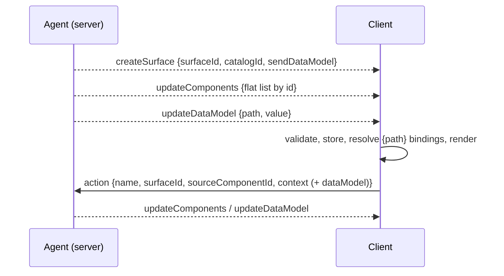

# Lab: A2UI

**What**: Agent-to-UI, a streaming JSON protocol (v0.9.x here). **Why**: the agent sends *what* to show (components + data) and the client keeps control of *how* (native components, state, security).

Run: `pnpm dev:a2ui` → http://localhost:5171

## Files
- `packages/schemas/src/a2ui.ts`: Zod schemas for the four envelopes, Basic Catalog subset, `action`
- `apps/a2ui/src/a2ui/store.ts`: `SurfaceStore` (client state; structure and data model kept apart)
- `apps/a2ui/src/a2ui/Surface.tsx`: native renderer
- `apps/a2ui/server/agent.ts`, `server/api.ts`: mock agent, SSE stream, `/api/a2ui/action`

## Walkthrough
- **Components** are flat and joined by id (`Card.child`, `Column.children`); unresolved ids render skeletons while streaming.
- **State**: `{path: "/form/email"}` binds to the data model. Editing writes locally (two-way); `Button` context bindings resolve at click time; with `sendDataModel` the whole model is attached to the action.
- **Responsibilities**: the agent owns structure/data and answers actions; the client validates every envelope, owns components and input state.
- **Safety**: unknown component → message rejected, stream continues (try *invalid message*); `__proto__` paths rejected; repeated `createSurface` is an error, so the page deletes the surface before a new run.

## UX modes
Static baseline (hand-written form) and **Declarative** (core). **Open-ended is deliberately not implemented**: the protocol has no code/markup field by design. A custom catalog entry could wrap a sandboxed iframe; see OpenUI/Capstone. Mixed → Capstone.

## Limitations
The renderer is hand-written for a Basic Catalog subset (Text, Column, Row, Card, Divider, TextField, CheckBox, ChoicePicker, Button); the official `@a2ui/*` renderers are **not** used. No functions/`formatDate`, no Markdown, no A2A transport, no `List` templates. Message shapes follow the v0.9.1 sample in the reference course; check the spec at https://a2ui.org before relying on details.
