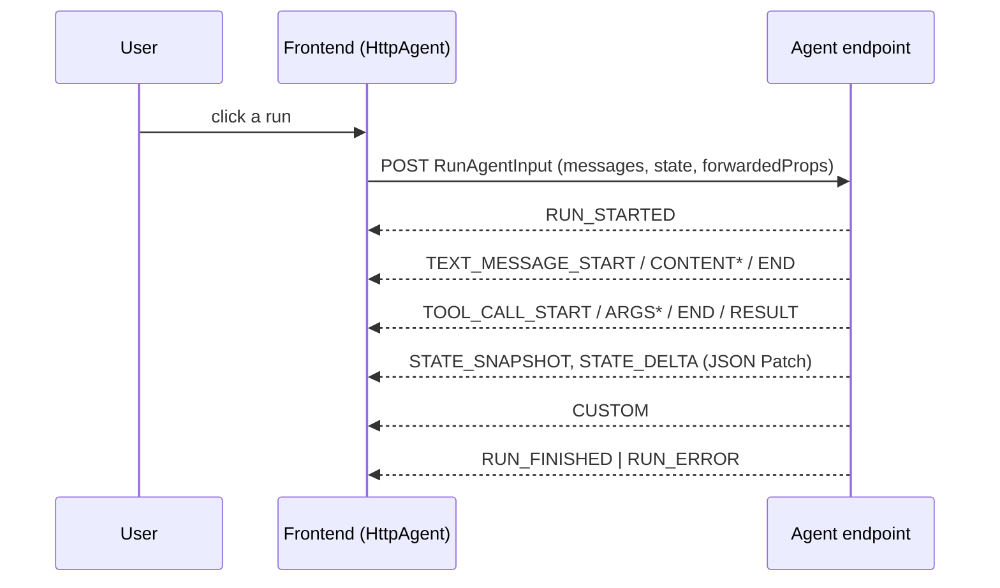

# Lab: AG-UI

**What**: the Agent–User Interaction protocol: typed events streamed from agent to frontend. **Why**: one contract for text, tool calls and shared state, independent of which UI payload you carry. Uses the official `@ag-ui/client` (`HttpAgent`), `@ag-ui/encoder` (`EventEncoder`) and `@ag-ui/core` (`EventType`, `RunAgentInputSchema`).

Run: `pnpm dev:agui` → http://localhost:5172

## Files
- `apps/agui/server/agent.ts`: the agent as an async generator of events (transport-free)
- `apps/agui/server/api.ts`: validates `RunAgentInput`, encodes SSE
- `apps/agui/src/App.tsx`: subscriber callbacks → streamed text, tools, state, UI
- `packages/harness/src/agui-bridge.ts`: harness events → AG-UI events

## The five runs
| Run | Shows | Mode |
|---|---|---|
| Tool call → component | tool *name* picks a compiled `ItemCard` | static |
| State patch → spec | `STATE_DELTA` replaces `/ui`; client re-validates, renders `JsonRender` | declarative |
| CUSTOM → sandbox | `CUSTOM html_artifact` into `SandboxedHtml` | open-ended |
| Frontend tool (approval) | run ends on an unanswered `confirm_plan` tool call; the user's answer is sent as a `tool` message and the run resumes | static |
| From the harness | the loop's callbacks become AG-UI events | declarative |

## Expected behavior
The event log shows the real lifecycle with timing; the state panel shows what `@ag-ui/client` maintains from snapshots + patches.

## UX modes
AG-UI is a **transport**: it does not choose a mode, so the lab shows it carrying each. Mixed → Capstone.

## Limitations
SSE only (no protobuf/WebSocket), no auth, no interrupts/resume API, no reconnect/`connectAgent`. The agent is scripted; `forwardedProps.demo` selects the scenario.
