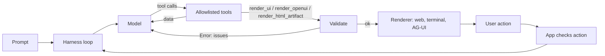

# Lab: Harness integration

**What it means here** (reference theme 07): a coding-agent harness gets a way to *answer with an interface*. The loop gains `render_ui(spec)`: the spec is validated against a catalog, then drawn by whichever surface listens. The hosted variant has the agent emit an OpenUI Lang program; the hybrid adds one `HtmlArtifact`.

Run: `pnpm dev:harness` → http://localhost:5176 · terminal: `pnpm harness:cli "compare laptops under \$1500"` (also `--ui openui`).

## Files
- `packages/harness/src/loop.ts`: loop, allowlist, Zod arg validation, error-as-result, step cap
- `packages/harness/src/tools.ts`: data tools + render tools
- `packages/harness/src/scripted-model.ts`, `openai-model.ts`, `factory.ts`: offline model, optional provider, config
- `packages/harness/src/text-render.ts`, `cli.ts`: terminal surface
- `apps/harness/server/api.ts`, `src/App.tsx`: web surface (SSE), config panel, timeline

## Configuration, state, tools, errors
- Env: `LLM_PROVIDER` (`mock`|`openai-compatible`), `LLM_BASE_URL`, `LLM_API_KEY`, `LLM_MODEL`, `HARNESS_MAX_STEPS`. The key stays server-side.
- State: transcript per session (in memory); UI state is the latest `ui` event.
- Tools: `search_items`, `get_item_details`, `compare_items`, `generate_summary`, `render_ui`, `render_openui`, `render_html_artifact`. Untick one in the page to watch the harness refuse it.
- Errors: unknown/unauthorized tool, bad args, rejected spec, thrown tool → `tool_error` + `Error:` message → the model retries. The *Invalid UI → self-correct* prompt demonstrates it. Step limit → `run_error`.
- Actions: a click is a named action from a closed set (`select_item`, `refine_search`, `compare_selected`), validated server-side, then becomes the next user turn. It never names an arbitrary tool.

## UX modes
**Declarative** (`render_ui`, `render_openui`), **open-ended** (`render_html_artifact`, sandboxed), hybrid (`openui-hybrid`). The tool outcome the model sees is one sentence; the picture is drawn from data.

## Limitations
Scripted model by default; the OpenAI-compatible adapter is untested against a live endpoint. Sessions are in memory with no auth. This is a teaching harness, not the reference course's full coding harness or TrueForge SDK, which are not used here.
