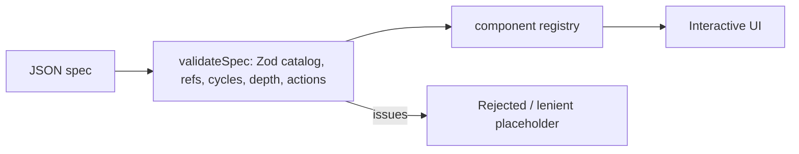

# Lab: JSON Render

**What**: a typed, validated JSON → UI renderer. **Why**: it is the clearest demonstration of *declarative* generative UI: the model describes, the app validates and decides what is drawn.
Built from scratch with Zod. It follows the flat element-map shape used by [json-render](https://github.com/vercel-labs/json-render) (`@json-render/core`) but does not use that library.

Run: `pnpm dev:json-render` → http://localhost:5174

## Files
- `packages/schemas/src/json-render.ts`: catalog (`propSchemas`), `validateSpec`, `formatIssues`
- `packages/ui/src/JsonRender.tsx`: registry-style renderer, `Form` state, error boundary
- `apps/json-render/src/App.tsx`: editor, presets, validation panel, action log

## Walkthrough
1. Wire shape `{root, elements: {id: {type, props, children}}}` is parsed by `rawSpecSchema`.
2. Each element's props go through `propSchemas[type]` (`.strict()`); children only on `Card`/`Stack`; missing ids, cycles, depth > 12, > 200 elements fail.
3. Strict mode fails closed (no spec). Lenient mode replaces bad elements by a warning `Alert` and keeps the rest.
4. `JsonRender` takes only a validated `Spec`. Buttons/Forms emit `{name, params}` actions; the app decides what they mean.

## Expected behavior
Pick *broken (unsafe)*: the strict view shows the rejection list and renders nothing; tick *Lenient* to see placeholders and the valid text. Edit the JSON live.

## UX modes
Static (ItemCard tab) and **Declarative** (core). Open-ended and Mixed tabs explain why they do not apply: a spec has no field that can carry code.

## Limitations
No streaming/patches in this lab (the spec is validated whole); no charts; renderer is React only.
