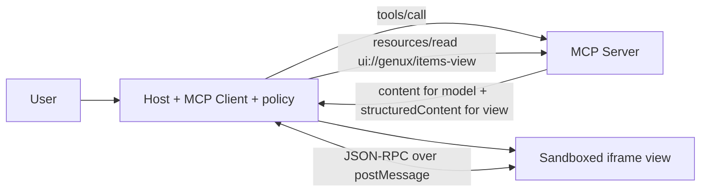

# Lab: MCP Apps

**What**: MCP tools that return structured data *and* point to a `ui://` HTML resource a **host** mounts in a sandboxed iframe. **Why**: ship one interface into someone else's chat client. Uses the official `@modelcontextprotocol/sdk` (server, client, in-memory and stdio transports).

Run: `pnpm dev:mcp` → http://localhost:5173. For a real host: `pnpm mcp:stdio`, then add to your MCP host config:
`{"mcpServers":{"genux-items":{"command":"pnpm","args":["--dir","<repo>","mcp:stdio"]}}}`.

## Concepts
Host = application embedding the model and MCP client. Client = protocol connection inside the host. Server = tools + resources. Tools = model-callable actions. Resources = readable content, here the UI.

## Files
- `packages/mcp-server/src/server.ts`: 4 tools (`search_items`, `get_item_details`, `compare_items`, `generate_summary`), `ui://` + `items://catalog` resources, `_meta.ui.resourceUri`
- `packages/mcp-server/src/view.ts`: the view (DOM via `textContent` only; bridge client)
- `apps/mcp-apps/server/api.ts`: host backend: client, tool/resource allowlists
- `apps/mcp-apps/src/bridge.ts`: host side of the bridge (pure, unit-tested); `McpFrame.tsx`: iframe + CSP

## Walkthrough
1. The host plans a tool call (stand-in for the model) and checks it against its allowlist.
2. The server returns `content` (text for the model) and `structuredContent` (data for the view).
3. The host reads the tool's `_meta.ui.resourceUri` and mounts the HTML with sandbox `allow-scripts` and a CSP.
4. View → `ui/initialize` → `ui/notifications/initialized`; host → `ui/notifications/tool-result`. A click in the view makes `tools/call` through the host.
5. *Mount a malicious view*: it tries a forbidden tool and network access; the bridge denies the first, the CSP blocks the second.

## UX modes
Static (fixed view layout), Declarative (view renders by `structuredContent.kind`), Open-ended (a view is arbitrary HTML, so containment is the host's job). Not a mixed demo on its own.

## Limitations
The bridge implements a **subset** of the MCP Apps methods (initialize, initialized, tool-result, size-changed, tools/call). The official `@modelcontextprotocol/ext-apps` helpers are not used; the browser demo uses an in-memory transport (same protocol, no process); the stdio entry was not tested against a real desktop host. Verify method names against https://github.com/modelcontextprotocol/ext-apps.
