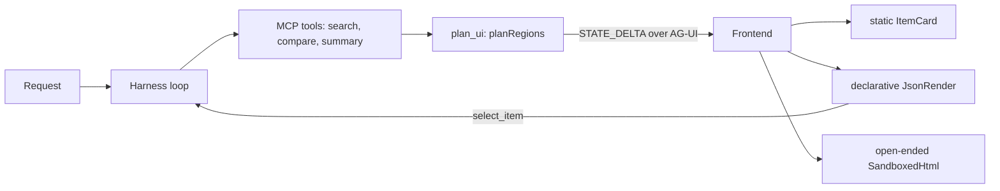

# Capstone: AI shopping research assistant (mixed UX)

**Why these technologies work together**: MCP gives the agent *capabilities* (data tools), the harness *runs the loop safely*, AG-UI *streams* progress and state to the page, and a planner chooses, per region, *how much freedom* the UI gets. Each solves a different problem; none replaces another.

Run: `pnpm dev:mixed` → http://localhost:5177 (default prompt asks for a budget calculator so all three modes appear; the second prompt shows open-ended being *skipped*).

## Files
- `server/pipeline.ts`: harness + MCP-backed tools + AG-UI event mapping
- `server/planner.ts`: the mode policy (pure, tested)
- `server/api.ts`: AG-UI endpoint; `src/App.tsx`: pipeline stepper, regions with why/guardrail, decisions table

## Policy
| Region | Mode | Reason | Guardrail |
|---|---|---|---|
| Top pick | static | one known entity, fixed layout | compiled component |
| Comparison | declarative | variable rows/columns | Zod catalog, action allowlist, re-validated on the client |
| Summary | declarative | prose belongs in a text node | React escaping |
| Savings planner | open-ended | live computation no catalog entry offers | sandbox + CSP + document check + message allowlist; only when requested |

Degrade path: open-ended check fails → declarative notice; spec invalid → region omitted with a reason in *Skipped*. Clicking *Details* in the comparison is a `select_item` action → a new run replaces the static top pick.

## Limitations
Scripted model and planner (a real model could propose regions, but the policy should still gate them). One in-memory MCP connection; state is per page load; no persistence or auth.
