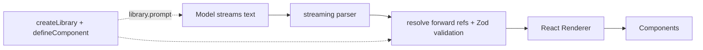

# Lab: OpenUI Lang

**Which OpenUI**: the reference course means **OpenUI Lang** from the OpenUI project (`@openuidev/lang-core`, `@openuidev/react-lang`), not a generic "open UI" idea. Statements are `id = Component(args)`, arguments are positional, references may point forward, and the renderer can paint line 1 before line 2 arrives.

Run: `pnpm dev:openui` → http://localhost:5175

## Files
- `packages/ui/src/openui.tsx`: `defineComponent` catalog (Stack, Text, Metric, Table, BarChart, Card, Alert, Button, **HtmlArtifact**), `catalogLibrary`, `hybridLibrary`
- `apps/openui/server/api.ts`: mock model streaming OpenUI Lang (or HTML) in chunks over SSE
- `apps/openui/src/App.tsx`: tabs, `<Renderer response isStreaming>`, raw stream, generated prompt

## Walkthrough
1. One definition, three uses: the Zod schema validates args, `library.prompt()` writes the system prompt (shown in the page), the `component` renders. Key order of `z.object` is the positional order.
2. The page accumulates the stream and re-passes the whole string to `<Renderer>`; the library re-parses each time.
3. *Malformed model output* button: an unknown component and a wrong-typed arg are dropped, the valid statement renders.
4. `HtmlArtifact(title, document)` is the open-ended escape hatch: raw source while `useIsStreaming()`, then `SandboxedHtml` (sandbox + CSP).

## UX modes
Static (hand-written program) · **Declarative** (core) · Open-ended (sandbox tab, no catalog) · **Hybrid** (catalog + `HtmlArtifact`).

## Differences
See the table in the app and `docs/comparison.md`. In short: a *language* with a React renderer, not a transport (AG-UI), not a host contract (MCP Apps), not a JSON message protocol (A2UI), and unlike arbitrary generated code it cannot execute anything outside `HtmlArtifact`.

## Limitations
The mock model is deterministic; the token numbers are rough chars/4 estimates, not a benchmark; React only. `@openuidev/lang-core` runs a telemetry postinstall (disable with `OPENUI_TELEMETRY_DISABLED=1`).
