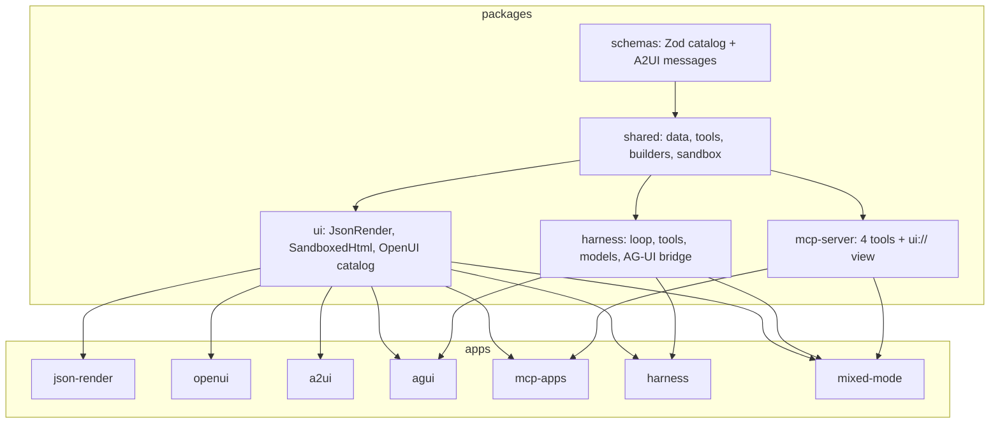
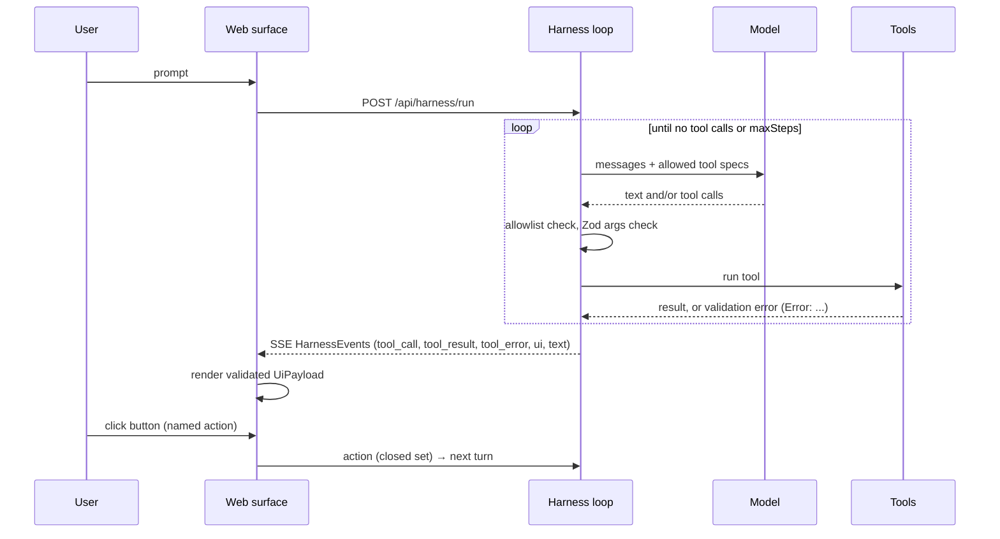
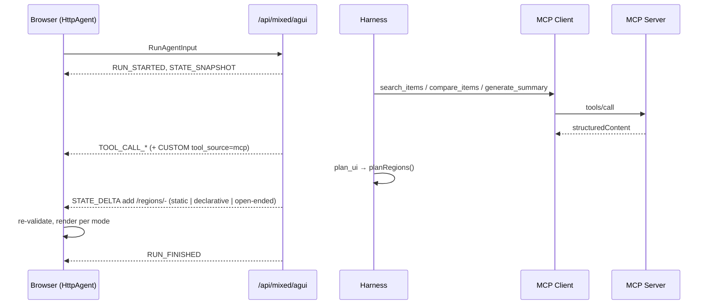

# Architecture

## Layers

Each app is a Vite + React page. Its server half is a Vite dev-server middleware plugin (`apps/*/server/api.ts`), so `pnpm dev:<lab>` is one process. In production you would lift those handlers into a real server.

## Harness execution flow

Errors: unauthorized tool, bad arguments, rejected spec, thrown tool → `tool_error` + `Error:` tool message; the loop continues. Model failure or step cap → `run_error`.

State: the transcript (`ChatMessage[]`) per session, held in memory (bounded). UI state is derived from the latest `ui` event.

Config: `HarnessConfig { maxSteps, allowedTools, system }`; provider via `LLM_PROVIDER`, `LLM_BASE_URL`, `LLM_API_KEY`, `LLM_MODEL`, `HARNESS_MAX_STEPS`.

## Capstone flow

The planner (`apps/mixed-mode/server/planner.ts`) is ordinary code. Why: it is auditable and testable, and the *model* never gets to pick the riskiest mode on its own.

## MCP Apps flow

`Host` = the MCP client + policy + iframe + bridge. `Server` = tools + resources. The model sees only `content` (text). The view sees `structuredContent` through `ui/notifications/tool-result`. A `tools/call` from the view passes through the same host allowlist.

## Agent/server vs client responsibilities (A2UI)

| Agent / server | Client |
|---|---|
| decides structure and data; emits envelopes | validates every envelope against the catalog |
| answers `action` messages | owns the component implementations and styling |
| never sends code | owns local input state (two-way binding into the data model) |
