# Harness, Not Model: Three Recursive Self-Improvement Methods on One Heuristic-Discovery Problem

**Author: Dev Mulchandani**

> **Thesis.** Recursive self-improvement is a claim about *the procedure that finds better answers*, not about any single better answer — so this repository implements three October-2026 RSI mechanisms (Dream-RSI, Budget RSI, SO-RSI) as minimal reproductions on **one shared, objectively scored problem**, compares them with matched budgets against strong fixed baselines, and reports what each one actually changed, including where it did not help.

**Read this first (result integrity).** Every number in the *Results* and *Ablation* sections is **measured** by code in this repository (30 seeds × 2 held-out tasks; raw rows in [`experiments/results/default/`](experiments/results/default)). Nothing is illustrative or synthetic. Figures quoted from the papers are labelled **source claim** and are *not* reproduced here. The proposer in every measured run is an offline, seeded mutation operator, **not a language model**.

**Headline, honestly stated.** At equal deployment budget, Budget RSI beat the fixed baseline it extends; Dream-RSI and SO-RSI, as minimally reproduced here, did **not**; and a simple fixed greedy search was a stronger baseline than any RSI method's improvement over a naive one. Details and caveats below.

---

## Contents
[Overview](#overview) · [Assignment mapping](#assignment-mapping) · [Problem](#problem-domain) · [Methods](#the-three-rsi-methods) · [Architecture](#unified-architecture) · [Codelabs](#codelab-progression) · [Structure](#repository-structure) · [Install](#installation) · [Quick start](#quick-start) · [Results](#results) · [What improved](#what-actually-improved) · [Comparison](#method-comparison) · [Ablations](#ablation-study) · [Observations](#key-observations) · [Failures](#failure-modes) · [Safety](#safety-and-bounded-self-improvement) · [Reproducibility](#reproducibility) · [References](#references)

## Overview

**Recursive self-improvement (RSI)** means a system revises *the procedure it uses to improve*, and the revised procedure governs later improvement work. It matters because gains that come from a better improver can compound, while gains from one better answer cannot — and because it is easy to mistake the second for the first. The course (Section 09) separates three objects: the task model, the research skill, and the improver; a valid RSI claim names which one changed, compares against a fixed improver at matched cost, and bounds the recursion.

This repository demonstrates that on a concrete task, with code you can run in minutes:

* a **shared problem** (discovering greedy construction heuristics for the Euclidean TSP) with an objective evaluator, a hidden test split and exact budget accounting;
* **three methods that change three different objects** (search policy, edit scorer, improver);
* **ten progressive, runnable codelabs** that build up to the comparison;
* a **controlled protocol**: equal deployment budgets, identical seeds, paired statistics, budget-matched controls, ablations, and failure analysis.

## Assignment mapping

The brief points at `rsi/COURSE-MAP.md`; in [dlmastery/simple-coding-harness](https://github.com/dlmastery/simple-coding-harness) the file is the root `COURSE-MAP.md` and **Section 10 is "Read and Rebuild October 2026 Research"** (see [method-selection.md](docs/research/method-selection.md) for what was verified and how the three methods were chosen).

| Section 10 requirement | Where it is met |
|---|---|
| Labs 10.01–10.02 — distinguish a source claim from evidence | [Codelab 08](codelabs/08_controlled_comparison/README.md), [10](codelabs/10_full_experiment/README.md); "source claim" vs "measured" labelling throughout; [limitations](docs/limitations.md) |
| Labs 10.03–10.05 — Budget RSI: score edits before full evaluation | [Codelab 06](codelabs/06_budget_rsi/README.md), `src/methods/budget_rsi/` (linear readout over parent score + 8 diff features, frozen; Thompson-sampled parents; paper's parent-only ablation) |
| Labs 10.06–10.08 — SO-RSI: diagnose before patching | [Codelab 07](codelabs/07_so_rsi/README.md), `src/methods/so_rsi/` (recurrence / opposing-edit / expectation-mismatch detectors, probes, inquiry memory) |
| Instructor's example: Dream-RSI (discovery trees → replay → return online with total cost) | [Codelabs 04–05](codelabs/05_dream_rsi/README.md), `src/methods/dream_rsi/` |
| "Compare systems by changed object, feedback, inheritance, evaluation, cost" | [Method comparison](#method-comparison), [docs/comparison.md](docs/comparison.md) |
| "Distinguish a source claim from your laptop adaptation and its observed result" | Each method section below has *Source claim* vs *This repository*; results are measured |
| Section 09 foundations (fixed improver, fair comparison, bounded generations, claim with limits) | Codelabs 03, 08, 10; [methodology](docs/methodology.md) |
| Section 10 *not* implemented | Labs 10.09–10.17 (AReaL-RSI, SwarmRSI, RSIFlow, Self-HPO, RSIGym) — mechanism-only in the course, out of scope here |

## Problem domain

**Task: discover a greedy construction heuristic for the Euclidean TSP.** A candidate is a small program — an expression over `d_cur` (distance from the current city), `d_start`, `d_cent` (distance to the centroid of unvisited cities), `d_iso` (distance to the nearest other unvisited city) and `t` (fraction left) — that scores each unvisited city; the best-scoring city is visited next. The seed is Nearest-Neighbour: `sub(0, d_cur)`.

* **Why it suits RSI.** Candidates are cheap (≈1 ms/instance), the landscape rewards both exploitation and exploration (most edits fail; a few help a lot), and improvements are visual: you can draw the tours. Search *policy* matters measurably, so improving the search procedure is a real, testable thing.
* **Objective.** `score = −100 × mean(tour_length / reference_length − 1)` (higher is better). The reference is a 2-opt local optimum — a strong heuristic, not the true optimum.
* **Evaluator.** Fixed and shared by every method. Cost is measured in *instance-evaluations* (one tour built = 1 unit; a full evaluation of the 12 train instances = 12 units); identical programs are memoised for everyone.
* **Splits.** Agents optimise the *train* split. Small charged `fit`/`probe` splits support Budget RSI and SO-RSI. The *test* split is read only by reporting code.
* **Tasks.** Adaptation (RSI methods only) on `uniform`, `clusters`, `ring`; deployment for every method on held-out `clusters_tight` and `grid_jitter`. So a method must improve the *procedure*, not memorise one program.
* **Constraints.** 30 cities, a 7-operator closed DSL (programs ≤ 25 nodes), 60 full evaluations (720 units) per deployment task.

## The three RSI methods

Each is an **educational minimal reproduction of the central mechanism** — not a reproduction of the paper's system, models or benchmarks. "Source claim" numbers are quoted from abstracts and are not reproduced here.

### 1. Dream-RSI — improve the exploration policy through replay worlds
Paper: [arXiv 2609.14858](https://arxiv.org/abs/2609.14858) (Zheng et al., 2026-09-14).

**Intuition.** A finished discovery run already records what every attempt scored. Alternative search *policies* can be tried against that record for free, so the system can improve how it explores without paying for new evaluations.

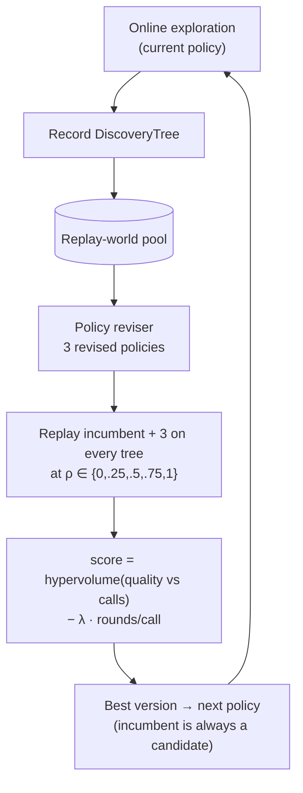

* **What recursively improves?** `SearchPolicy` — selection temperature, novelty bonus, restart probability, parallel batch size, stopping patience. The proposer, evaluator and DSL are frozen.
* **Feedback signal.** Replay score on recorded trees; zero evaluator calls.
* **Memory/history.** Pool of discovery trees, one per generation.
* **Selection/update rule.** Highest mean replay score; ties keep the incumbent, so selection cannot lower replay score.
* **Algorithm.** 3 generations (one per training task): rollout → record → revise → replay → select → inherit; then deploy on held-out tasks with ρ = 1.
* **Source claim.** Competitive or better discovery quality at substantially lower cost across algorithm engineering, mathematical optimisation and GPU kernels (e.g. Lasso-path runtime with 317 vs 550 calls).
* **This repository.** `src/methods/dream_rsi/` — the replay simulator and score follow the paper's description; the **policy-development agent is rule-based** (an LLM rewrites policy *code* in the paper), and the history is three trees of ≈60 nodes.

### 2. Budget RSI — score edits before they run
Paper: [arXiv 2610.29121](https://arxiv.org/abs/2610.29121) (Darzi, Balija, He, 2026-10-21).

**Intuition.** Most edits are bad. If a cheap model can rank proposed edits before evaluation, a fixed budget buys more good evaluations.

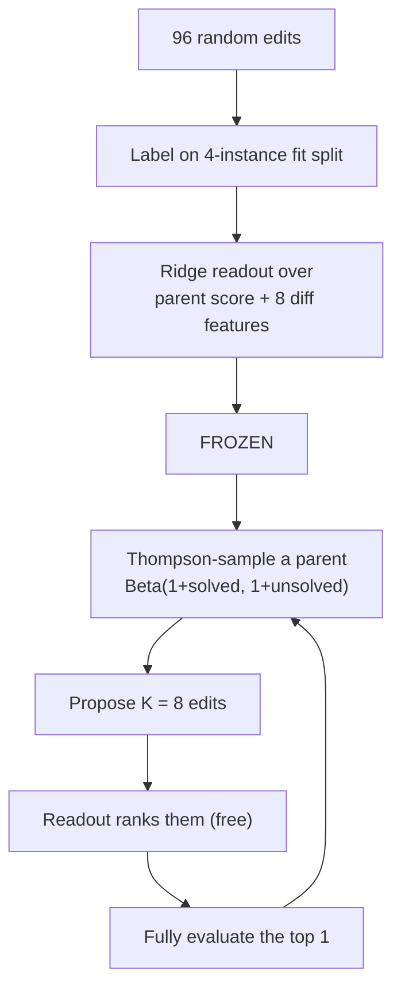

* **What recursively improves?** The edit-*selection scorer* (and so how the budget is spent).
* **Feedback signal.** Change in score on a small fit split; label = `max(gain, 0)`, clipped.
* **Memory/history.** Labelled-edit set; node archive with solved-instance counts.
* **Selection/update rule.** argmax predicted gain over K proposals; Thompson sampling over parents. The readout is **never refit** at deployment.
* **Source claim.** Held-out HumanEval+ 87.0% (GPT-4o) vs 84.2% for a parent-rate-only ablation.
* **This repository.** `src/methods/budget_rsi/`. Ablations: `budget_parent_only` (the paper's own), `budget_no_screen`.

### 3. SO-RSI — diagnose why failures happen before patching
Paper: [arXiv 2610.05701](https://arxiv.org/abs/2610.05701) (Jiang, Vempaty, Jagmohan, 2026-10-05).

**Intuition.** First-order RSI reacts to symptoms and can thrash. A second-order system asks *why* a failure recurs, tests the hypothesis with a cheap probe, and then makes a structural change.

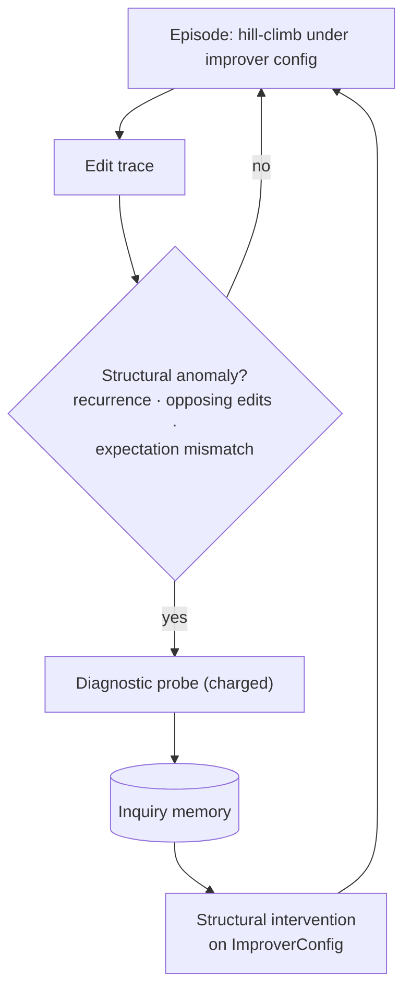

* **What recursively improves?** The improver: edit-kind weights, step size, validation-acceptance rule (`ImproverConfig`).
* **Feedback signal.** Anomalies in the trace; probe verdicts (e.g. `insensitive_constants`, `step_too_large`, `overfit_to_train`).
* **Memory/history.** `InquiryMemory` of (anomaly, evidence, verdict, intervention); consulted before re-probing.
* **Selection/update rule.** Apply the intervention licensed by the verdict; naive RSI instead re-weights kinds by recent success rate.
* **Source claim.** +21.8 (Lean 4) / +25.8 (Verus) held-out pass-rate points over naive RSI under matched 24-hour budgets.
* **This repository.** `src/methods/so_rsi/`. Ablations: `naive_rsi`, `so_no_probes`, `so_no_memory`.

## Unified architecture

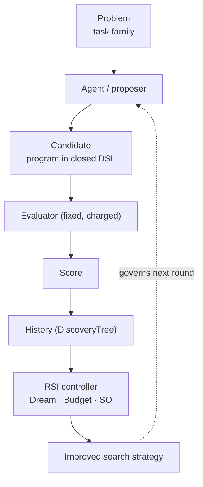

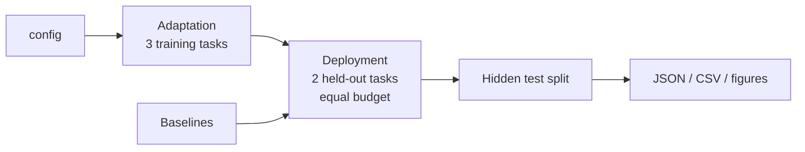

See [docs/architecture.md](docs/architecture.md) for module responsibilities and data flow.

## Codelab progression

Each codelab has a `run.py` that actually runs and a README with: goal, RSI concept, architecture, files, algorithm, steps, code walkthrough, how to run, expected output (generated from the real run), what changed, what it means, key takeaway.

| Codelab | Concept | Implementation | Run |
|---|---|---|---|
| [01](codelabs/01_problem_and_evaluator/README.md) | Protected, budgeted objective evaluator | `core/problem.py`, `core/evaluator.py` | `python codelabs/01_problem_and_evaluator/run.py` |
| [02](codelabs/02_candidates_and_proposer/README.md) | Bounded edit surface; random search | `core/candidate.py`, `agents/proposer.py` | `python codelabs/02_candidates_and_proposer/run.py` |
| [03](codelabs/03_baseline_search_agents/README.md) | Fixed improver: hill-climb, tree search, AIDE-style | `agents/tree_search.py` | `python codelabs/03_baseline_search_agents/run.py` |
| [04](codelabs/04_memory_and_trajectories/README.md) | Trajectory memory and free replay | `core/history.py`, `dream_rsi/replay.py` | `python codelabs/04_memory_and_trajectories/run.py` |
| [05](codelabs/05_dream_rsi/README.md) | **Method 1** — search-policy RSI via replay worlds | `methods/dream_rsi/` | `python codelabs/05_dream_rsi/run.py` |
| [06](codelabs/06_budget_rsi/README.md) | **Method 2** — score edits before running | `methods/budget_rsi/` | `python codelabs/06_budget_rsi/run.py` |
| [07](codelabs/07_so_rsi/README.md) | **Method 3** — diagnose before patching | `methods/so_rsi/` | `python codelabs/07_so_rsi/run.py` |
| [08](codelabs/08_controlled_comparison/README.md) | Controlled, budget-matched comparison | `benchmarks/protocol.py` | `python codelabs/08_controlled_comparison/run.py` |
| [09](codelabs/09_ablations_and_failures/README.md) | Ablations and failure analysis | `benchmarks/protocol.py::ABLATIONS` | `python codelabs/09_ablations_and_failures/run.py` |
| [10](codelabs/10_full_experiment/README.md) | Bounded generations, figures, the claim | `visualization/plots.py` | `python codelabs/10_full_experiment/run.py` |

Progression: **01** fixes the evaluator → **02** adds the (bounded) thing that gets edited → **03** adds feedback-driven search with a *fixed* improver (Section 09.02) → **04** records its history and replays it → **05–07** each use history to revise a different object → **08** compares them fairly → **09** removes components and studies failures → **10** states the bounded claim.

## Repository structure

```text
src/core/          problem, candidate DSL, evaluator+budget, history, metrics, config
src/agents/        mutation proposer, optional LLM proposer, tree search / hill-climb / random
src/methods/       dream_rsi/  budget_rsi/  so_rsi/
src/benchmarks/    baselines and the shared protocol
src/visualization/ all figures
src/cli.py         command line
codelabs/          10 progressive codelabs (run.py + README)
experiments/       configs/ (JSON)   results/default (measured data)
artifacts/figures/ generated figures used below
docs/              architecture, rsi-primer, methodology, comparison, limitations, research/method-selection
scripts/           setup / run_* / reproduce shell scripts, render_docs.py
tests/             38 tests: evaluator, scoring, replay, methods, protocol, CLI smoke, regression
```

## Installation

```bash
git clone <this repository> && cd <repository folder>
python -m venv .venv
source .venv/bin/activate
pip install -r requirements.txt        # numpy, matplotlib, pytest, ruff
```

Python ≥ 3.10. No API key is needed for anything reported here. (`.env.example` documents the optional key for the real-LLM proposer; keys are never committed.)

## Quick start

```bash
python -m src.cli demo        # ~10 s: all methods, tiny config, table + figures
```

`make setup | test | lint | demo | compare | ablate | visualize | reproduce` are provided as shortcuts.

### Running individual methods
```bash
python -m src.cli baseline                          # non-RSI baselines only
python -m src.cli run --method dream-rsi            # adds the initial-solution row for reference
python -m src.cli run --method budget-rsi
python -m src.cli run --method so-rsi
python -m src.cli run --method naive-rsi            # any ablation name also works
python -m src.cli llm-check                         # optional; exits 2 with an explanation if no LLM_API_KEY
```
Add `--config smoke` for a fast run, `--seeds N` to override the seed count, `--workers 1` for serial execution.

### Running the comparison
```bash
python -m src.cli compare --ablations               # full experiment: 30 seeds, ≈3.5 min on 8 cores
python -m src.cli ablate --config reduced_budget    # ablations at 20 evals/task, ≈1 min
python -m src.cli visualize                         # regenerate figures from saved results
python scripts/render_docs.py                       # refresh README tables / codelab outputs from results
```
Outputs: `experiments/results/<config>/{runs.json, summary.csv, summary.json, method_logs.json, config.json}`.

## Results

**All numbers below are MEASURED** (config `default`: 30 seeds × 2 held-out tasks = 60 paired runs per method; test split; higher is better; `Initial` is Nearest-Neighbour). *Adaptation units* are what RSI methods spent before deployment (all three training tasks); *Deployment units* are spent on each held-out task. Success = improvement ≥ 1.0 point over the initial solution.

<!-- TABLE:main -->
| Method | Initial | Final test score [95% CI] | Improvement | Success | Adaptation units | Deployment units | Wall time per held-out task (s) |
|---|---:|---:|---:|---:|---:|---:|---:|
| Initial solution (NN) | -13.84 | -13.84 [-14.89, -12.92] | +0.00 | 0% | 0 | 12 | 0.02 |
| Random search | -13.84 | -11.79 [-12.83, -10.70] | +2.05 | 32% | 0 | 720 | 0.75 |
| Hill-climb (fixed) | -13.84 | -6.83 [-7.80, -5.88] | +7.01 | 72% | 0 | 720 | 0.79 |
| AIDE-style tree (fixed) | -13.84 | -6.74 [-7.63, -5.86] | +7.10 | 73% | 0 | 720 | 0.86 |
| Fixed tree search (Dream-RSI's start policy) | -13.84 | -8.17 [-9.02, -7.36] | +5.67 | 67% | 0 | 720 | 0.81 |
| Hill-climb, +adaptation budget | -13.84 | -5.26 [-6.02, -4.51] | +8.58 | 88% | 0 | 1800 | 2.17 |
| Fixed tree, +adaptation budget | -13.84 | -6.19 [-6.96, -5.43] | +7.65 | 82% | 0 | 1800 | 2.17 |
| **Dream-RSI** | -13.84 | -8.41 [-9.38, -7.49] | +5.43 | 60% | 1978 | 617 | 2.23 |
| **Budget RSI** | -13.84 | -6.24 [-7.08, -5.41] | +7.60 | 88% | 396 | 720 | 1.57 |
| **SO-RSI** | -13.84 | -7.18 [-7.98, -6.27] | +6.66 | 78% | 1912 | 718 | 1.84 |
<!-- /TABLE:main -->

Paired differences in final test score (same seed, same held-out task; 95% bootstrap CI; positive = RSI method better):

<!-- TABLE:paired -->
| RSI method minus ... | Fixed tree search | AIDE-style tree | Fixed tree, +adaptation budget |
|---|---:|---:|---:|
| **Dream-RSI** | -0.24 [-1.39, +0.97] | -1.67 [-2.79, -0.65] | -2.22 [-3.31, -1.23] |
| **Budget RSI** | +1.94 [+0.89, +2.94] | +0.51 [-0.41, +1.39] | -0.04 [-0.93, +0.84] |
| **SO-RSI** | +0.99 [-0.06, +2.06] | -0.44 [-1.48, +0.54] | -0.99 [-1.88, -0.12] |
<!-- /TABLE:paired -->

Budget needed to reach the fixed tree search's final train score (a cost-efficiency view, which is what Dream-RSI optimises):

<!-- TABLE:match -->
| Method | Runs that reach it | Median deployment units | Median incl. amortised adaptation |
|---|---:|---:|---:|
| Random search | 18% | 156 | 156 |
| Hill-climb (fixed) | 65% | 204 | 204 |
| AIDE-style tree (fixed) | 78% | 228 | 228 |
| Fixed tree search (Dream-RSI's start policy) | 55% | 420 | 420 |
| Hill-climb, +adaptation budget | 85% | 276 | 276 |
| Fixed tree, +adaptation budget | 78% | 456 | 456 |
| **Dream-RSI** | 45% | 228 | 1284 |
| **Budget RSI** | 75% | 204 | 402 |
| **SO-RSI** | 63% | 243 | 1202 |
<!-- /TABLE:match -->

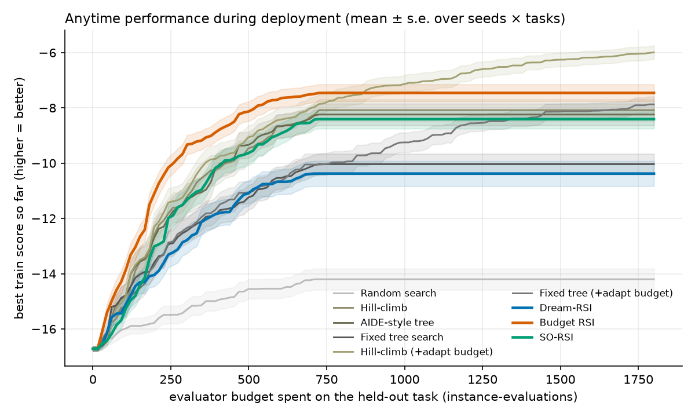
*Best train score vs budget spent during deployment (adaptation cost not shown on this axis; see the table above and the compute figure).*

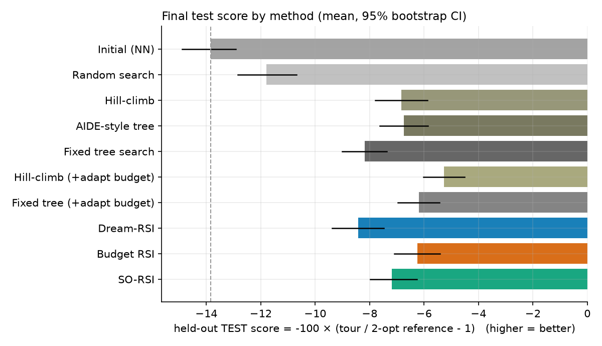
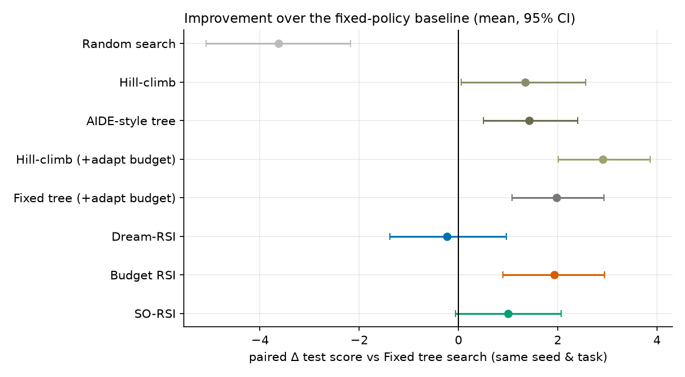
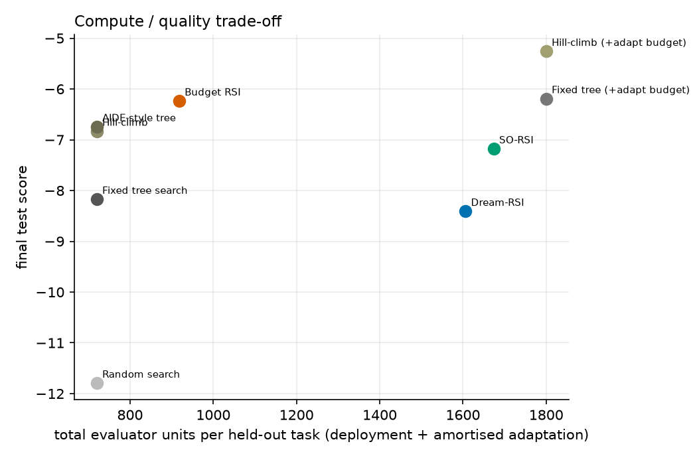

Method-specific evidence: 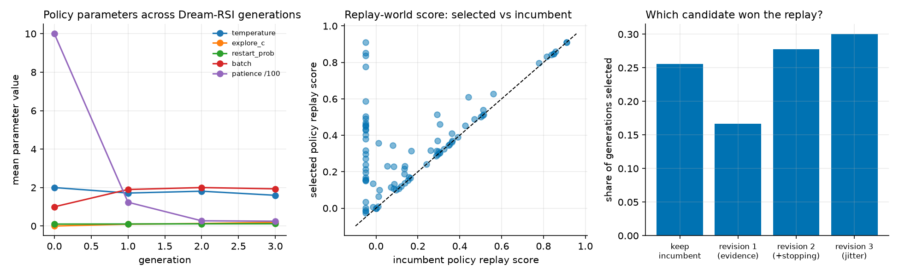
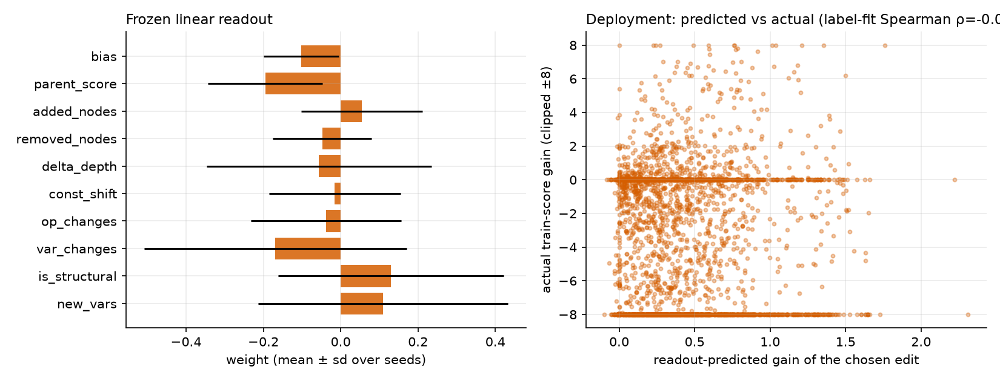
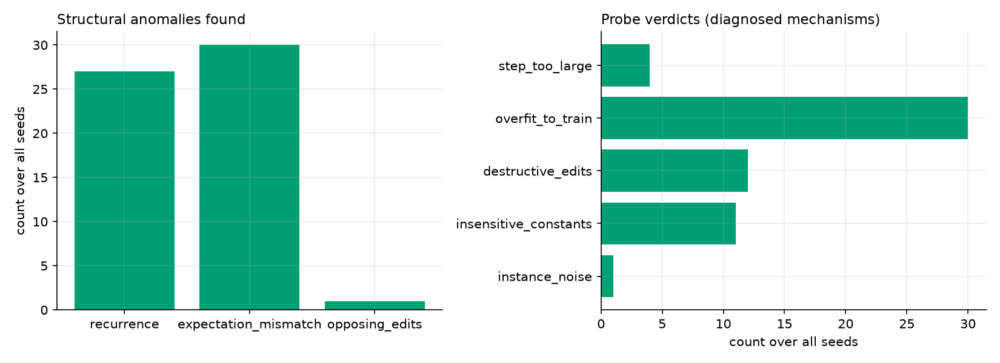
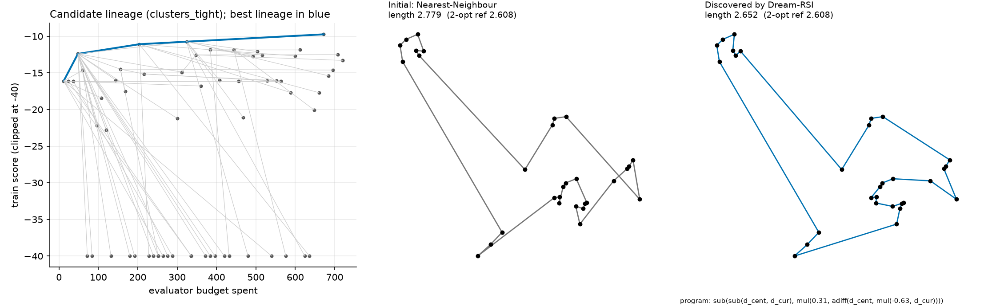

Reduced-budget ablation suite (`reduced_budget` config, 20 evaluations per task, 30 seeds):

<!-- TABLE:reduced -->
| Method (20 evals per task) | Final test score | Paired Δ vs fixed tree [95% CI] |
|---|---:|---:|
| Fixed tree search (Dream-RSI's start policy) | -10.60 | - |
| **Dream-RSI** | -11.23 | -0.63 [-2.17, +0.75] |
| **Budget RSI** | -9.54 | +1.06 [-0.51, +2.52] |
| **SO-RSI** | -9.95 | +0.65 [-0.99, +2.26] |
| dream_no_replay | -11.11 | -0.51 [-2.08, +1.02] |
| dream_no_evolution | -10.24 | +0.36 [-0.94, +1.67] |
| budget_parent_only | -10.14 | +0.45 [-1.07, +2.00] |
| budget_no_screen | -9.18 | +1.41 [+0.13, +2.70] |
| naive_rsi | -9.12 | +1.48 [+0.17, +2.76] |
| so_no_probes | -9.95 | +0.65 [-0.99, +2.26] |
| so_no_memory | -9.86 | +0.74 [-0.92, +2.41] |
<!-- /TABLE:reduced -->

## What actually improved?

There are two different statements that are easy to conflate:

1. **"The model generated a better answer."** A program with a higher test score exists. Hill-climbing, tree search and random-luck all produce this. It says nothing about the *process*.
2. **"The recursive system improved the process used to discover better answers."** A *procedure* that was revised from history, then inherited and used, found better answers on tasks it was not adapted to, at a stated cost, against a fixed-procedure baseline.

In this repository the proposer is frozen and identical for every method, so statement 1 can never be attributed to a smarter model. Only the procedure differs. Measured, with 95% CIs from the paired table above:

* **Budget RSI** — the procedure (parent selection + edit screening) produced better programs than the fixed tree search at the same deployment budget (+1.94, CI excludes 0). But that is only a partial vindication of *recursive* improvement: **most of the gain is Thompson-sampled parent selection** (`budget_no_screen` alone is already ≈+1.2 over the fixed tree), and the learned readout, the actual "self-improved" component, has ≈0 held-out rank correlation. Against a good fixed policy (AIDE-style) or the fixed tree with 2.5× the budget, the difference vanishes.
* **Dream-RSI** — the process *did* change (a revised policy, not the incumbent, won the replay in 67 of 90 generations; the typical winner batches and stops early) and it did use fewer deployment units (≈617 of 720), but quality at the same budget did not improve over its own starting policy (−0.24, CI spans 0), and it reached the baseline's quality in fewer runs. Improved *cost-per-call* behaviour without improved *outcome*.
* **SO-RSI** — the improver was revised using diagnosed mechanisms (e.g. 21 of 30 runs diagnosed overfitting to the train split and ended with a validation requirement), but outcomes are no better than first-order `naive_rsi` and slightly worse.

So: in this study, **a changed procedure is not the same as an improved procedure**, and the evidence for genuine recursive improvement is weak, with one modest, partially-attributable exception.

## Method comparison

| | Dream-RSI | Budget RSI | SO-RSI |
|---|---|---|---|
| Mechanism | replay recorded trees to pick a better search policy | frozen linear readout pre-screens edits | diagnose recurring failures by probing, then restructure improver |
| Search strategy | tree search; policy parameters evolve | Thompson-sampled parent, best-of-K screened proposal | hill-climb under an evolving improver config |
| Memory | replay-world pool | labelled-edit set, node archive | inquiry memory |
| Self-modified component | `SearchPolicy` | scorer (readout) | `ImproverConfig` |
| Evaluator usage | none during replay; full evals in rollouts | cheap fit split for labels; one full eval per round | probes + validation split charged |
| Strengths | free policy comparison; targets cost | cheapest adaptation (≈400 units); simple | explains *why*; targets thrashing |
| Weaknesses | cannot judge unrecorded branches; needs coverage | frozen scorer may not predict; gain may come from other components | probes cost budget; wrong diagnosis possible |
| Compute (adaptation) | ≈1 980 units | ≈396 units | ≈1 910 units |
| Best use | long, expensive discovery where cost dominates | proposal-heavy searches with a cheap proxy | agents that repeat failed fixes |

Longer treatment: [docs/comparison.md](docs/comparison.md).

## Ablation study

Full-experiment ablations (paired difference of the *ablated* variant minus the full method; negative = removing the component hurt):

<!-- TABLE:ablation -->
| Variant | Final test score | Ablation minus full method, paired [95% CI] |
|---|---:|---:|
| **dream_rsi** (full method) | -8.41 | - |
| &nbsp;&nbsp;`dream_no_replay`: accept a random revised policy (no replay evidence) | -8.27 | +0.14 [-0.95, +1.25] |
| &nbsp;&nbsp;`dream_no_evolution`: never revise the policy (collect trees only) | -7.77 | +0.64 [-0.54, +1.91] |
| **budget_rsi** (full method) | -6.24 | - |
| &nbsp;&nbsp;`budget_parent_only`: readout sees parent score only (the paper's own ablation) | -7.11 | -0.87 [-1.78, +0.07] |
| &nbsp;&nbsp;`budget_no_screen`: no screening: K=1 proposal, evaluate it | -6.96 | -0.72 [-1.51, +0.04] |
| **so_rsi** (full method) | -7.18 | - |
| &nbsp;&nbsp;`naive_rsi`: first-order RSI: reward-following edit weights, no diagnosis | -6.36 | +0.82 [-0.08, +1.71] |
| &nbsp;&nbsp;`so_no_probes`: anomalies detected, default reflex instead of probes | -6.49 | +0.69 [+0.02, +1.47] |
| &nbsp;&nbsp;`so_no_memory`: improver reset each episode (no inquiry memory) | -6.78 | +0.40 [-0.24, +1.09] |
<!-- /TABLE:ablation -->

* **No replay / no policy evolution (Dream-RSI):** neither hurts. A random revised policy does as well as the replay-selected one, and never revising does slightly *better* (not significant). Replay is not doing detectable work in this toy: with three bushy trees generated by a near-uniform policy, the recorded history simply does not distinguish policies well — the paper's own coverage limitation, made concrete.
* **Parent-only readout / no screening (Budget RSI):** both cost ≈0.7–0.9 points but CIs touch 0. Together with the ≈0 readout rank correlation, the honest reading is: *parent selection by Thompson sampling matters; whether the learned readout matters is not established here.*
* **No probes / no memory / naive (SO-RSI):** each of these is as good or better than the full method. The probes cost budget and the diagnosed interventions (demote a "dead" kind, halve the step size, require validation) did not help. Reverting to first-order RSI was best. In the reduced-budget run `so_no_probes` equals `so_rsi` exactly: the only anomaly that fires in 10-evaluation episodes is expectation mismatch, which needs no probe, so the two variants behave identically.
* **Reduced budget:** at 20 evaluations per task the ordering is similar and every CI includes 0 except `budget_no_screen` and `naive_rsi` versus the fixed tree; with so little budget nothing adapts much.

## Key observations

1. **Baseline strength decides the conclusion.** The AIDE-style greedy policy beats Dream-RSI's naive starting policy by ≈+1.4 — more than any RSI method's gain over that same policy except Budget RSI. A comparison against only the naive baseline would have made Budget RSI (+1.94) and SO-RSI (+0.99) look like clear wins.
2. **Matched budget changes the story.** Giving the plain fixed tree the RSI adaptation allowance (150 instead of 60 evaluations per task) puts it ≈ level with Budget RSI (−0.04) and ahead of Dream-RSI (−2.22) and SO-RSI (−0.99, CI excludes 0). RSI adaptation must be *amortised across many tasks* to pay off; with only two deployment tasks it does not.
3. **Train–test gap is real for every method** (≈1.2–2.0 points on average) and 6–14 of 60 discovered programs are worse than Nearest-Neighbour on the hidden test split despite beating it on train. 12 training instances are easy to overfit; SO-RSI's most common diagnosis (overfitting to the train split, in 21 of 30 runs) was correct but its fix did not generalise better.
4. **Cheap adaptation is a feature.** Budget RSI spent ≈5× less than the others and was never beaten by them.
5. **The learned readout isn't a good predictor here** (mean held-out Spearman −0.00). The paper's mechanism is plausible on HumanEval+ edits; this problem's edit features are not enough to rank edits.
6. **Ablation vs the paper.** The paper's parent-rate-only ablation reportedly loses ≈2.8 points on HumanEval+ (source claim); here it loses ≈0.9. Different problem, different scale; not comparable.

## Failure modes

* **No gain at all:** 20 of 60 fixed-tree runs, 24 of 60 Dream-RSI, 13 of 60 SO-RSI and 7 of 60 Budget RSI runs improved the test score by less than 1 point.
* **Gains that don't transfer:** the best-train program was worse than the seed on test in 6–14 of 60 runs per method (codelab 09 prints the counts).
* **Replay blind spots (Dream-RSI):** a recorded tree built by a near-uniform policy has few children at its best nodes, so greedy policies look no better in replay than diffuse ones.
* **Mis-specified labels (Budget RSI):** the first version labelled edits with signed score change; it learned to pick harmless no-op edits and *hurt* deployment. Fixed to expected improvement (disclosed in [methodology](docs/methodology.md)).
* **Diagnoses that cost more than they return (SO-RSI):** probes consume budget; the intervention "require validation" itself spends budget at deployment.
* **Early stopping leaves budget unused (Dream-RSI):** ≈14% of the deployment budget unspent, which costs final quality when the metric is quality at fixed budget.

## Safety and bounded self-improvement

This is **task-bounded, sandboxed optimisation**, not open-ended self-modification:

* **Fixed evaluator.** The scoring function, the instance generators and the test split are not reachable by any agent code path; a regression test pins the baseline score.
* **Restricted mutation surface.** Programs live in a closed DSL (7 operators, 5 variables, ≤ 25 nodes) and are *interpreted*, never `exec`-ed; the parser rejects anything else (also for LLM output). RSI methods may revise only `SearchPolicy` (clamped), a linear readout, or `ImproverConfig`.
* **Resource limits.** Every evaluation is charged to a `Budget` that raises `BudgetExceeded`; tests assert every method respects the cap. Generations are capped at three per method.
* **No autonomous deployment.** Nothing is installed, executed outside the process, or promoted without a human running the CLI. No network access is needed for any measured result.
* **No uncontrolled self-modification.** The proposer, the evaluator and the DSL never change during an experiment.
* **Secrets.** `.env.example` only; `.env` is git-ignored; the optional LLM path fails with an informative error and never fabricates a reply.

## Reproducibility

* **Seeds.** Instances are keyed by `(task seed, split)`; each method run by `(seed, stream)`; results do not depend on process order. Re-running `python -m src.cli compare --ablations` regenerates `experiments/results/default/` (wall-clock columns will differ; all scores are deterministic).
* **Environment.** Python 3.13 on macOS for the committed results (CI also runs 3.10 and 3.12); numpy ≥ 1.26, matplotlib ≥ 3.8. Versions used: see `requirements.txt` and `pip freeze` in a fresh venv.
* **Configs.** [`experiments/configs/`](experiments/configs): `default` (30 seeds, 60/60 evals), `reduced_budget` (20/20), `smoke` (used by the demo, CI and tests).
* **Tests.** `python -m pytest` → 38 passed; `python -m ruff check src tests codelabs` clean.
* **Dev vs reporting seeds.** The only tuning decision (Budget RSI labels) is disclosed; confirmation used dev seeds 100–109.
* **Docs are generated from data.** `scripts/render_docs.py` fills every table and codelab output from `experiments/results/`.

## References

Papers (read via arXiv abstract/HTML; method descriptions summarised, not copied):

* Zheng et al. **Dream-RSI: Recursive Self-Improvement through Evolving Worlds.** arXiv:[2609.14858](https://arxiv.org/abs/2609.14858), 2026. Official repository: [zhengkid/Dream-RSI](https://github.com/zhengkid/Dream-RSI) (not inspected here).
* Darzi, Balija, He. **Recursive Self-Improvement on a Budget: Scoring Code Edits Before They Run.** arXiv:[2610.29121](https://arxiv.org/abs/2610.29121), 2026.
* Jiang, Vempaty, Jagmohan. **Second-Order Problem Solving for Recursive Self-Improvement in Formal Verification (SO-RSI).** arXiv:[2610.05701](https://arxiv.org/abs/2610.05701), 2026.
* Jiang, Schmidt, Wu et al. **AIDE: AI-Driven Exploration in the Space of Code.** arXiv:[2502.13138](https://arxiv.org/abs/2502.13138), 2025. Code: [WecoAI/aideml](https://github.com/WecoAI/aideml). (Baseline inspiration: its tree-search policy.)
* Weco AI. **Recursive self-improvement of AI research agents (AIDE²).** arXiv:[2609.26457](https://arxiv.org/abs/2609.26457), 2026 — considered, not implemented.
* Yamada et al. **The AI Scientist-v2.** arXiv:[2504.08066](https://arxiv.org/abs/2504.08066), 2025; [SakanaAI/AI-Scientist-v2](https://github.com/SakanaAI/AI-Scientist-v2) — considered, not implemented.
* Course: [dlmastery/simple-coding-harness](https://github.com/dlmastery/simple-coding-harness) (`COURSE-MAP.md`, Sections 09–10; `12_october_2026_papers/PAPER_SUMMARIES.md`).

Selection rationale, verification status and rejected candidates: [docs/research/method-selection.md](docs/research/method-selection.md). Further reading in this repo: [RSI primer](docs/rsi-primer.md) · [architecture](docs/architecture.md) · [methodology](docs/methodology.md) · [comparison](docs/comparison.md) · [limitations](docs/limitations.md).
