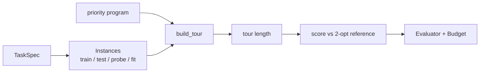

# Codelab 01 - The problem and its objective evaluator

## 1. Goal
Define the single problem every later codelab attacks, and build the fixed evaluator that is the ground truth for all methods.

## 2. RSI concept being demonstrated
Recursive improvement is only meaningful against an evaluator that does not move. Section 09.01 calls this the *protected evaluation*: the improver must not be able to change what counts as better. (Course: Section 09.01, Section 10 'ready when': evaluation and cost.)

## 3. Architecture


## 4. Files involved
- `src/core/problem.py` - instance families, tour construction, 2-opt reference
- `src/core/evaluator.py` - `Budget`, `Evaluator`, `score_expr`
- `codelabs/01_problem_and_evaluator/run.py`

## 5. Algorithm
1. A *task* is a city-layout distribution; instances are generated deterministically from `(task seed, split)`.
2. A candidate is a priority expression. `build_tour` repeatedly visits the unvisited city with the highest priority.
3. `score = -100 x mean(tour / reference - 1)`; the reference is the 2-opt local optimum of the Nearest-Neighbour tour (a strong heuristic, not the true optimum).
4. Every full evaluation costs `n_train` budget units; re-evaluating a known program is free (memoised).

## 6. Step-by-step explanation
1. Load the first training task and look at one instance.
2. Compare the Nearest-Neighbour (NN) tour length with the reference.
3. Score NN over the whole train split.
4. Spend the budget: show the charge, the memoised repeat, and the refusal when the budget is exhausted.

## 7. Important code walkthrough
`problem.build_tour` is the whole 'program execution' - five features per unvisited city, argmax, ties to the lowest index. `Evaluator.evaluate` is the only way agents obtain a score, and it raises `BudgetExceeded` instead of silently overspending. The **test split** is never reachable through `Evaluator`; only reporting code calls `score_expr(..., 'test')`.

## 8. How to run
```bash
python codelabs/01_problem_and_evaluator/run.py
```

## 9. Expected terminal output
Generated by running the codelab (`python scripts/render_docs.py --codelabs`); numbers are deterministic.

<!--OUTPUT-->
```text
task 'uniform': 30 cities, 12 train / 30 test instances
instance 0: NN tour 4.735  2-opt reference 4.614  excess 2.6%
train score of Nearest-Neighbour = -15.15  (score = -100 x mean excess; higher is better)
solved (within 12% of reference): 2/12
after 1 evaluation: used 12 of 24 units
re-evaluating the same program is memoised and free: used 12, cache hits 1
third distinct program refused: need 12.0, only 0.0 left
```
<!--/OUTPUT-->

## 10. What changed from the previous codelab
First codelab - nothing earlier.

## 11. What the result means
The seed program (Nearest-Neighbour) sits roughly 15 points below the 2-opt reference on the training task, so there is real headroom, and only 2 of 12 instances are within 12% of the reference. Budget accounting is exact and enforced.

## 12. Key takeaway
Fix the evaluator first. Every later claim of 'improvement' is a claim about this number at this cost.
