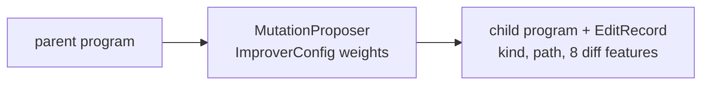

# Codelab 02 - Candidates and the edit proposer

## 1. Goal
Introduce the closed program DSL, the mutation proposer, and the first (weakest) search: random search.

## 2. RSI concept being demonstrated
Bounded self-modification. The agent can only edit expression trees in a whitelisted grammar, so 'self-modification' cannot escape the sandbox. Each edit also carries *diff features* that Budget RSI will later use.

## 3. Architecture


## 4. Files involved
- `src/core/candidate.py` - DSL, parser, `diff_features`, `Candidate`
- `src/agents/proposer.py` - `MutationProposer`, `ImproverConfig`
- `src/agents/llm.py` - optional real-LLM proposer (same interface)
- `src/agents/tree_search.py::random_search`

## 5. Algorithm
1. Programs are trees over 7 operators and 5 features.
2. Six edit kinds: perturb a constant, swap an operator, replace a subtree, add a term, prune, rewrite.
3. `ImproverConfig.edit_weights` sets how often each kind is chosen; `step_sigma` sets constant-perturbation size. These are the knobs SO-RSI will later revise.
4. `diff_features(old, new)` gives 8 numbers describing the edit.

## 6. Step-by-step explanation
1. Print the seed program.
2. Draw five edits and show their kind and diff features.
3. Show that an out-of-grammar string (`__import__...`) is rejected by the parser.
4. Run random search for 60 evaluations.

## 7. Important code walkthrough
`MutationProposer.propose` retries until the edit actually changes the program, caps program size at 25 nodes, and respects `frozen_paths`. The `LLMProposer` produces text that is parsed with the same `cand.parse`, so a model can never inject anything outside the grammar.

## 8. How to run
```bash
python codelabs/02_candidates_and_proposer/run.py
```

## 9. Expected terminal output
Generated by running the codelab (`python scripts/render_docs.py --codelabs`); numbers are deterministic.

<!--OUTPUT-->
```text
seed program (Nearest-Neighbour): sub(0, d_cur)

five edits proposed from the seed (offline MutationProposer, seed 0):
  add_term         sub(sub(0, d_cur), mul(0.64, adiff(d_start, 0.57))) diff features {'added_nodes': 6.0, 'delta_depth': 2.0, 'op_changes': 1.5, 'var_changes': 0.5, 'is_structural': 1.0, 'new_vars': 1.0}
  replace_subtree  sub(0, max(d_cent, d_iso))                       diff features {'added_nodes': 3.0, 'removed_nodes': 1.0, 'delta_depth': 1.0, 'op_changes': 0.5, 'var_changes': 1.5, 'is_structural': 1.0, 'new_vars': 2.0}
  prune            0                                                diff features {'removed_nodes': 2.0, 'delta_depth': -1.0, 'op_changes': 0.5, 'var_changes': 0.5}
  add_term         add(sub(0, d_cur), mul(-0.54, d_cur))            diff features {'added_nodes': 4.0, 'delta_depth': 1.0, 'const_shift': 0.54, 'op_changes': 1.0, 'var_changes': 0.5, 'is_structural': 1.0, 'new_vars': 1.0}
  swap_op          pdiv(0, d_cur)                                   diff features {'added_nodes': 1.0, 'removed_nodes': 1.0, 'op_changes': 1.0}

the DSL is closed: an out-of-grammar program is rejected, not executed
  rejected: unknown token '__import__'

random search, 60 evaluations: best train score -15.15 (seed program -15.15)
a random program of depth 3 looks like: 0.42
```
<!--/OUTPUT-->

## 10. What changed from the previous codelab
Adds the candidate representation and the proposer on top of the evaluator from codelab 01.

## 11. What the result means
Random search does not escape the seed here: random programs are almost always worse than Nearest-Neighbour, so the best score stays at the seed's. Undirected sampling is not a search strategy for this space.

## 12. Key takeaway
The edit surface is small and explicit. That is what makes later 'self-modification' bounded and auditable.
