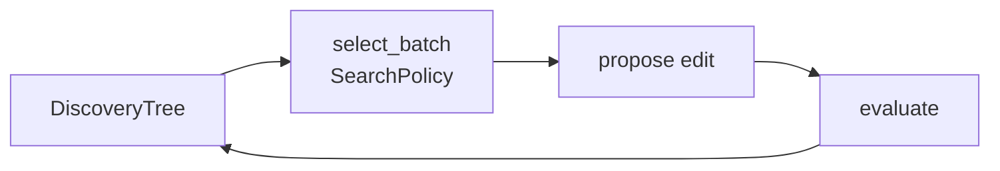

# Codelab 03 - Fixed (non-RSI) search agents

## 1. Goal
Build the feedback-driven baselines every RSI method must beat: hill-climbing, a tree search with a naive policy, and an AIDE-style greedy best-first tree search.

## 2. RSI concept being demonstrated
Rung 3 of the RSI ladder: the evaluator's score steers the next attempt, but the *search procedure itself is fixed*. This is Section 09.02, 'run with a fixed improver'.

## 3. Architecture


## 4. Files involved
- `src/agents/tree_search.py` - `SearchPolicy`, `select_batch`, `run_tree_search`, `hill_climb`
- `src/core/history.py` - `DiscoveryTree`

## 5. Algorithm
Tree search keeps every evaluated node. Each round `select_batch` picks parent(s) by a softmax over score ranks (`temperature`), a bonus for rarely-expanded nodes (`explore_c`), and occasional root restarts (`restart_prob`). `temperature=0` is greedy best-first - the AIDE-style policy. Hill-climbing always edits the incumbent.

## 6. Step-by-step explanation
1. Run three agents for 60 evaluations on 5 seeds.
2. Report best train score, the hidden-test score of the best program, tree size, and how many edits improved their parent.

## 7. Important code walkthrough
`SearchPolicy` is a frozen dataclass with `clamp()`; the same `select_batch` function is used online and, later, inside Dream-RSI's replay, so a policy behaves identically in both.

## 8. How to run
```bash
python codelabs/03_baseline_search_agents/run.py
```

## 9. Expected terminal output
Generated by running the codelab (`python scripts/render_docs.py --codelabs`); numbers are deterministic.

<!--OUTPUT-->
```text
agent                            best train    test  nodes  improving edits
hill-climb (1+1)                      -7.07  -10.00     65                3
tree search, naive policy             -7.21   -9.26     62                9
AIDE-style (greedy best-first)        -7.39  -10.60     61                2

(mean of 5 seeds, 60 evaluations each; the seed program scores -15.15 on train)
Every attempt is stored in a DiscoveryTree - that trajectory is the raw material for codelabs 04-07.
```
<!--/OUTPUT-->

## 10. What changed from the previous codelab
Adds search over edits (codelab 02 only sampled independent programs) and the `DiscoveryTree` that records every attempt.

## 11. What the result means
All three feedback-driven agents reach far better programs than random search, but their test scores are noticeably worse than their train scores: some of the improvement is fitting 12 training instances. Only a handful of edits per run actually improve the parent.

## 12. Key takeaway
Most edits fail. A search procedure that wastes fewer evaluations on failures is exactly what the RSI methods try to learn.
