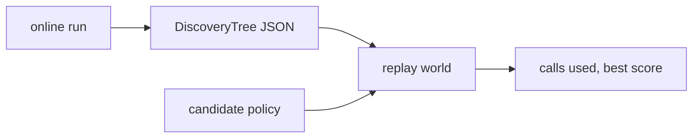

# Codelab 04 - Memory: trajectories and replay

## 1. Goal
Persist the discovery history and show the primitive Dream-RSI is built on: replaying a different policy against recorded outcomes at zero evaluator cost.

## 2. RSI concept being demonstrated
Memory/trajectory collection. A completed search is a *dataset of decisions and their realised outcomes*. Replaying alternative policies on it is free, but limited to what was recorded (Dream-RSI's stated limitation).

## 3. Architecture


## 4. Files involved
- `src/core/history.py` - save / load / lineage
- `src/methods/dream_rsi/replay.py::replay`

## 5. Algorithm
Replay starts with only the root revealed. Each round the candidate policy picks nodes among those revealed that still have unrevealed recorded children; expanding one reveals its next recorded child. Nothing is generated or evaluated. It stops when nothing is eligible, patience runs out, or the tree is exhausted.

## 6. Step-by-step explanation
1. Run an online search and save the tree to JSON, reload it.
2. Replay three policies on the loaded tree.
3. Note the last line: a patient stop rule can quit before the recorded improvement.

## 7. Important code walkthrough
`replay()` builds a lightweight view (`Candidate` copies with empty `children`) and calls the same `select_batch` as the online search. `calls` counts revealed children, which equals the evaluator calls the policy would have used.

## 8. How to run
```bash
python codelabs/04_memory_and_trajectories/run.py
```

## 9. Expected terminal output
Generated by running the codelab (`python scripts/render_docs.py --codelabs`); numbers are deterministic.

<!--OUTPUT-->
```text
online run on 'clusters': 61 evaluator calls, best -13.42, 720 units
saved + reloaded: 62 nodes, best lineage [0, 20]

replay = re-run a *different* policy against the recorded outcomes, with ZERO new evaluations
  naive (temp 2.0)                       reveals  61 recorded calls -> best -13.42
  greedy (temp 0)                        reveals  61 recorded calls -> best -13.42
  greedy + stops after 3 stale rounds    reveals   5 recorded calls -> best -15.31

Limit: a replayed policy can only reach outcomes that were recorded (it never sees unexplored children).
```
<!--/OUTPUT-->

## 10. What changed from the previous codelab
Adds persistence and replay on top of the trees produced in codelab 03.

## 11. What the result means
Replaying a never-stopping policy reveals the whole recorded tree; a policy that stops after three stale rounds uses only a handful of recorded calls and, on this tree, quits before finding anything - quality *and* cost are both visible from one recording.

## 12. Key takeaway
History is not just a log: it is a free simulator of alternative search policies, as far as its coverage reaches.
