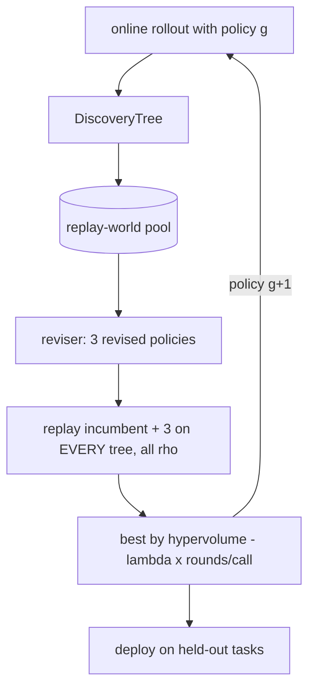

# Codelab 05 - Method 1: Dream-RSI

## 1. Goal
Implement Dream-RSI's loop: explore online, record trees, dream (replay candidate policies), deploy the best policy, repeat - then use the improved policy on tasks it was never adapted to.

## 2. RSI concept being demonstrated
**Search-policy optimisation.** The *harness's exploration policy* improves; the proposer (our stand-in for the foundation model), evaluator and DSL are frozen. Paper: [arXiv 2609.14858](https://arxiv.org/abs/2609.14858). This is a minimal reproduction of the central mechanism, not the paper's system.

## 3. Architecture


## 4. Files involved
- `src/methods/dream_rsi/dream_rsi.py` - generation loop, `dream_step`
- `src/methods/dream_rsi/replay.py` - `replay`, `policy_replay_score`
- `src/methods/dream_rsi/reviser.py` - `history_stats`, `propose_revisions`
- `src/core/metrics.py::frontier_hypervolume`

## 5. Algorithm
1. Generation *g*: roll out tree search with the current policy on training task *g*; append the tree to history.
2. Reviser reads history statistics (where improvements came from, stall lengths) and produces 3 revised policies (evidence-following, +stopping/parallelism, seeded jitter).
3. Replay the 4 candidates (incumbent included) on every tree at budget preferences rho in {0,.25,.5,.75,1}. Each replay gives a point (fraction of calls, normalised quality gain); score = hypervolume of those points - lambda x mean(rounds per call).
4. Highest score wins; ties keep the incumbent. Repeat; finally deploy on held-out tasks.

## 6. Step-by-step explanation
1. Run Dream-RSI for one seed.
2. For each generation print the four candidate policies with their replay scores and which was selected.
3. Print the final policy, the adaptation cost, and the deployment results.

## 7. Important code walkthrough
`dream_step` always puts the incumbent at index 0 and uses `np.argmax` (first maximum), so selection cannot lower mean replay score. A test asserts this. `policy_replay_score` skips worlds with no discovered improvement (no signal). The reviser is **rule-based** - the paper uses an LLM agent that rewrites policy code.

## 8. How to run
```bash
python codelabs/05_dream_rsi/run.py
```

## 9. Expected terminal output
Generated by running the codelab (`python scripts/render_docs.py --codelabs`); numbers are deterministic.

<!--OUTPUT-->
```text
initial policy : {'temperature': 2.0, 'explore_c': 0.0, 'restart_prob': 0.1, 'batch': 1, 'max_children': 50, 'patience': 1000.0}

generation 0 (online rollout on 'uniform': best -7.44, 59 calls)
  incumbent  temp=2.00 explore=0.00 restart=0.10 batch=1 patience=1000  replay score -0.050
  revision 1 temp=1.00 explore=0.00 restart=0.10 batch=1 patience=1000  replay score -0.050
  revision 2 temp=1.00 explore=0.00 restart=0.10 batch=2 patience=25  replay score +0.491  <== selected
  revision 3 temp=1.24 explore=0.20 restart=0.10 batch=4 patience=50  replay score -0.001

generation 1 (online rollout on 'clusters': best -13.19, 61 calls)
  incumbent  temp=1.00 explore=0.00 restart=0.10 batch=2 patience=25  replay score +0.241  <== selected
  revision 1 temp=0.50 explore=0.00 restart=0.10 batch=2 patience=25  replay score +0.206
  revision 2 temp=0.50 explore=0.00 restart=0.10 batch=4 patience=29  replay score +0.226
  revision 3 temp=0.82 explore=0.08 restart=0.07 batch=1 patience=13  replay score +0.144

generation 2 (online rollout on 'ring': best -4.04, 63 calls)
  incumbent  temp=1.00 explore=0.00 restart=0.10 batch=2 patience=25  replay score +0.164
  revision 1 temp=0.50 explore=0.00 restart=0.10 batch=2 patience=25  replay score +0.126
  revision 2 temp=0.50 explore=0.00 restart=0.10 batch=4 patience=34  replay score +0.165  <== selected
  revision 3 temp=0.77 explore=0.03 restart=0.19 batch=4 patience=32  replay score +0.141

final policy   : {'temperature': 0.5, 'explore_c': 0.0, 'restart_prob': 0.1, 'batch': 4, 'max_children': 50, 'patience': 33.72}
adaptation cost: 2160 units (online rollouts only; every replay was free)
deployed on held-out 'clusters_tight': best train -9.73 using 720 of 720 units
deployed on held-out 'grid_jitter': best train -10.36 using 720 of 720 units
```
<!--/OUTPUT-->

## 10. What changed from the previous codelab
Adds the first *self-improving* loop: codelab 04's replay is now used to choose between policies, and the chosen policy is inherited by the next rollout.

## 11. What the result means
Offline replay does pick different policies (here, a batched policy with an early-stopping rule wins generation 0), and all replays cost zero evaluator calls: only the 3 online rollouts are paid for. Whether the selected policy is *better* is a separate question answered by codelab 08 and the full experiment - and there the answer for this toy is no.

## 12. Key takeaway
The thing that improved is the search policy, not the proposer. Replay makes that improvement cheap to *evaluate* - but it can only judge policies against what was recorded.
