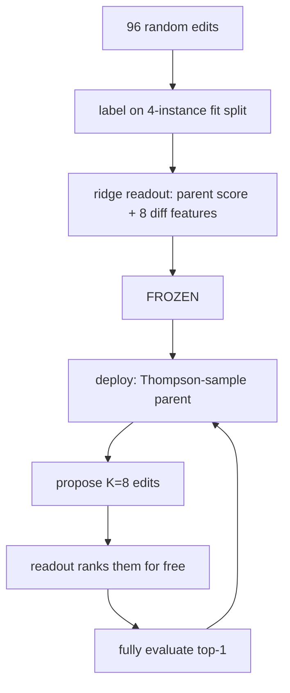

# Codelab 06 - Method 2: Budget RSI

## 1. Goal
Implement Budget RSI's mechanism: predict an edit's value from cheap diff features *before* spending a full evaluation, with a readout fitted once and then frozen.

## 2. RSI concept being demonstrated
**Scoring before running.** The changed object is the edit-*selection* scorer. Paper: [arXiv 2610.29121](https://arxiv.org/abs/2610.29121) (Section 10 labs 10.03-10.05). Reported there: held-out HumanEval+ 87.0% vs 84.2% for the parent-rate-only ablation; **not** reproduced here.

## 3. Architecture


## 4. Files involved
- `src/methods/budget_rsi/budget_rsi.py` - labelling, Thompson sampling, deployment search
- `src/methods/budget_rsi/readout.py` - features, ridge fit, Spearman

## 5. Algorithm
1. Collect 96 labelled edits across the training tasks; label = max(child - parent fit-score, 0), clipped at 5.
2. Fit ridge regression on `[1, parent_score/10, 8 diff features]`. Check rank correlation on a held-out 20% of labels. Refit on all and freeze.
3. Deployment: Thompson-sample a parent from Beta(1 + solved, 1 + unsolved), generate K=8 proposals, rank by predicted gain, evaluate only the best.
4. Ablations: `parent_only` (diff features zeroed, the paper's own ablation), `no_screen` (K=1).

## 6. Step-by-step explanation
1. Collect and cost the labelled edits.
2. Fit on 80%, report held-out Spearman.
3. Print the frozen weights.
4. Compare full / parent-only / no-screen deployments on 5 seeds.

## 7. Important code walkthrough
The label is `max(gain, 0)` on purpose: a search keeps the best child, so *expected improvement* matters, not expected change. Using the signed gain made the scorer prefer harmless no-op edits and hurt deployment in our first attempt (disclosed in `docs/methodology.md`). The readout is never refit at deployment time.

## 8. How to run
```bash
python codelabs/06_budget_rsi/run.py
```

## 9. Expected terminal output
Generated by running the codelab (`python scripts/render_docs.py --codelabs`); numbers are deterministic.

<!--OUTPUT-->
```text
labelled 96 edits on a 4-instance fit split: cost 396 units (= 33 full evaluations); 7% of edits improved their parent
readout fitted on 80%, Spearman rank-correlation with held-out labels: +0.02

frozen readout weights (predicts expected improvement of an edit):
  bias          +0.022
  parent_score  -0.227
  added_nodes   +0.163
  removed_nodes +0.012
  delta_depth   +0.023
  const_shift   -0.291
  op_changes    -0.351
  var_changes   -0.199
  is_structural +0.486
  new_vars      -0.142

deployment (same 60-evaluation budget on each held-out task), mean of 5 seeds:
  full         best train score -7.19
  parent_only  best train score -9.10
  no_screen    best train score -7.77
```
<!--/OUTPUT-->

## 10. What changed from the previous codelab
Adds learning from labelled edit history to *choose* edits, where codelab 05 learned a policy for *which node* to expand.

## 11. What the result means
Only a small share of random edits improve their parent, and the readout's rank correlation with held-out labels is weak (about zero on average across the 30 seeds of the full experiment), so any benefit of screening must be read with care. In the full experiment most of Budget RSI's advantage over the fixed tree comes from its Thompson-sampled parent selection, with screening adding a small, borderline-significant increment.

## 12. Key takeaway
Cheap proxy scoring changes how a fixed budget is spent. Its value depends on how predictive the proxy actually is - measure that, don't assume it.
