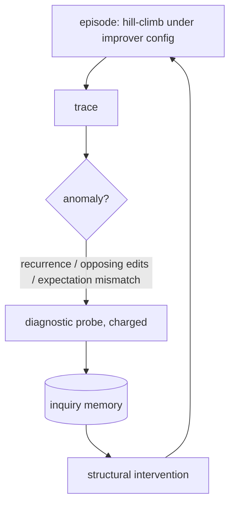

# Codelab 07 - Method 3: SO-RSI

## 1. Goal
Implement second-order RSI: detect structural anomalies in an episode's trace, run diagnostic probes to learn *why*, record the finding, and apply a targeted structural intervention to the improver.

## 2. RSI concept being demonstrated
**Diagnose before patching.** The changed object is the improver's edit procedure (`ImproverConfig`). Paper: [arXiv 2610.05701](https://arxiv.org/abs/2610.05701) (labs 10.06-10.08); reported +21.8/+25.8 held-out points on Lean 4 / Verus is **not** reproduced here. First-order RSI (the contrast) only follows symptoms.

## 3. Architecture


## 4. Files involved
- `src/methods/so_rsi/so_rsi.py` - episodes, probes, interventions, naive baseline
- `src/methods/so_rsi/anomalies.py` - three detectors
- `src/methods/so_rsi/memory.py` - `InquiryMemory`

## 5. Algorithm
Detectors: **recurrence** (an edit kind tried >= 8 times, never improved); **opposing edits** (two accepted edits at one path with reversed effect); **expectation mismatch** (train gain not reproduced on fresh validation instances). Probes: constant-sensitivity or edit-kind neutrality; a noise check for opposing edits. Interventions: demote a dead kind / promote structural kinds, halve the step size, or require validation before accepting an edit. Naive RSI instead re-weights edit kinds by last success rates.

## 6. Step-by-step explanation
1. Run SO-RSI for one seed and print each episode with its anomalies, verdicts and interventions.
2. Show the inquiry-memory size and final improver state.
3. Compare naive RSI and SO-RSI on 5 seeds.

## 7. Important code walkthrough
Interventions only touch `ImproverConfig` / `validate` - the *restricted mutation surface*. Memory is consulted before probing, so a previously diagnosed anomaly is not re-probed (saving budget). Probe costs are charged to the same `Budget` as evaluations.

## 8. How to run
```bash
python codelabs/07_so_rsi/run.py
```

## 9. Expected terminal output
Generated by running the codelab (`python scripts/render_docs.py --codelabs`); numbers are deterministic.

<!--OUTPUT-->
```text
episode  task      best     anomalies -> diagnosis -> intervention
      0  uniform   -15.15   -
      1  uniform    -5.79   recurrence/perturb_const -> step_too_large -> halve step_sigma
      2  clusters  -13.77   expectation_mismatch/train_vs_validation -> overfit_to_train -> require validation-split agreement before accepting edits
      3  clusters  -14.01   expectation_mismatch/train_vs_validation -> overfit_to_train -> require validation-split agreement before accepting edits
      4  clusters  -13.92   -
      5  ring       -5.41   -
      6  ring       -4.48   -
      7  ring       -5.41   -

inquiry memory entries: 3 | validation required at deployment: True
final edit weights: {'perturb_const': 3.0, 'swap_op': 2.0, 'replace_subtree': 2.0, 'add_term': 2.0, 'prune': 1.0, 'rewrite': 1.0}

deployment, mean of 5 seeds (60 evaluations per held-out task):
  naive_rsi  best train score -7.31
  so_rsi     best train score -7.87
```
<!--/OUTPUT-->

## 10. What changed from the previous codelab
Where codelab 05 changed the policy and 06 the scorer, this changes the *improver*: the loop that decides how edits are produced.

## 11. What the result means
The diagnoses are mechanically sensible (e.g. a recurring failing constant-tweak is diagnosed as a step-size problem). Whether they translate into better deployment is measured in codelab 08/09 - in the full experiment they do not beat the first-order version.

## 12. Key takeaway
A diagnosis is only valuable if the intervention it licenses pays for the probes. Here that was not established.
