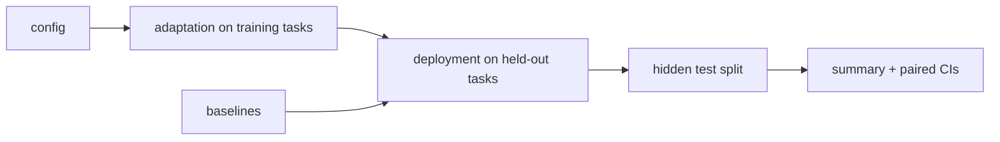

# Codelab 08 - Controlled comparison

## 1. Goal
Run every method on one shared protocol with equal deployment budgets, identical seeds and tasks, and report paired differences with the cost of adaptation separated out.

## 2. RSI concept being demonstrated
Section 09.05 (fair comparison under matched cost) and Section 10.01-10.02 (claim vs evidence): a headline number is not a claim until protocol, controls and limits are stated.

## 3. Architecture


## 4. Files involved
- `src/benchmarks/protocol.py` - runner, summaries, paired statistics
- `src/benchmarks/baselines.py`
- `experiments/configs/smoke.json`

## 5. Algorithm
For each method and seed: (RSI methods) adapt on the three training tasks, then run on each held-out task with an equal budget; baselines run deployment only. Score the best-train program once on the hidden test split. Compare paired by (seed, task). Budget-matched baselines receive the RSI adaptation allowance as extra deployment evaluations.

## 6. Step-by-step explanation
1. Load the tiny `smoke` config (2 seeds, 20 evals).
2. Run all ten methods in parallel.
3. Print the summary table and paired differences vs the fixed tree search.

## 7. Important code walkthrough
`protocol.to_rows` is the only place the test split is read. Tests assert every method respects the deployment budget cap. **This codelab uses the smoke config, so its numbers are noisy** - use it to see the machinery, not to draw conclusions; conclusions come from codelab 10's 30-seed run.

## 8. How to run
```bash
python codelabs/08_controlled_comparison/run.py
```

## 9. Expected terminal output
Generated by running the codelab (`python scripts/render_docs.py --codelabs`); numbers are deterministic.

<!--OUTPUT-->
```text
config 'smoke': seeds [0, 1], 20 adaptation evals/train task, 20 deploy evals/held-out task
train tasks ['uniform', 'clusters', 'ring']  held-out ['clusters_tight', 'grid_jitter']

Method              Initial   Final  Improvement  Success  Adapt units  Deploy units  Time (s)
------------------  -------  ------  -----------  -------  -----------  ------------  --------
initial              -13.10  -13.10        +0.00       0%            0             6      0.03
random_search        -13.10  -13.10        +0.00       0%            0           120      0.15
hill_climb           -13.10   -9.78        +3.32      50%            0           120      0.14
aide_style           -13.10  -11.95        +1.15      25%            0           120      0.16
fixed_tree           -13.10   -6.75        +6.35      75%            0           120      0.11
hill_climb_matched   -13.10   -6.41        +6.69      50%            0           300      0.30
fixed_tree_matched   -13.10   -5.27        +7.83     100%            0           300      0.29
dream_rsi            -13.10   -9.46        +3.64      75%          360           120      0.37
budget_rsi           -13.10   -8.66        +4.44      75%          108           120      0.25
so_rsi               -13.10   -5.69        +7.41      75%          309           118      0.20

paired difference vs fixed tree search (same seed & task):
  dream_rsi  -2.71  95% CI [-6.26, +0.84]
  budget_rsi -1.91  95% CI [-4.77, +2.03]
  so_rsi     +1.06  95% CI [-4.88, +7.00]

Fairness checks: equal deployment budget, identical seeds/tasks/initial program; RSI adaptation cost is reported separately,
and *_matched baselines receive that adaptation budget as extra deployment evaluations.
```
<!--/OUTPUT-->

## 10. What changed from the previous codelab
Moves from running methods one at a time to one shared runner and paired statistics.

## 11. What the result means
Even with two seeds the machinery shows why paired, budget-aware comparison matters: some methods that look good on raw score cost far more total budget, and the ranking changes if you add the baselines' matched-budget controls.

## 12. Key takeaway
State the protocol before the result. Most apparent RSI gains disappear under matched budget or against a stronger fixed baseline.
