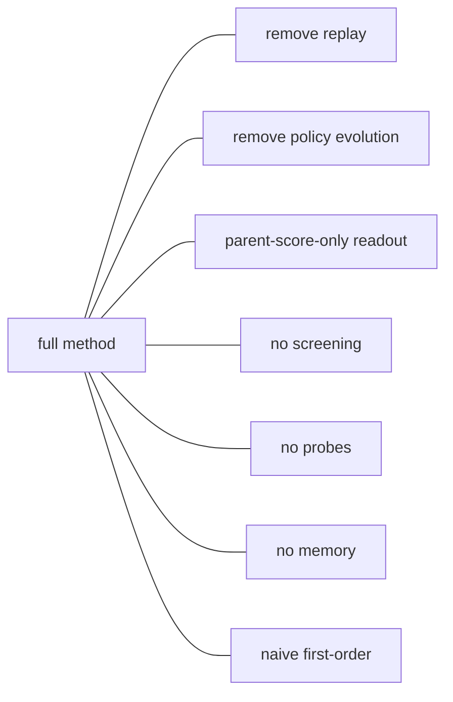

# Codelab 09 - Ablations and failure analysis

## 1. Goal
Remove each method's distinctive component and see what breaks; catalogue where self-improvement does not help.

## 2. RSI concept being demonstrated
Section 10's 'what each paper actually tested': an ablation isolates the mechanism from the headline.

## 3. Architecture


## 4. Files involved
- `src/benchmarks/protocol.py::ABLATIONS`
- `experiments/results/default/runs.json` (produced by `make compare`)

## 5. Algorithm
Each ablation is a flag on the method (`use_replay`, `evolve`, `variant`). They run on the same seeds and held-out tasks as the full methods; differences are paired.

## 6. Step-by-step explanation
1. Load the saved full-experiment rows.
2. Print each ablation's score and its paired difference from the full method.
3. Count runs with no meaningful gain and runs where the discovered program is worse than the initial solution on the hidden test split.

## 7. Important code walkthrough
Ablation names map one-to-one to the paper's own ablations where they exist (`budget_parent_only` is Budget RSI's parent-rate-only ablation). Failure analysis counts `improvement < 1.0` and `final_test < initial_test`.

## 8. How to run
```bash
python codelabs/09_ablations_and_failures/run.py
```

> Requires the saved full experiment: run `python -m src.cli compare --ablations` first (the repository ships those results).

## 9. Expected terminal output
Generated by running the codelab (`python scripts/render_docs.py --codelabs`); numbers are deterministic.

<!--OUTPUT-->
```text
variant                final test  vs full method
dream_rsi                   -8.41
  - dream_no_replay         -8.27     +0.14 [-0.95,+1.25]
  - dream_no_evolution      -7.77     +0.64 [-0.54,+1.91]
budget_rsi                  -6.24
  - budget_parent_only      -7.11     -0.87 [-1.78,+0.07]
  - budget_no_screen        -6.96     -0.72 [-1.51,+0.04]
so_rsi                      -7.18
  - naive_rsi               -6.36     +0.82 [-0.08,+1.71]
  - so_no_probes            -6.49     +0.69 [+0.02,+1.47]
  - so_no_memory            -6.78     +0.40 [-0.24,+1.09]

Failure analysis: runs where the discovered program did NOT beat the initial solution on the hidden test split
  dream_rsi   no meaningful gain in 24/60 runs; test score WORSE than initial in 9/60 (train/test gap)
  budget_rsi  no meaningful gain in 7/60 runs; test score WORSE than initial in 6/60 (train/test gap)
  so_rsi      no meaningful gain in 13/60 runs; test score WORSE than initial in 8/60 (train/test gap)
  fixed_tree  no meaningful gain in 20/60 runs; test score WORSE than initial in 14/60 (train/test gap)
```
<!--/OUTPUT-->

## 10. What changed from the previous codelab
Re-uses the full 30-seed experiment; adds the component-level and failure view.

## 11. What the result means
Removing Dream-RSI's replay or evolution changes nothing detectable; removing Budget RSI's screening costs about 0.7-0.9 points (borderline); removing SO-RSI's probes or reverting to first-order RSI *improves* results. Every method, including the fixed baselines, sometimes produces programs that are worse than the seed on unseen instances.

## 12. Key takeaway
An ablation that does not hurt is evidence the component is not doing the work claimed.
