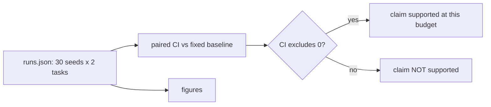

# Codelab 10 - Full experiment, bounded generations, and the claim

## 1. Goal
Produce the final figures and state, per method, what the experiment does and does not support, with explicit bounds on recursion.

## 2. RSI concept being demonstrated
Section 09.06 (bounded generations with a stopping rule) and 09.07 (state the claim with its limits): objects changed, comparison made, untested assumptions.

## 3. Architecture


## 4. Files involved
- `src/visualization/plots.py`
- `experiments/configs/default.json`
- `artifacts/figures/`

## 5. Algorithm
Recursion is bounded by construction: three adaptation generations (one per training task), each with a hard evaluation cap. The claim 'better than fixed search at equal deployment budget' is supported only if the 95% bootstrap CI of the paired difference excludes 0.

## 6. Step-by-step explanation
1. (optional `--rerun`) re-run the entire default experiment.
2. Print the claim verdict for each RSI method.
3. Regenerate all figures.

## 7. Important code walkthrough
The verdict line is deliberately mechanical so it cannot be talked around. Figures read the same `runs.json`/`method_logs.json` that the README tables are generated from.

## 8. How to run
```bash
python codelabs/10_full_experiment/run.py
```

Re-run everything (about 4 minutes on 8 cores): `python codelabs/10_full_experiment/run.py --rerun`.

## 9. Expected terminal output
Generated by running the codelab (`python scripts/render_docs.py --codelabs`); numbers are deterministic.

<!--OUTPUT-->
```text
Bounded recursion: 3 adaptation generations (one per training task), hard cap 60 evals each; no method may run more.

dream_rsi: final -8.41 vs fixed tree: -0.24 [-1.39,+0.97] over 60 paired runs -> 'better than fixed search at equal deployment budget' NOT supported (CI includes 0)

budget_rsi: final -6.24 vs fixed tree: +1.94 [+0.89,+2.94] over 60 paired runs -> 'better than fixed search at equal deployment budget' supported

so_rsi: final -7.18 vs fixed tree: +0.99 [-0.06,+2.06] over 60 paired runs -> 'better than fixed search at equal deployment budget' NOT supported (CI includes 0)

figures:
  artifacts/figures/anytime_curves.png
  artifacts/figures/final_comparison.png
  artifacts/figures/improvement_over_baseline.png
  artifacts/figures/compute_quality.png
  artifacts/figures/dream_policy_evolution.png
  artifacts/figures/budget_rsi_readout.png
  artifacts/figures/so_rsi_inquiry.png
  artifacts/figures/ablations.png
  artifacts/figures/lineage_and_solution.png
```
<!--/OUTPUT-->

## 10. What changed from the previous codelab
Closes the loop: the claim is made from the full experiment rather than the smoke config of codelab 08.

## 11. What the result means
At equal deployment budget only Budget RSI is supported against the fixed tree search. None of the three beats the best fixed alternatives (AIDE-style greedy search, or the fixed tree given 2.5x the budget) with confidence.

## 12. Key takeaway
The claim this repository can defend is narrow: Budget RSI-style pre-screening gave a modest, cheap gain over a naive fixed search; Dream-RSI and SO-RSI, as minimally reproduced here, did not show a benefit; and a good fixed policy is a stronger baseline than any of them.
