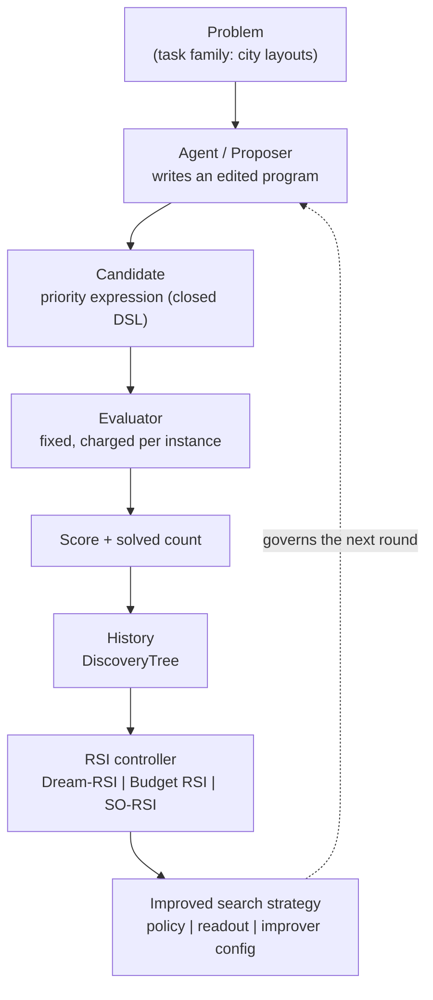
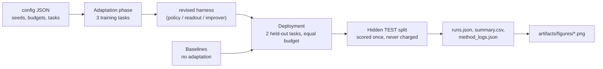

# Architecture

## Unified loop

The evaluator, the DSL and the proposer's mutation operators never change. Only the object on the dashed arrow changes.

## Module map

| Path | Responsibility |
|---|---|
| `src/core/problem.py` | Instance families, tour construction, 2-opt reference, Nearest-Neighbour seed |
| `src/core/candidate.py` | Closed expression DSL, parser, edit-diff features, `Candidate` node |
| `src/core/evaluator.py` | `Budget`, `Evaluator` (charged, memoised), uncharged `score_expr` for reporting |
| `src/core/history.py` | `DiscoveryTree`: lineage, best-so-far curve, JSON persistence |
| `src/core/metrics.py` | Curve resampling, cost-to-reach, frontier hypervolume, bootstrap CI |
| `src/core/config.py` | `ExperimentConfig` (JSON in `experiments/configs/`) |
| `src/agents/proposer.py` | `MutationProposer` (offline, seeded) and `ImproverConfig` (the bounded tunable surface) |
| `src/agents/llm.py` | Optional real-LLM proposer; fails loudly without credentials |
| `src/agents/tree_search.py` | `SearchPolicy`, shared `select_batch`, tree search, hill-climb, random search |
| `src/methods/dream_rsi/` | replay worlds, policy reviser, generation loop |
| `src/methods/budget_rsi/` | labelled-edit collection, ridge readout, Thompson-sampled deployment |
| `src/methods/so_rsi/` | anomaly detectors, probes, inquiry memory, naive/SO loops |
| `src/benchmarks/` | baselines and the shared protocol (runner, summaries, paired statistics) |
| `src/visualization/plots.py` | all figures |
| `src/cli.py` | `baseline`, `run`, `compare`, `ablate`, `visualize`, `demo`, `llm-check` |

## Experimental pipeline

## Data flow details

* **Budget unit** = one instance-evaluation (building one tour for one instance). A full train evaluation costs `n_train` = 12 units; cheap probes and fit-split labels are charged at their true instance count, so all methods share one currency.
* **Three splits per task:** `train` (what agents optimise), `fit`/`probe` (small charged splits used by Budget RSI and SO-RSI), `test` (reporting only; *no agent code path reads it*).
* **Memoisation:** re-evaluating an identical program is free for every method, which is a property of the shared evaluator.
* **Determinism:** instance generation is keyed by `(task seed, split)`; every method run is keyed by `(seed, method-specific stream)`. Runs are order-independent and reproducible in parallel.

## Method loops

```mermaid
flowchart TD
    subgraph Dream["Dream-RSI"]
      d1["online rollout<br/>(policy_g)"] --> d2["record DiscoveryTree"] --> d3["replay-world pool"]
      d3 --> d4["policy reviser: 3 revisions"] --> d5["replay all 4 versions on every tree<br/>score = hypervolume - λ·rounds/call"]
      d5 --> d6["best version = policy_g+1"] --> d1
    end
    subgraph Budget["Budget RSI"]
      b1["label ~96 edits on fit split"] --> b2["fit + FREEZE ridge readout"]
      b2 --> b3["deploy: Thompson-sample parent"] --> b4["propose K edits"] --> b5["readout ranks them<br/>(free)"] --> b6["fully evaluate top-1"] --> b3
    end
    subgraph SO["SO-RSI"]
      s1["episode of hill-climbing<br/>under improver config"] --> s2["detect anomalies in trace"]
      s2 --> s3["diagnostic probes<br/>(cheap, charged)"] --> s4["inquiry memory"] --> s5["structural intervention<br/>on improver config"] --> s1
    end
```

