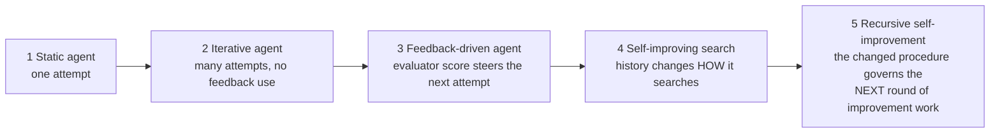

# RSI primer: from a static agent to recursive self-improvement

All examples use this repository's problem: discovering a greedy *priority program* for the Euclidean TSP.

## 1. Five rungs

| Rung | What it does | In this repo |
|---|---|---|
| Static | Produces one program. | The seed: Nearest-Neighbour, `sub(0, d_cur)` ([codelab 01](../codelabs/01_problem_and_evaluator/README.md)) |
| Iterative | Samples many programs and keeps the best; ignores what happened. | `random_search` ([codelab 02](../codelabs/02_candidates_and_proposer/README.md)) |
| Feedback-driven | Each new attempt is an edit of a previously *scored* program. | `hill_climb`, tree search ([codelab 03](../codelabs/03_baseline_search_agents/README.md)) |
| Self-improving search | Records its trajectory and uses it to change the search procedure. | Dream-RSI, Budget RSI, SO-RSI ([codelabs 05–07](../codelabs/05_dream_rsi/README.md)) |
| Recursive | The revised procedure is inherited and used to produce the next improvement. | Generations of adaptation: policy / readout / improver config passed forward, then deployed on unseen tasks |

Rungs 3 and 4 are the usual confusion. A hill-climber improves *the program*. A self-improving search improves *the thing that improves programs*.

## 2. Distinguishing nearby ideas

| Idea | What changes | Example | Is it RSI? |
|---|---|---|---|
| Model self-improvement | Model weights (RL, self-distillation) | training on own successful traces | Only if the improver is itself retrained; **not touched here** |
| Prompt optimisation | The instruction text given to a fixed model | rewriting a system prompt using scores | Weak: a single-level search over prompts |
| Agent optimisation | The agent's tools, memory, control flow | editing the scaffold | Possibly, if the edit rule is itself revised |
| Search-policy optimisation | How attempts are selected/stopped/parallelised | **Dream-RSI** | Yes: the policy governs the next search |
| Harness optimisation | The evaluation/steering code around the model | **Budget RSI** (edit scorer), **SO-RSI** (edit procedure) | Yes, when inherited by later rounds |
| Recursive improvement | The improver is revised and the revision is used to improve the next improver | course Section 09 (`I0 → I1`) | The target concept |

Section 09 of the course names three objects: the **task model** (here, the proposer), the **research skill** (the search procedure), and
the **improver** (what revises the research skill). In this repository the proposer, evaluator and DSL are *frozen* in every experiment. What changes:

| Method | Revised object |
|---|---|
| Dream-RSI | research skill: `SearchPolicy` parameters |
| Budget RSI | the improver's selection component: a linear readout over edit features |
| SO-RSI | the improver: `ImproverConfig` (edit-kind weights, step size, validation rule) |

## 3. What a valid recursive claim needs

1. **Which object changed**, and which stayed fixed.
2. **A fixed-improver baseline** run under the same budget.
3. **A fair comparison** – matched evaluation cost, including the cost of *producing* the revision.
4. **Evidence on unseen tasks** – adaptation on training tasks, claims on held-out tasks.
5. **Bounded generations** – a hard limit and a stopping rule.
6. **An honest limit statement** – what was and was not tested.

Every experiment here follows these rules ([methodology.md](methodology.md)). Better *answers* from a fixed procedure are not evidence of recursion;
better *procedures* that survive a fair comparison are.
